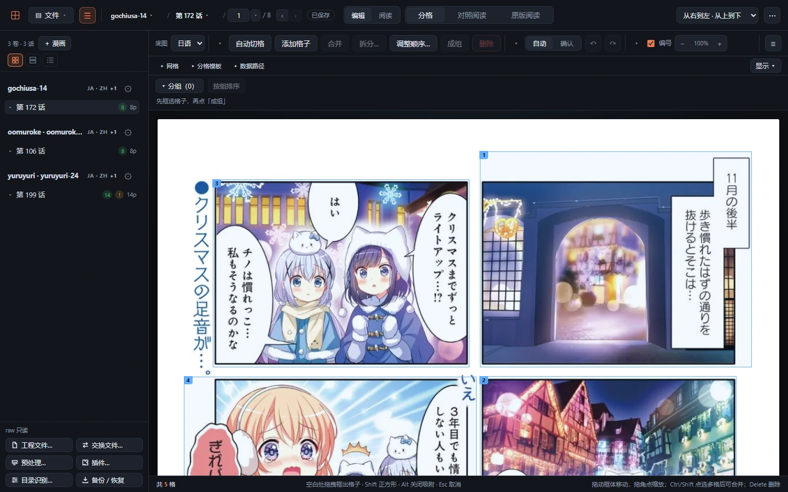
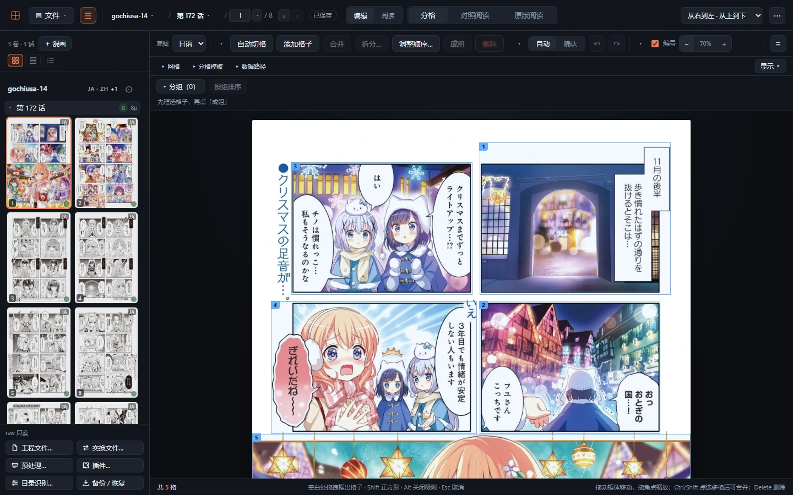
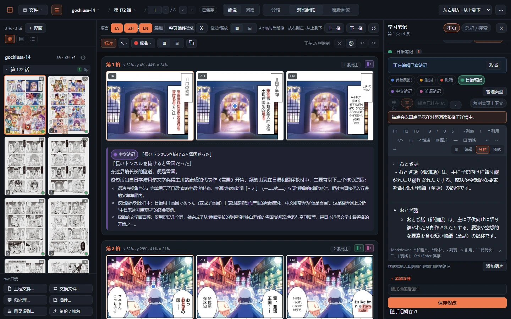
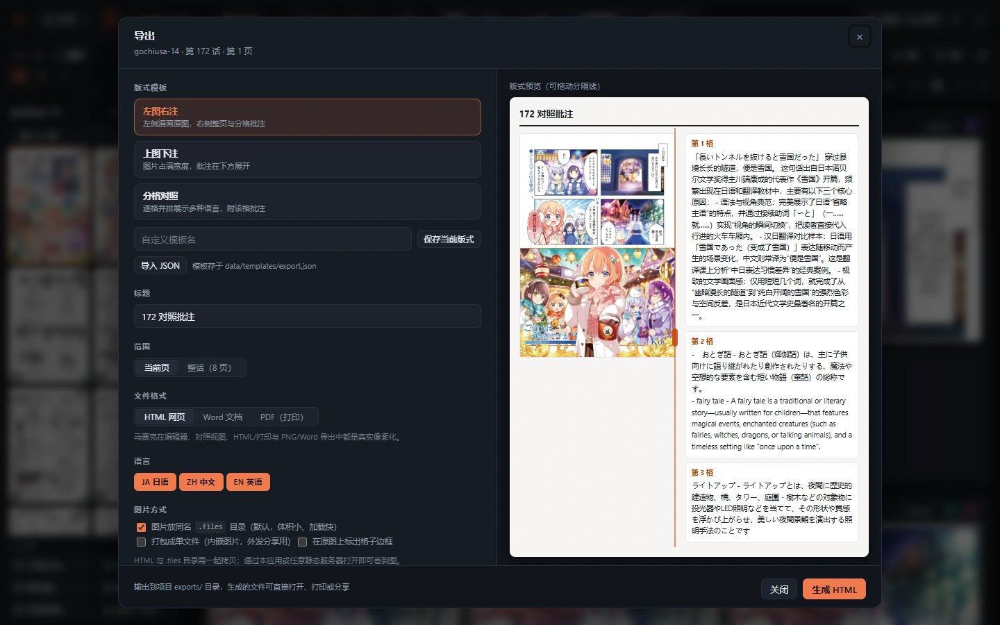
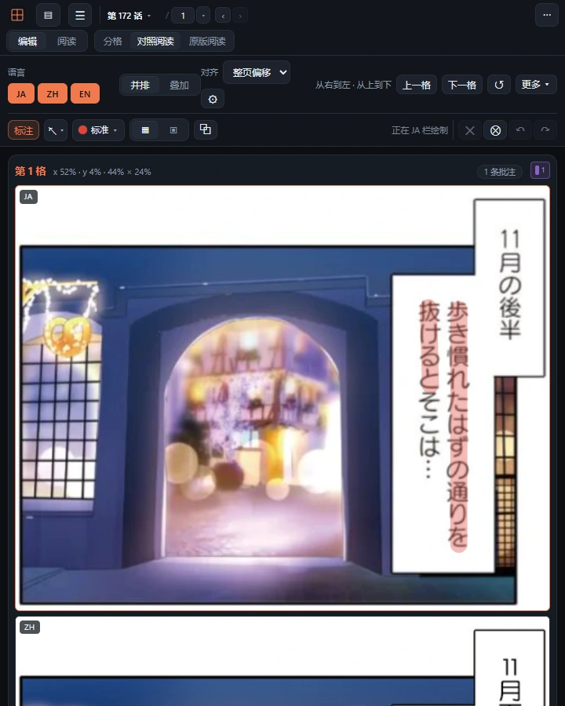

# KomaYomi（格读）

**ローカル優先、コマ単位の漫画精読。**

**日本語はすべて漫画から学んだ~**

[English](README.md) · [日本語](README.ja.md) · [简体中文](README.zh-CN.md)

作者ページ：[X · @payayakamo](https://x.com/payayakamo) · [note · @payayakamo](https://note.com/payayakamo)。どちらも作者個人のページで、製品サイトではありません。KomaYomi に専用の製品サイトはありません。

漫画で語学を学ぼうとすると、たいてい窓が三つ必要です。原作、翻訳、辞書。さらにノートアプリを開き、書きたい一文の位置はだいたいずれています。KomaYomi（**格读**：Koma＝コマ、Yomi＝読み）は、同じページの日本語・中国語・英語を一つの窓に並べ、まずコマに分け、Markdown ノートと注釈を絵のその場所に貼れるようにします。作業の単位はページではなくコマです。画像はあなたのフォルダに、ノートは隣のプレーンな JSON に残ります。アカウントもアップロードもありません。

学習用のツールであり、漫画を配布するためのものではありません。手持ちのスキャンを自分の環境で読むためのアプリです。

## 3 手順ではじめる

1. **アプリを用意する**：[GitHub Releases](https://github.com/PayayaKamo/KomaYomi/releases) から Windows / macOS / Linux のビルドを入れる。または `npm install && npm run dev` で `http://127.0.0.1:5173` を開く。
2. **ページを置く**：`raw/<巻>/<言語>/<話>/001.jpg` に置くか、「ファイル → ライブラリフォルダーを開く…」「漫画を追加…」を使う。
3. **話を開く**：初回はコマが自動検出される（下書きとして扱う）。あとは比較リーダーで読み、ノートを書き、書き出す。

<!-- スクリーンショット枠：3言語の比較リーダーとノート（後で差し替え）。 -->

未署名ビルドの注意、Docker、初回のフォルダー構成、その他の導入方法は[下にまとめてあります](#クイックスタート)。

## クイックスタート

### ビルドをインストールする

ビルド済みパッケージは [GitHub Releases](https://github.com/PayayaKamo/KomaYomi/releases) で配布しています。Windows（NSIS インストーラとポータブル版）、macOS（dmg と zip）、Linux（AppImage と deb）を、それぞれ x64 と arm64 で用意します。

**これらのビルドは署名されていません。** コード署名証明書が未設定のため、Windows では SmartScreen が「Windows によって PC が保護されました」と表示します（「詳細情報」→「実行」を選択）。macOS では初回起動を Gatekeeper が止めるので、アプリを右クリック →「開く」、または「システム設定 → プライバシーとセキュリティ」で「このまま開く」を選んでください。証明書シークレットの差し込み位置は workflow に記載しています。

### ソースから実行する

必要環境：Node.js 22 以上と npm。バッチ CLI は Node の TypeScript サポートを利用します（Node 26 では `.ts` を直接実行できます）。

```bash
npm install
npm run dev
```

`npm run dev` は `http://127.0.0.1:5173` で Vite を起動します。ポートが使用中なら次の空きポートに移ります。API は Vite のミドルウェアとして動くため、別プロセスは不要です。

`npm run desktop` はフロントエンドをビルドし、サーバーを `dist-server/` にまとめ、Electron のウィンドウを開きます。ソースから実行した場合はリポジトリのフォルダを `raw/`・`data/`・`exports/` として使います。パッケージ版では Electron のユーザーデータ内の `library` フォルダを使い、初回起動時にフォルダを尋ねます。`Ctrl+Shift+D` でデータフォルダを切り替え（再起動が必要）、`MANGA_DATA_DIR` で上書きできます。

`v*` タグを push すると `.github/workflows/release.yml` が走り、6 つのプラットフォーム/アーキテクチャの組み合わせをビルドして該当リリースにアップロードします。

### Docker

```bash
docker compose up --build
```

コンテナは同じ API を `http://127.0.0.1:3921` で提供します。自分用に動かす前提で、公開サービスではありません（アカウントも認証もありません）。3 つのバインドマウントで状態をイメージの外に置きます。

| マウント    | コンテナ内パス      | 内容                                                  |
| ----------- | ------------------- | ----------------------------------------------------- |
| `./raw`     | `/data/raw`         | 漫画ページ（`<volume>/<language>/<chapter>/`）        |
| `./data`    | `/data/annotations` | ページ JSON、プリセット、テンプレート、ライブラリ設定 |
| `./exports` | `/data/exports`     | HTML / PNG 出力、バックアップ、`.mnproj` プロジェクト |

設定は `.env`（`.env.example` をコピー）に置きます：`PORT`、`MANGA_LOCALE`、`LOG_LEVEL`、任意の `WEBDAV_*`。認証情報は実行時に読み込まれ、イメージには入りません。ヘルスチェックは `/api/health`。

### 初回の使い方

1. `raw/` に 1 巻以上を置きます（デスクトップ版ではフォルダを指定してもかまいません）。

```text
raw/
  <volume>/
    <language-dir>/       # ja / zh / en、または下記の別名
      <chapter>/
        001.jpg
        002.jpg
```

2. アプリを開き、サイドバーで話を選びます。初回はコマが自動検出されるので、結果は下書きとして扱い、ワークベンチで枠を直します。
3. 比較リーダーか原版ビューに切り替え、ノートと注釈を付けます。コマ、位置合わせ、ノート、注釈は作業中に `data/` へ保存されます。

## KomaYomi の 4 つのリポジトリ

KomaYomi は 1 つのプロジェクトを 4 つのリポジトリに分けたものです。このリポジトリが参照実装です。

| リポジトリ                                                           | 内容                                                                                                                                                                                                   |
| -------------------------------------------------------------------- | ------------------------------------------------------------------------------------------------------------------------------------------------------------------------------------------------------ |
| [KomaYomi](https://github.com/PayayaKamo/KomaYomi)（このリポジトリ） | デスクトップ完全版。Electron ウィンドウとローカル Node サーバーで動きます。フォルダー走査、コマ検出とプラグイン、WebDAV 接続を含め、下記の機能をすべて備えます。                                       |
| [KomaYomi-online](https://github.com/PayayaKamo/KomaYomi-online)     | ブラウザー専用版。`.mnproj` プロジェクトを開き、タブ内だけで閲覧・注釈・静的 HTML / PNG のエクスポートができます。サーバー不要でオフラインでも動作しますが、フォルダー走査と自動コマ検出はありません。 |
| [KomaYomi-mobile](https://github.com/PayayaKamo/KomaYomi-mobile)     | Android / iOS 向けの React Native アプリ。HarmonyOS NEXT は現在プレースホルダーのみです。                                                                                                              |
| [KomaYomi-docs](https://github.com/PayayaKamo/KomaYomi-docs)         | このドキュメントサイトのビルド成果物。CI が自動生成して push するため、直接編集しないでください。                                                                                                      |

3 つの形態は同じページ JSON と `.mnproj` プロジェクト形式を共有しており、プロジェクトはデスクトップ版・ブラウザー版・モバイル版の間で移せます。モバイル版は独立したクライアントであり、デスクトップ版のラッパーではありません。

## できること

- **同じページを 3 言語で並べて読む** — 横並びまたは重ね表示、ページ全体またはコマ単位。枠の外を確認したいときは原版ビューに切り替えられます。ペインを右クリックすると等倍の拡大ビューが開きます。
- **ページを構造にする** — XY-cut の自動検出は下書きです。分割・結合・番号の並べ替え・テンプレート適用で、枠を絵に合わせられます。コマをダブルクリックすると詳細ビューが開き、絵とノートの分割をドラッグで変え、絵をドラッグして位置合わせできます。
- **ノートを絵に貼る** — 背景知識・語彙・感想の 3 種類に加え、有効な言語ごとの分類と、色を選べる自作分類。ノートは絵の一点に「ピン」で留められ、同じ場所の複数ノートは件数付きのポップオーバーにまとまります。
- **セリフのそばで注釈** — 矢印・テキスト・ハイライト・ペン・モザイク・番号バッジを、ページ単位またはコマ単位で、言語ごとに分けて描けます。注釈を右クリックすると色変更・削除・他の言語へのコピーができます。
- **ずれる版をそろえる** — 4 通りの位置合わせをページまたは話のプリセットとして保存できます。詳細ビューの「同期移動」をオンにすると、ドラッグもズームも全言語が一緒に動きます。
- **文脈を失わない** — 操作履歴が取り消せる編集を新しい順に並べ、選択したコマは比較ビューが自動で中央にスクロールします。読み取り専用モードでは作業台がビューアーになり、ディスクへの書き込みは行いません。
- **プロジェクトファイルを最新に保つ** — `.mnproj` を開くと保存のたびに同じファイルへ書き戻します。「名前を付けて保存…」は別コピーを作り、リンク済みの元ファイルには触れません。
- **学んだことを共有する** — HTML・PNG・Word・印刷 PDF に加え、Xiaohongshu（RED）向けの共有画像（カバー、単一コマ、3 言語比較、長いページの分割）を書き出せます。
- **好きな形で動かす** — Electron デスクトップ、ローカルサーバーに繋ぐブラウザー、Docker、インストール可能な PWA、そして独立したモバイルアプリ。UI は英語・中国語・日本語に対応します。

### これは何ではないか

- **気軽に読み流すためのリーダーではありません。** ページ送りはできますが、1 ページで止まり、コマに分けて何かを書き残す前提の道具です。
- **OCR でも機械翻訳でもありません。** 原文を推測したり訳文を作ったりはしません。版とノートは自分で用意し、自動処理は確認待ちの下書きにすぎません。
- **クラウドでもマルチユーザーでもありません。** 1 人・1 台・ディスク上の普通のファイルです。

### スクリーンショット



_ライブラリはフォルダ構成から自動で作られます。各話のページ数と言語の有無を確認できます。_



_分割ワークベンチ：番号付きのコマ、8 方向のリサイズ、座標の数値入力、コマテンプレート、注釈レイヤー。_


_対照ビュー：同じページを日本語・中国語・英語で並べ、コマ単位で位置合わせできます。_



_ノートはページ単位・コマ単位の Markdown。プレビューとタグ付き。_



_エクスポート：ページ単位または話単位の HTML を、画像フォルダ付きまたは単一ファイルで出力。PNG 出力も可能。_

| ライト                                                           | ダーク                                                          |
| ---------------------------------------------------------------- | --------------------------------------------------------------- |
|  |  |



_幅 1024 px 以下ではライブラリがドロワーになり、対照ペインは縦に積まれます。Web ビルドは PWA としてインストールできます。_

サンプル漫画はデモ用です。すべての権利は原作者に帰属します。

## ライブラリとフォルダー規則

ディレクトリ構成そのものが設定です。インポート手順もデータベースもありません。

- **巻** は既定では `raw/` 直下のフォルダです。`raw/` に複数の作品を並べた場合は作品フォルダの下のフォルダが巻になり（`raw/<作品>/<巻>/<言語>/<話>/<ページ>`）、作品名はサイドバーでシリーズとして表示されます。別作品の同名の巻は統合されません。
- **話** は言語フォルダ内のフォルダです。話は言語をまたいで統合されるため、ある言語に話が無くても構いません。
- ページはファイル名ではなく**並び順**で対応づけられます（自然順で `2.jpg` が `10.jpg` より前）。
- 認識される言語フォルダ：`ja`、`jp`、`jpn`、`japanese`、`ja-jp`、`日`、`日本語`、`日文`；`zh`、`zh-cn`、`zh-hans`、`zh-sg`、`cn`、`chs`、`zh-tw`、`zh-hk`、`zh-hant`、`cht`、`tw`、`hk`、`中`、`中文`、`繁中`、`简中`；`en`、`en-us`、`en-gb`、`us`、`uk`、`eng`、`english`、`英`、`英文`。
- 認識されないフォルダは巻設定で言語に割り当てられます。対応表は `data/library.json` に保存され、ディスク上の名前は変更されません。巻設定では話の一覧、話の非表示・復元、ページが途中で増えて以降の番号がずれたときの言語別ページオフセットも扱えます。
- URL ハッシュで直接開けます：`#/<volume>/<chapter>/<page>/<panels|compare|original>`、単一コマはさらに `.../panel/<id>`。

## コマ分割とワークベンチ

- XY-cut による自動検出。ページ端の細い帯（_あらすじ_ など）は誤検出せず除外します。
- 手動編集：ドラッグで枠を描いてライブプレビューと吸着、8 方向リサイズ、`X / Y / 幅 / 高さ` の数値入力、キーボード微調整、複数選択、結合、分割、削除。
- 手動の番号付け：選択中のコマの後ろに挿入して以降を繰り下げ、分割時は元の位置を引き継ぎ、番号ダイアログで全体を並べ替え。
- コマテンプレート：現在のページを保存し、同じ話の他のページへ適用。`data/layouts/` の宣言的なレイアウトテンプレートは検出時に自動で使われます。
- 検出の順序はレイアウトテンプレート → プラグイン → 内蔵検出器。プラグインが例外を投げる、2.5 秒でタイムアウトする、0 コマを返す場合は、警告を出して内蔵検出に戻ります。インターフェースは[レイアウトテンプレートとプラグイン](https://payayakamo.github.io/KomaYomi-docs/ja/extending)を参照してください。

## 比較読みと原版ビュー

- 比較リーダー：横並びまたは重ね表示、言語ごとのマスク、ホイールズームとパン、ページ全体またはコマ単位。前のコマ／次のコマはページ・話をまたいで移動します。
- 原版ビュー：言語ごとに未裁切のページ全体を表示し、個別にズームとパンができます。検出されたコマの外側を確認するときに便利です。
- `#/<volume>/<chapter>/<page>/panel/<id>` 深リンク付きのコマ詳細ビュー。詳細内でコマを順に切り替えられます。
- 位置合わせは 4 通り：ページ全体のオフセット、コマごとのオフセット、2 点アンカー、グリッド／パーセント吸着。ページまたは話のプリセットとして保存できます。

## ノートと注釈

- ページ単位・コマ単位の Markdown ノート。編集／分割／プレビューの 3 モード、書式ツールバー、内容に応じて伸びるエディタ。既存ノートの編集は同じ単一エディタで行います。
- タグ、出典（ページタイトル取得は任意）、貼り付け・ドロップしたスクリーンショット、スクラッチパッド。
- 本文・タグ・出典をまたぐ全文検索と、ノートを LLM や翻訳ツールに渡すための「コンテキストをコピー」。
- 注釈レイヤー：矢印、矩形、楕円、ハイライト、フリーハンド、テキスト、バッジ、本物のモザイク。ページ全体またはコマ内に描画できます。
- 注釈は言語レーンに属します。日本語ペインで描いた線は中国語・英語のペインには出ず、1 つのスイッチで全言語に共有できます。注釈の右クリックで色・削除・「言語へコピー」、何もない絵の右クリックでペインメニュー（拡大表示、マスク、この言語だけ表示、コマ PNG、コマ番号）を開けます。
- 注釈にはアンカー（点または枠）を付けられ、引き出し線の有無も選べます。余白のメモでも正しい吹き出しを指せます。PNG 出力に焼き込むか除外するかを選べます。
- ノートのピンも同じ仕組みです。「絵にピン留め」は 1 つの言語に点を置き、同じ場所の複数ノートは件数付きのポップオーバーにまとまります。

## 保存とエクスポート

- `.mnproj` を開くとエディターがリンクされ、保存のたびにそのファイルへ書き戻します。上部バーの保存状態をクリックすると、対象パス・最終書き込み・待ち行列・再試行を確認できます。「ファイル → プロジェクトファイルへ保存」で即時書き戻し、「ファイル → 名前を付けて保存…」で別コピーを作り、リンク済みの元ファイルは変更しません。
- ブラウザー単体ではファイル選択ダイアログがないため、「名前を付けて保存…」はライブラリをまとめてダウンロードに渡します。
- HTML は 2 モード：`.html` と隣接する `<name>.files/` 画像フォルダ（既定）、または画像を埋め込んだ単一ファイル。
- ページ単位・話単位の出力、含める言語の選択、レイアウトテンプレートの選択。印刷用スタイルはコマやノートの途中で改ページしません。
- PNG 出力：ページ全体、現在のコマ、3 言語のコラージュ。
- 共有画像：1080×1440 のカバー、単一コマ、3 言語比較、長いページの分割。ページ／言語バーと注釈の焼き込みを選べます。18 枚超または 1 枚 20 MB 超では警告します。
- PDF（ブラウザの印刷ダイアログ経由）と Word（`.docx`）の出力。ページ画像とノートを含み、注釈は既定で文書に焼き込まれます。合成できないページは元画像にフォールバックし、警告を出します。

## バックアップ、キャッシュ、リモート

| パス                                                | 内容                                                                                                |
| --------------------------------------------------- | --------------------------------------------------------------------------------------------------- |
| `raw/`                                              | ページ画像。最も大きく、あなたが用意する唯一のフォルダです。                                        |
| `data/pages/<volume>/<chapter>/<index>.json`        | コマ、ノート、位置合わせオフセット、注釈、閲覧方向。1 ページ 1 ファイル（0 始まりのインデックス）。 |
| `data/templates/`、`data/presets/`、`data/layouts/` | コマテンプレート、位置合わせプリセット、レイアウトテンプレート。最初に保存したときに作成されます。  |
| `data/library.json`                                 | 言語フォルダの手動対応、話の表示状態、ページオフセット、言語順。                                    |
| `data/cache/thumbs/`                                | サムネイルキャッシュ。いつ削除してもかまいません。                                                  |
| `data/backups/`                                     | 復元やプロジェクト取り込みの前に取るスナップショット。                                              |
| `exports/`                                          | 出力した HTML / PNG、バックアップ ZIP、`.mnproj` プロジェクト。                                     |

バックアップ ZIP は `data/` を含み（サムネイルキャッシュを除く）、復元前にファイル数とページ数の確認を求め、現在のデータを先にスナップショットします。定期的な自動バックアップは間隔と保持数を設定して実行でき、設定ダイアログからサムネイル、リモートキャッシュ、staging データ、コマ検出キャッシュを消去できます。`.mnproj` は参照モード（パスと SHA-1、小さい）とパッケージモード（画像同梱、持ち運び向け、大きい）があります。詳しい流れは[リモートストレージとバックアップ](https://payayakamo.github.io/KomaYomi-docs/ja/guide/remote)へ。

WebDAV、ネットワークドライブ、ローカルフォルダをリモート画像ソースとして利用でき、オンデマンドのキャッシュと、失敗した保存を再送するブラウザー側のアウトボックスを備えます。デスクトップ版のデータフォルダは `%APPDATA%/manga-memo/config.json` に記録されます。

## バッチ CLI

CLI は `raw/` と `data/` を直接操作します。ブラウザもサーバーも不要です。

```bash
node scripts/manga-cli.ts report
node scripts/manga-cli.ts detect --volume <volume> --chapter <chapter> --pages 1,2 --apply
node scripts/manga-cli.ts plugins
```

| コマンド                                              | 用途                                                                                        |
| ----------------------------------------------------- | ------------------------------------------------------------------------------------------- |
| `report [--narrow]`                                   | すべてのページのコマ数ヒストグラム。`--narrow` は端に寄った細い帯を一覧します。             |
| `detect … [--apply]`                                  | UI と同じテンプレート → プラグイン → 自動の優先順位で検出。`--apply` がなければドライラン。 |
| `apply-layout` / `apply-template` / `apply-align`     | レイアウト、コマテンプレート、位置合わせプリセットを話内のページへ適用。                    |
| `templates` / `layouts` / `align-presets` / `plugins` | 登録済みの一覧。                                                                            |
| `regress [--update]`                                  | コマ数を `scripts/detect-baseline.json` と比較。                                            |

## 開発とビルド

| コマンド                             | 内容                                                                |
| ------------------------------------ | ------------------------------------------------------------------- |
| `npm run dev`                        | ローカル API ミドルウェア付きの Vite 開発サーバー                   |
| `npm run desktop`                    | フロントエンドとサーバーをビルドして Electron を起動                |
| `npm run build`                      | 型チェックとフロントエンドのビルド（`dist/`）                       |
| `npm run preview`                    | 本番ビルドのプレビュー                                              |
| `npm run server:build`               | Node サーバーを `dist-server/` にバンドル                           |
| `npm start`                          | ビルド済みフロントエンドと API を提供（スタンドアロン / Docker 用） |
| `npm run dist:win`                   | Windows の NSIS インストーラとポータブル版を `release/` に出力      |
| `npm run dist:dir`                   | デバッグ用の未パッケージ出力                                        |
| `npm run docker:build` / `docker:up` | コンテナイメージのビルド / 起動                                     |
| `npm run typecheck`                  | 出力なしの型チェック                                                |
| `npm run lint` / `lint:fix`          | ESLint                                                              |
| `npm run format` / `format:check`    | Prettier                                                            |
| `npm run i18n:scan`                  | ロケールファイル外のハードコードされた中国語を検査                  |
| `npm run docs:dev` / `docs:build`    | `docs/` のドキュメントサイト                                        |

パッケージ設定は `electron-builder.yml`（アプリ ID `com.payayakamo.komayomi`、製品名 `KomaYomi`）。`npm run dist:win` は `KomaYomi-<version>-win-x64.exe`、`KomaYomi-<version>-win-portable-x64.exe`、`win-unpacked/` を `release/` に出力します。リリース workflow は `--win/--mac/--linux` と `--x64/--arm64` を渡すため、公開されるファイル名には必ずプラットフォームとアーキテクチャが入ります。

`plugins/` または `data/plugins/` に小さな `.mjs` を置くと、組み込みのコマ検出を置き換えられます。プラグインはサーバープロセス内で完全な Node 権限で動くため、信頼できるものだけを入れてください。

```text
src/                React フロントエンド（ライブラリ、分割、対照、ノート、エクスポート）
server/             Node HTTP API、ライブラリ走査、検出、エクスポート、バックアップ
shared/             フロントエンドとサーバーで共有するコード（型、Markdown、幾何計算）
electron/           Electron メインプロセスとデータフォルダの扱い
plugins/            コマ検出プラグイン（サンプル同梱）
scripts/            バッチ CLI、サーバービルド、i18n 検査
docs/               VitePress のドキュメントサイト
public/             アイコンと PWA マニフェスト
raw/                漫画ページ（gitignore 対象）
data/               ページ JSON、テンプレート、プリセット、ライブラリ設定
exports/            生成した HTML・PNG、バックアップ、プロジェクト（gitignore 対象）
```

## ロードマップ

- 版をまたぐページ / コマ対応の補助：読み順とコマの幾何（将来は画像類似度も）から候補を出し、一度確認すれば対応表を再利用できるようにします。
- 不規則なレイアウトでも手直しが少なくて済むコマ検出。
- バックアップのリマインダー。長年 `data/` にノートを貯める人向け。
- 単語リストのエクスポート。PDF・Word・共有画像は現在エクスポートダイアログから利用できます。
- アプリ内での画像形式変換。名前変更と分割は前処理に含まれます。
- インポート / エクスポートの往復に対する自動統合テスト。

## 既知の制限

- 単一ユーザーで認証はありません。管理下にないネットワークへサーバーやコンテナを公開しないでください。
- 自動検出は WebP ページをデコードします。AVIF、HEIC、GIF、BMP は事前に JPEG か PNG へ変換してください。
- フォルダモードの HTML 出力は隣接する `.files/` フォルダが必要です。HTML だけを移動すると画像が欠けます。単一ファイル出力なら回避できますが、話によっては数十 MB になります。
- コマテンプレートの適用や再検出では、旧コマを矩形の重なりで新しいコマに対応づけるため、コマ単位のノートと注釈は元の絵に残ります。対応先がないノートはページ単位のノートとして保持され、コマごとの位置合わせとグループも引き継がれます。
- UI の翻訳は英語・中国語・日本語のみです。プラグインが返す文章やエラーは翻訳されません。
- OCR・機械翻訳・意味的なページ対応は行いません。版をまたぐ同一ページの対応付けは手作業で、コマ枠も確認前提の下書きです。
- このリポジトリはデスクトップ / リファレンス実装です。オンライン版・モバイル版・ドキュメントサイトはプロジェクト形式を共有しますが、機能範囲は同じではありません。

## ドキュメント

完全なユーザーガイドは https://payayakamo.github.io/KomaYomi-docs/ で公開されています。

| 言語    | 入口                                           |
| ------- | ---------------------------------------------- |
| English | https://payayakamo.github.io/KomaYomi-docs/    |
| 中文    | https://payayakamo.github.io/KomaYomi-docs/zh/ |
| 日本語  | https://payayakamo.github.io/KomaYomi-docs/ja/ |

## 名前

KomaYomi = **Koma**（コマ）+ **Yomi**（読み）。「コマを読む」という作業そのものが名前になっており、ページ単位の漫画リーダーではなく、コマ単位の精読ツールであることを示しています。

- 正式表記は **KomaYomi（格读）**。格はコマ、读は精読。ラテン部分は **KomaYomi** で固定です（`komayomi` や `Koma Yomi` ではありません）。検索語の揺れはすべてこのリポジトリに集まります。
- 名前だけで伝わらない場合は、副題がその翻訳です：_ローカル優先、コマ単位の漫画精読_。

## 作者とライセンス

KomaYomi（格读）は **PayayaKamo** が制作し、[MIT License](LICENSE) で公開されています。作者ページ：[X · @payayakamo](https://x.com/payayakamo) と [note · @payayakamo](https://note.com/payayakamo)。どちらも作者個人のページで、製品サイトではありません。

KomaYomi は独立したプロジェクトであり、同名または類似名のプロジェクト・製品・組織とは関係ありません。スクリーンショットの漫画ページはデモ用であり、すべての権利は原作者に帰属します。本リポジトリに第三者の漫画は含まれていません。
