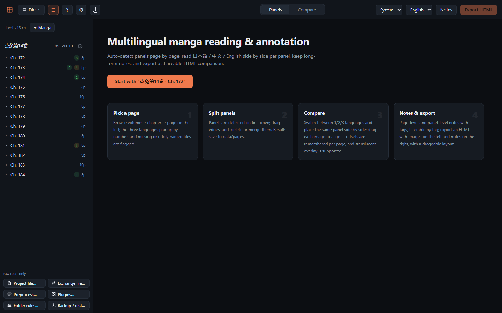
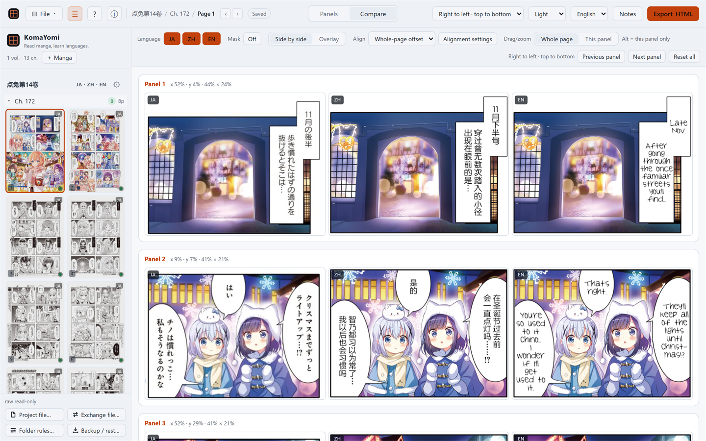
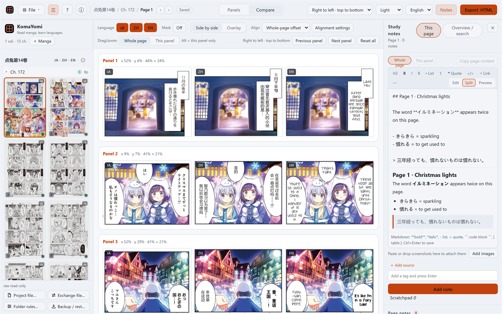

# KomaYomi

**日本語はすべて漫画から学んだ~**

[English](README.md) · [日本語](README.ja.md) · [简体中文](README.zh-CN.md)

KomaYomi is a local-first reading and annotation app for people who study languages with manga. Point it at a folder of pages, and it pairs the same page across Japanese, Chinese and English, splits the page into panels, and lets you read, align and annotate them side by side while taking Markdown notes. There is no account and no upload: your images stay in your own folder, and your work stays in plain JSON next to them.

It is a study tool, not a manga host. Bring your own scans and read them on one machine.

## Screenshots



_The library is built from the folder tree. Each chapter shows how many pages it has and which languages are available._


_Panel workbench: detected panels with numbering, eight-direction resize handles, numeric rectangle inputs, panel templates and the annotation layer._



_Compare reader: the same page in Japanese, Chinese and English, aligned panel by panel._



_Notes are Markdown at page or panel scope, with a live preview and tags._


_Export: HTML for a page or a whole chapter, with an image folder or as a single file, plus PNG output._

| Light                                                                    | Dark                                                                   |
| ------------------------------------------------------------------------ | ---------------------------------------------------------------------- |
|  |  |


_Below 1024 px the library becomes a drawer and the compare panes stack. The web build is installable as a PWA._

All captures use the self-made sample volume in [`samples/demo-library/`](samples/demo-library/README.md) — three pages in Japanese, Chinese and English, drawn by a script for this project and released as CC0. No third-party manga is included.

## Features

**Reading**

- Scans `raw/` as the library: `raw/<volume>/<language>/<chapter>/<pages>`, with one or more languages per volume.
- Pairs pages across languages by sorted position and reports pages that are missing a language.
- Compare reader: side-by-side or overlay, per-language mask, wheel zoom and pan, full page or one panel at a time.
- Alignment in four ways — whole-page offset, per-panel offset, two-anchor point-to-point, and grid/percentage snapping — savable as presets for a page or a chapter.

**Panels**

- Automatic XY-cut detection that ignores the narrow strip at the page edge (the _あらすじ_ column) instead of turning it into a false panel.
- Manual editing: drag to draw a panel with live preview and snapping, eight-direction resize, direct `X / Y / width / height` input, keyboard nudge, multi-select, merge and delete.
- Panel templates: capture the current page and apply it to other pages of the chapter. Declarative layout templates in `data/layouts/` are applied automatically during detection.
- Annotation layer: arrows, boxes, ellipses, highlights, freehand pen, text, badges and a real mosaic, on the whole page or inside one panel. Annotations can be baked into PNG exports or left out.

**Notes**

- Markdown notes at page or panel scope, with edit / split / preview modes, a formatting toolbar and an auto-growing editor.
- Tags, sources with an optional page-title fetch, pasted or dropped screenshots, and a scratch pad.
- Full-text search across pages, tags and sources, plus "copy context" to hand the page's notes to an LLM or a translation tool.

**Export and backup**

- HTML export in two modes: a `.html` file plus a sibling `<name>.files/` image folder (default), or a single file with images inlined.
- Export a whole page or a whole chapter, choose which languages to include, and pick a layout template. Print styles avoid splitting panels and notes across pages.
- PNG export: the whole page, the current panel, or a three-language collage.
- PDF through the browser print dialog, and Word (`.docx`) export with page images and notes; annotations are not embedded in the `.docx` yet.
- Backup ZIP of `data/` with an inspection step before restore, and `.mnproj` projects in reference mode (paths + SHA-1) or packaged mode (images embedded, with relink on import).

**Desktop, offline and interface**

- Runs in the browser against a local Node server, or in an Electron window.
- WebDAV, network drives and local folders as remote image sources, with on-demand caching and a browser-side outbox that replays failed writes.
- Light and dark palettes, English / Chinese / Japanese interface, drawer navigation and touch zoom on narrow screens.
- Installable PWA; the web manifest ships with the web build.

**Extending**

- Drop a small `.mjs` plugin into `plugins/` or `data/plugins/` to replace the built-in panel detector.
- Batch CLI for detection, templates, layouts and alignment presets without opening the browser.

## Quick start

Requirement: Node.js 22 or newer with npm. The batch CLI relies on Node's TypeScript support (Node 26 runs the `.ts` entry directly).

```bash
npm install
npm run dev
```

`npm run dev` starts Vite on `http://127.0.0.1:5173`; if the port is busy it picks the next free one. The API is served by a Vite middleware plugin, so there is no second process to start.

Put at least one volume under `raw/` in this shape:

```text
raw/
  <volume>/
    <language-dir>/       # ja / zh / en, or an alias listed below
      <chapter>/
        001.jpg
        002.jpg
```

Then open the app and pick a chapter in the sidebar.

### Desktop app

```bash
npm run desktop
```

This builds the frontend, bundles the server into `dist-server/`, and opens the Electron window. Run from source, it reuses the repository folder for `raw/`, `data/` and `exports/`. A packaged build keeps them in a `library` folder inside the Electron user data directory and asks for a folder on first launch. `Ctrl+Shift+D` switches the data directory (restart required); `MANGA_DATA_DIR` overrides it.

### Docker

```bash
docker compose up --build
```

The container serves the same API on `http://127.0.0.1:3921`. It is meant for running on your own machine, not as a public service: there are no accounts and no authentication. Three bind mounts keep all state outside the image:

| Mount       | Container path      | Contents                                        |
| ----------- | ------------------- | ----------------------------------------------- |
| `./raw`     | `/data/raw`         | manga pages (`<volume>/<language>/<chapter>/`)  |
| `./data`    | `/data/annotations` | page JSON, presets, templates, library config   |
| `./exports` | `/data/exports`     | HTML / PNG exports, backups, `.mnproj` projects |

Configuration lives in `.env` (copy `.env.example`): `PORT`, `MANGA_LOCALE`, `LOG_LEVEL` and optional `WEBDAV_*` credentials, which are read at runtime and never baked into the image. Health is exposed at `/api/health`.

### Batch CLI

The CLI works directly on `raw/` and `data/`; no browser or server is needed.

```bash
node scripts/manga-cli.ts report
node scripts/manga-cli.ts detect --volume <volume> --chapter <chapter> --pages 1,2 --apply
node scripts/manga-cli.ts plugins
```

| Command                                            | Purpose                                                                                               |
| -------------------------------------------------- | ----------------------------------------------------------------------------------------------------- |
| `report [--narrow]`                                | Panel-count histogram for every page; `--narrow` lists edge-hugging narrow strips.                    |
| `detect … [--apply]`                               | Run detection with the same template → plugin → auto priority as the UI. A dry run without `--apply`. |
| `apply-layout`, `apply-template`, `apply-align`    | Apply a layout, panel template or alignment preset to pages of a chapter.                             |
| `templates`, `layouts`, `align-presets`, `plugins` | List what is installed.                                                                               |
| `regress [--update]`                               | Compare panel counts against `scripts/detect-baseline.json`.                                          |

## Scripts

| Command                              | What it does                                                 |
| ------------------------------------ | ------------------------------------------------------------ |
| `npm run dev`                        | Vite dev server with the local API middleware                |
| `npm run desktop`                    | Build the frontend and server bundle, then launch Electron   |
| `npm run build`                      | Type-check and build the frontend into `dist/`               |
| `npm run preview`                    | Preview the production frontend build                        |
| `npm run server:build`               | Bundle the Node server into `dist-server/`                   |
| `npm start`                          | Serve the built frontend and API (standalone / Docker entry) |
| `npm run dist:win`                   | Windows NSIS installer and portable build into `release/`    |
| `npm run dist:dir`                   | Unpacked build for debugging                                 |
| `npm run docker:build` / `docker:up` | Build / run the container image                              |
| `npm run typecheck`                  | Type-check without emitting                                  |
| `npm run lint` / `lint:fix`          | ESLint                                                       |
| `npm run format` / `format:check`    | Prettier                                                     |
| `npm run i18n:scan`                  | Scan for hard-coded Chinese strings outside the locale files |
| `npm run docs:dev` / `docs:build`    | Documentation site in `docs/`                                |

Packaging uses `electron-builder.yml` (app id `com.payayakamo.komayomi`, product name `KomaYomi`). `npm run dist:win` writes `KomaYomi-<version>-x64.exe`, `KomaYomi-<version>-portable.exe` and `win-unpacked/` into `release/`.

## Project structure

```text
src/                React frontend (library, panel workbench, compare reader, notes, export)
server/             Node HTTP API, library scanner, detection, export, backup
shared/             Code used by both the frontend and the server (types, Markdown, geometry)
electron/           Electron main process and data-directory handling
plugins/            Panel detector plugins (example included)
scripts/            Batch CLI, server build, i18n scan
docs/               VitePress documentation site
public/             Icons and the PWA manifest
raw/                Your manga pages (gitignored)
data/               Page JSON, templates, presets, library config
exports/            Generated HTML, PNG, backups, projects (gitignored)
```

## Library folder rules

The directory tree is the configuration; there is no import step and no database.

- A **volume** is any top-level folder under `raw/`.
- A **chapter** is any folder inside a language directory. Chapters are unioned across languages, so one language may be missing a chapter.
- Pages are **paired by sorted position**, not by filename, using a natural sort (`2.jpg` before `10.jpg`).
- Recognized language directories: `ja`, `jp`, `jpn`, `japanese`, `ja-jp`, `日`, `日本語`, `日文`; `zh`, `zh-cn`, `zh-hans`, `zh-sg`, `cn`, `chs`, `zh-tw`, `zh-hk`, `zh-hant`, `cht`, `tw`, `hk`, `中`, `中文`, `繁中`, `简中`; `en`, `en-us`, `en-gb`, `us`, `uk`, `eng`, `english`, `英`, `英文`.
- An unrecognized directory can be mapped to a language in volume settings; the mapping is stored in `data/library.json` and nothing on disk is renamed.
- The URL hash is deep-linkable: `#/<volume>/<chapter>/<page>/<panels|compare>`.

## Data and backups

| Path                                                | What is there                                                                                             |
| --------------------------------------------------- | --------------------------------------------------------------------------------------------------------- |
| `raw/`                                              | Your page images. The largest folder and the only one you provide.                                        |
| `data/pages/<volume>/<chapter>/<index>.json`        | Panels, notes, alignment offsets, annotations and reading direction, one file per page (0-based index).   |
| `data/templates/`, `data/presets/`, `data/layouts/` | Panel templates, alignment presets and layout templates; each folder appears when you save the first one. |
| `data/library.json`                                 | Manual language-directory mapping and language order.                                                     |
| `data/cache/thumbs/`                                | Thumbnail cache; safe to delete.                                                                          |
| `data/backups/`                                     | Snapshots taken before a restore or a project import.                                                     |
| `exports/`                                          | Exported HTML / PNG, backup ZIPs and `.mnproj` projects.                                                  |

Backup ZIP covers `data/` (excluding the thumbnail cache) and asks you to inspect file and page counts before restoring; the current data is snapshotted first. `.mnproj` comes in reference mode (paths and SHA-1, small) and packaged mode (images embedded, portable, large). See [Remote Storage & Backup](https://payayakamo.github.io/KomaYomi-docs/guide/remote) for the full workflow.

In the desktop app the data directory is remembered in `%APPDATA%/manga-memo/config.json`.

## Templates and plugins

When a page is detected, the server tries a layout template bound to the page, chapter or volume first, then a matching plugin from `plugins/` or `data/plugins/`, then the built-in detector. A plugin that throws, times out (2.5 s) or returns no panels falls back to the built-in detector with a visible warning. Plugins run in the server process with full Node access, so only install ones you trust.

See [Layout Templates & Plugins](https://payayakamo.github.io/KomaYomi-docs/extending) for the plugin interface, template contract and API endpoints.

## Documentation

The full user guide is published at **https://payayakamo.github.io/KomaYomi-docs/**:

| Language | Entry point                                    |
| -------- | ---------------------------------------------- |
| English  | https://payayakamo.github.io/KomaYomi-docs/    |
| 中文     | https://payayakamo.github.io/KomaYomi-docs/zh/ |
| 日本語   | https://payayakamo.github.io/KomaYomi-docs/ja/ |

## Try it online (in development)

The browser-only edition is still in development and has no public demo URL yet. Its source lives at `https://github.com/PayayaKamo/KomaYomi-online`; this section will get a working link once it ships.

What to expect when it does:

- **Static pages, no server.** It can open a `.mnproj` project file for viewing and editing, but it cannot scan a folder on your computer, and automatic panel detection has not been ported to the browser yet.
- **Data lives in IndexedDB.** Your work is stored in the browser's IndexedDB. Export the project before switching devices or clearing site data or cache.
- **Folder access is Chromium-only.** Picking a folder will be supported in Chromium-based browsers once phase 2 lands; Safari and Firefox have to select files manually.
- **Your manga stays yours.** Manga images always stay on your own machine; this project hosts no manga content.

## Roadmap

- Vocabulary-list export; PDF and Word are available in the export dialog today.
- Scheduled backups; backups are started manually today.
- Automated integration tests for the import / export round trip.

## Known limitations

- Single user, no authentication. Do not expose the server or the container to a network you do not control.
- Automatic detection does not decode WebP pages; convert them to JPEG or PNG first.
- Folder-mode HTML exports need the sibling `.files/` folder; moving the HTML away from it breaks the images. Single-file exports avoid this at the cost of size (a chapter can reach tens of megabytes).
- Applying a panel template or re-detecting drops panel-scoped notes when the panel count changes; page-scoped notes are kept.
- The interface is localized in English, Chinese and Japanese; documents and error strings from plugins are not translated.

## Author and license

KomaYomi is built by **PayayaKamo** and released under the [MIT License](LICENSE).

KomaYomi is an independent project and is not affiliated with, endorsed by, or connected to any similarly named project, product or organization. The manga pages in the screenshots come from the self-made sample volume under `samples/demo-library/` (CC0); the repository ships no third-party manga.
