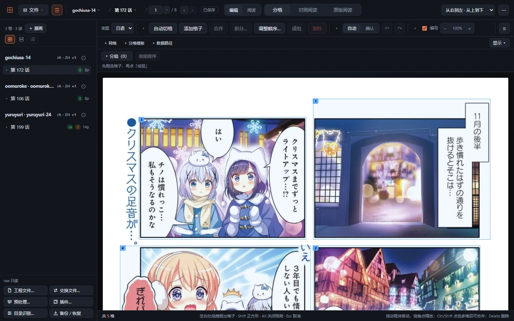
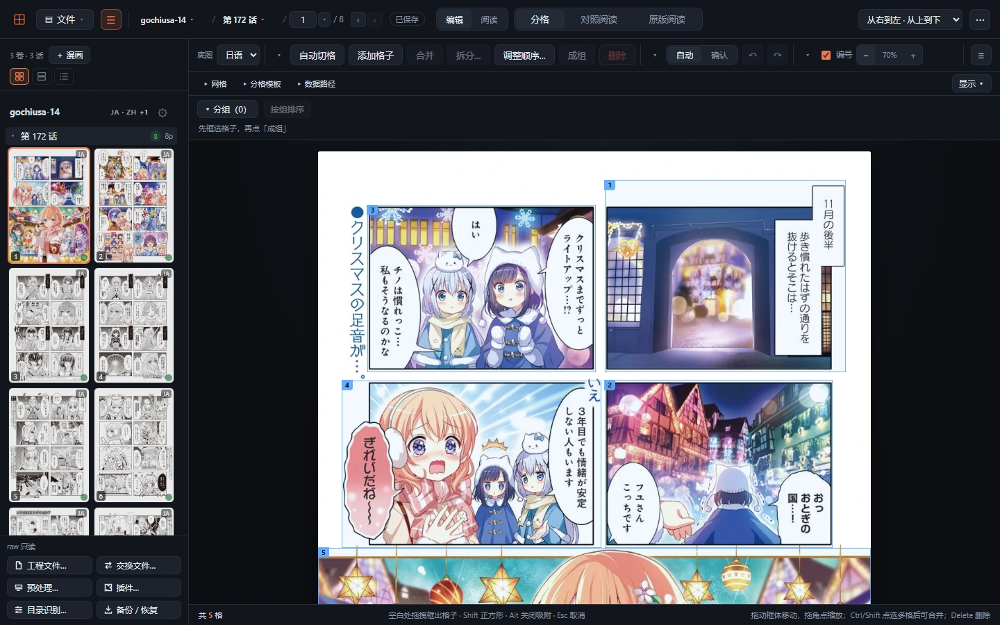
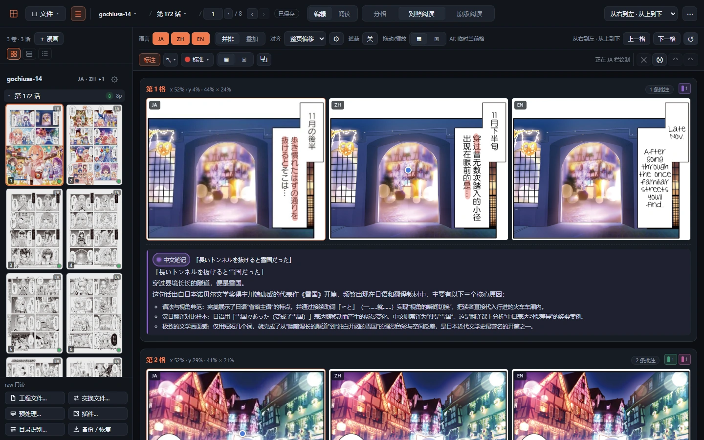
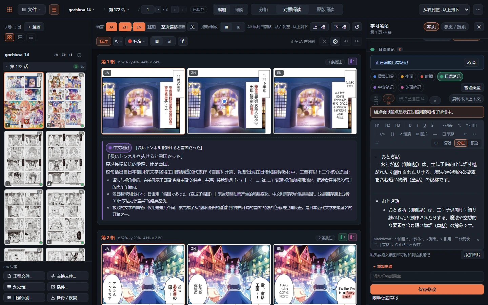
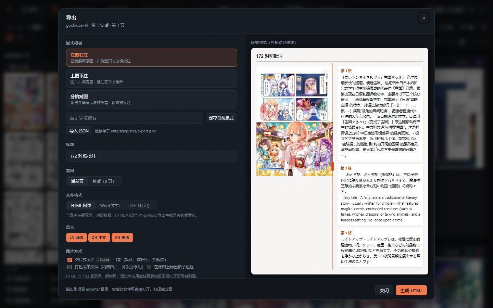
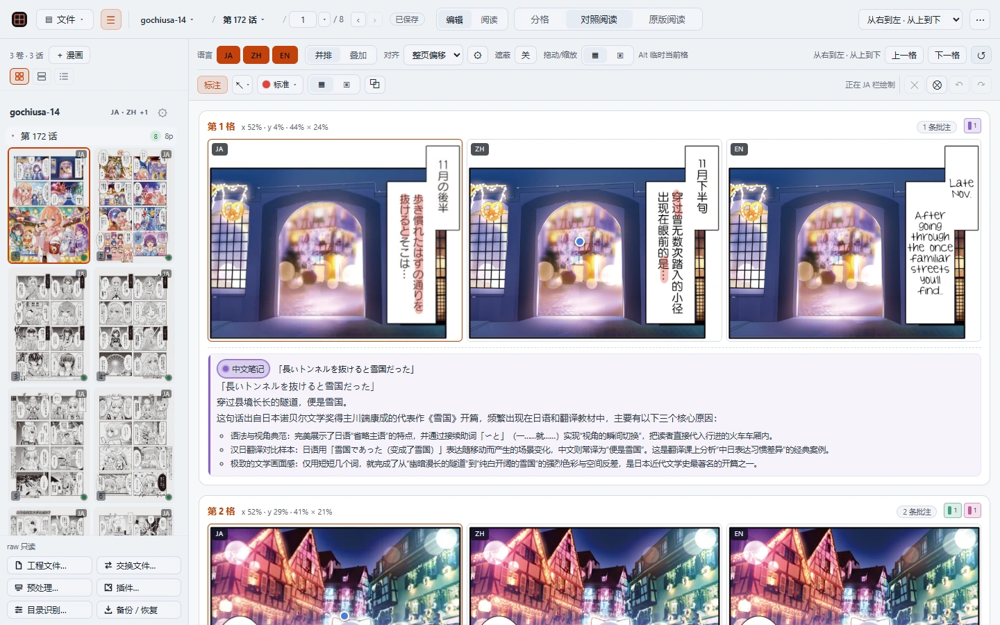
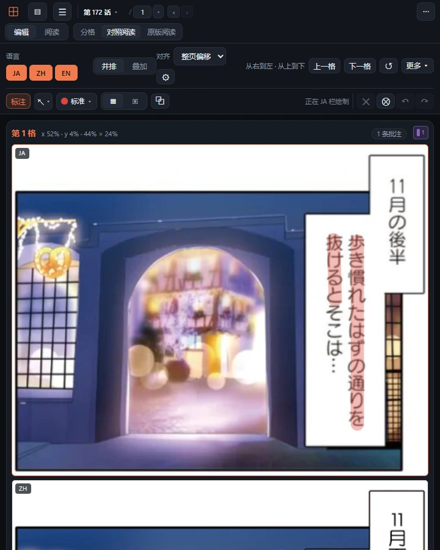

# KomaYomi（格读）

**Local-first, panel-by-panel manga intensive reading.**

**日本語はすべて漫画から学んだ~**

[English](README.md) · [日本語](README.ja.md) · [简体中文](README.zh-CN.md)

Author homepages: [X · @payayakamo](https://x.com/payayakamo) · [note · @payayakamo](https://note.com/payayakamo). These are the author's pages, not a product site — KomaYomi has no separate product website.

Reading a manga in a second language usually means three windows, a dictionary tab and a notes app that never quite line up. KomaYomi（格读） — _Koma_ (コマ, a manga panel) + _Yomi_ (読み, reading) — puts the same page in Japanese, Chinese and English in one window, cuts it into panels, and lets you pin Markdown notes and marks to the exact drawing. The panel, not the page, is the unit of work. Your images stay in your own folder, notes stay in plain JSON next to them: no account, no upload.

It is a study tool, not a manga host. Bring your own scans and read them on one machine.

## Run it in two minutes

1. **Get the app.** Install a build from [GitHub Releases](https://github.com/PayayaKamo/KomaYomi/releases) (Windows, macOS, Linux), or run `npm install && npm run dev` for the browser edition at `http://127.0.0.1:5173`.
2. **Point it at your pages.** Drop a folder at `raw/<volume>/<language>/<chapter>/001.jpg`, or use **File → Open library folder…** / **Add manga…**.
3. **Open a chapter.** Panels are detected on first open (treat them as a draft), then read in the compare view, write notes, and export.

<!-- Screenshot placeholder: three-language compare reader with notes (image arrives in a later pass). -->

Screenshots of the compare reader, the workbench and the notes panel follow under [What you can do](#what-you-can-do). Unsigned-build caveats, Docker, the full first-run folder layout and every other install path are [below](#quick-start).

## Quick start

### Install a build

Prebuilt packages are attached to [GitHub Releases](https://github.com/PayayaKamo/KomaYomi/releases): Windows (NSIS installer and portable exe), macOS (dmg and zip) and Linux (AppImage and deb), each for x64 and arm64.

**The builds are unsigned.** No code-signing certificates are configured yet, so Windows SmartScreen shows "Windows protected your PC" (choose **More info → Run anyway**) and macOS Gatekeeper blocks the first launch (right-click the app → **Open**, or allow it under **System Settings → Privacy & Security → Open Anyway**). The workflow documents where the Windows and Apple certificate secrets plug in.

### Run from source

Requirement: Node.js 22 or newer with npm. The batch CLI relies on Node's TypeScript support (Node 26 runs the `.ts` entry directly).

```bash
npm install
npm run dev
```

`npm run dev` starts Vite on `http://127.0.0.1:5173`; if the port is busy it picks the next free one. The API is served by a Vite middleware plugin, so there is no second process to start.

`npm run desktop` builds the frontend, bundles the server into `dist-server/`, and opens the Electron window. When run from source, it reuses the repository folder for `raw/`, `data/` and `exports/`. A packaged build keeps them in a `library` folder inside the Electron user data directory and asks for a folder on first launch. `Ctrl+Shift+D` switches the data directory (restart required); `MANGA_DATA_DIR` overrides it.

Pushing a `v*` tag runs `.github/workflows/release.yml`, which builds all six platform/architecture combinations and uploads them to the release.

### Docker

```bash
docker compose up --build
```

The container serves the same API on `http://127.0.0.1:3921`. It is meant to run on your own machine, not as a public service: there are no accounts and no authentication. Three bind mounts keep all state outside the image:

| Mount       | Container path      | Contents                                        |
| ----------- | ------------------- | ----------------------------------------------- |
| `./raw`     | `/data/raw`         | manga pages (`<volume>/<language>/<chapter>/`)  |
| `./data`    | `/data/annotations` | page JSON, presets, templates, library config   |
| `./exports` | `/data/exports`     | HTML / PNG exports, backups, `.mnproj` projects |

Configuration lives in `.env` (copy `.env.example`): `PORT`, `MANGA_LOCALE`, `LOG_LEVEL` and optional `WEBDAV_*` credentials, which are read at runtime and never baked into the image. Health is exposed at `/api/health`.

### First run

1. Put at least one volume under `raw/` (or point the desktop app at a folder):

```text
raw/
  <volume>/
    <language-dir>/       # ja / zh / en, or an alias listed below
      <chapter>/
        001.jpg
        002.jpg
```

2. Open the app and pick a chapter in the sidebar. The first visit auto-detects panels; treat the result as a draft and fix the boxes in the workbench.
3. Switch to the compare reader or the original view, then add notes and annotations. Panels, alignment, notes and annotations are saved to `data/` as you work.

## The KomaYomi repositories

KomaYomi is one project split across four repositories. This one is the reference implementation.

| Repository                                                           | What it is                                                                                                                                                                                                |
| -------------------------------------------------------------------- | --------------------------------------------------------------------------------------------------------------------------------------------------------------------------------------------------------- |
| [KomaYomi](https://github.com/PayayaKamo/KomaYomi) (this repository) | Full desktop edition: an Electron window around a local Node server. It scans folders, runs panel detection and plugins, talks to WebDAV, and provides every feature listed below.                        |
| [KomaYomi-online](https://github.com/PayayaKamo/KomaYomi-online)     | Browser-only edition. Opens a `.mnproj` project, reads, annotates and exports static HTML or PNG entirely in the tab — no server, works offline. It cannot scan folders or run automatic panel detection. |
| [KomaYomi-mobile](https://github.com/PayayaKamo/KomaYomi-mobile)     | React Native app for Android and iOS. HarmonyOS NEXT currently has a placeholder only.                                                                                                                    |
| [KomaYomi-docs](https://github.com/PayayaKamo/KomaYomi-docs)         | Build output of this documentation site, generated and pushed by CI. Do not edit it by hand.                                                                                                              |

All three editions use the same page JSON and the same `.mnproj` project format, so a project can move between the desktop, browser and mobile builds. The mobile app is a separate client, not a wrapper around the desktop build.

## What you can do

- **Read one page in three languages** — side by side or overlaid, whole page or panel by panel, with a separate original-page view for anything outside the boxes. Right-click any pane for the enlarged 1:1 viewer.
- **Turn a page into structure** — XY-cut detection gives you a draft; split, merge, renumber and apply templates until the boxes match the art. Double-click a panel for the detail view, with draggable artwork/notes layout and alignment by dragging the image.
- **Take notes that stay on the drawing** — typed Markdown notes (Background, Vocabulary, Reaction, one per language, plus your own categories with colours), pinned to a spot on the artwork; page notes, panel notes and a scratch pad share one editor.
- **Annotate where the line is** — arrows, text, highlighter, pen, mosaic and badges, scoped to a page or a panel and isolated per language; annotate and bake them into exports. Right-click a mark to recolour, delete or copy it to another language.
- **Line up editions that do not line up** — four alignment modes, reusable as page or chapter presets; the detail view moves every language together with sync move.
- **Never lose the thread** — operation history lists undoable edits newest first, and the compare view auto-centres the panel you jump to; read-only mode turns the workspace into a viewer with nothing written to disk.
- **Keep the project file current** — open a `.mnproj` and every save writes back into that same file; **Save as…** packs a separate copy without touching the linked original.
- **Share what you studied** — export HTML, PNG, Word or print-to-PDF, plus Xiaohongshu-ready share images (cover, single panel, language compare, long page).
- **Run it your way** — Electron desktop, browser against the local server, Docker, an installable PWA, or the separate mobile app; the interface is available in English, Chinese and Japanese.

### What it is not

- **Not a reader for casual reading.** Paging works, but the app assumes you stop on a page, cut it into panels and write something down.
- **Not OCR or machine translation.** It never guesses the text for you; you supply the editions and the notes. Anything automatic is a draft you confirm.
- **Not a cloud or multi-user service.** One person, one machine, plain files on disk.

### Screenshots



_The library is built from the folder tree. Each chapter shows how many pages it has and which languages are available._



_Panel workbench: detected panels with numbering, eight-direction resize handles, numeric rectangle inputs, panel templates and the annotation layer._



_Compare reader: the same page in Japanese, Chinese and English, aligned panel by panel._



_Notes are Markdown at page or panel scope, with a live preview and tags._



_Export: HTML for a page or a whole chapter, with an image folder or as a single file, plus PNG output._

| Light                                                                     | Dark                                                                    |
| ------------------------------------------------------------------------- | ----------------------------------------------------------------------- |
|  |  |



_Below 1024 px the library becomes a drawer and the compare panes stack. The web build is installable as a PWA._

Sample manga is used for demonstration only; all rights belong to the original author.

## Library and folder rules

The directory tree is the configuration; there is no import step and no database.

- A **volume** is a top-level folder under `raw/`, or the folder inside a work folder when several works sit side by side (`raw/<work>/<volume>/<language>/<chapter>/<pages>`). The work name is shown as a series in the sidebar; same-named volumes in different works stay separate.
- A **chapter** is any folder inside a language directory. Chapters are unioned across languages, so one language may be missing a chapter.
- Pages are **paired by sorted position**, not by filename, using a natural sort (`2.jpg` before `10.jpg`).
- Recognized language directories: `ja`, `jp`, `jpn`, `japanese`, `ja-jp`, `日`, `日本語`, `日文`; `zh`, `zh-cn`, `zh-hans`, `zh-sg`, `cn`, `chs`, `zh-tw`, `zh-hk`, `zh-hant`, `cht`, `tw`, `hk`, `中`, `中文`, `繁中`, `简中`; `en`, `en-us`, `en-gb`, `us`, `uk`, `eng`, `english`, `英`, `英文`.
- An unrecognized directory can be mapped to a language in volume settings; the mapping is stored in `data/library.json` and nothing on disk is renamed. Volume settings also list the volume's chapters, hide or restore them, and set a per-language page offset when an extra page shifts later numbering.
- The URL hash is deep-linkable: `#/<volume>/<chapter>/<page>/<panels|compare|original>` and `.../panel/<id>` for a single panel.

## Panels and the workbench

- Automatic XY-cut detection that ignores the narrow strip at the page edge (the _あらすじ_ column) instead of turning it into a false panel.
- Manual editing: drag to draw a panel with live preview and snapping, eight-direction resize, direct `X / Y / width / height` input, keyboard nudge, multi-select, merge, split and delete.
- Manual numbering: insert a panel after the selected one and shift the rest, split a panel in place, or reorder everything in the order dialog.
- Panel templates: capture the current page and apply it to other pages of the chapter. Declarative layout templates in `data/layouts/` are applied automatically during detection.
- Detection order is layout template → plugin → built-in detector; a plugin that throws, times out (2.5 s) or returns no panels falls back with a visible warning. See [Layout Templates & Plugins](https://payayakamo.github.io/KomaYomi-docs/extending).

## Compare and original reading

- Compare reader: side-by-side or overlay, per-language mask, wheel zoom and pan, full page or one panel at a time, previous/next panel across page and chapter boundaries.
- Original view: the uncropped page per language, with independent zoom and pan, for checking what sits outside the detected panels.
- Panel detail views with `#/<volume>/<chapter>/<page>/panel/<id>` deep links, switchable panel by panel.
- Alignment in four ways — whole-page offset, per-panel offset, two-anchor point-to-point, and grid/percentage snapping — savable as presets for a page or a chapter.

## Notes and annotations

- Markdown notes at page or panel scope, with edit / split / preview modes, a formatting toolbar and an auto-growing editor; editing an existing note reuses the same single editor.
- Tags, sources with an optional page-title fetch, pasted or dropped screenshots, and a scratch pad.
- Full-text search across pages, tags and sources, plus "copy context" to hand the page's notes to an LLM or a translation tool.
- Annotation layer: arrows, boxes, ellipses, highlights, freehand pen, text, badges and a real mosaic, on the whole page or inside one panel.
- Marks belong to a language lane: drawing in the Japanese pane keeps the mark out of the Chinese and English panes, and one toggle shares it with all languages. Right-click a mark for colour, delete and "copy to language"; right-click empty artwork for the pane menu (view enlarged, mask, show only, panel PNG, panel number).
- A mark can carry an anchor point or box with an optional leader line, so a note in the margin still points at the right balloon. Annotations can be baked into PNG exports or left out.
- Note pins work the same way: **Pin on artwork** drops a dot in one language, and several notes at one spot collapse into a counted popover.

## Saving and export

- Open a `.mnproj` and the editor is linked: every save is written back into that file, and the top-bar save state opens a panel with the target path, last write, queue and a retry. **File → Save to project file** forces a write-back; **File → Save as…** writes a separate copy and never touches the linked original.
- In a plain browser there is no file dialog, so **Save as…** packs the library and hands it to the download manager instead.
- HTML export in two modes: a `.html` file plus a sibling `<name>.files/` image folder (default), or a single file with images inlined.
- Export a whole page or a whole chapter, choose which languages to include, and pick a layout template. Print styles avoid splitting panels and notes across pages.
- PNG export: the whole page, the current panel, or a three-language collage.
- Share images for social posts: 1080×1440 cover, single panel, language compare, or a long page split into strips, with an optional page/language bar and baked-in annotations; exports warn above 18 images or 20 MB per file.
- PDF through the browser print dialog, and Word (`.docx`) export with page images and notes; annotations are baked into the `.docx` by default, with a warning and an un-baked fallback if a page cannot be composed.

## Backup, cache and remote sources

| Path                                                | What is there                                                                                             |
| --------------------------------------------------- | --------------------------------------------------------------------------------------------------------- |
| `raw/`                                              | Your page images. The largest folder and the only one you provide.                                        |
| `data/pages/<volume>/<chapter>/<index>.json`        | Panels, notes, alignment offsets, annotations and reading direction, one file per page (0-based index).   |
| `data/templates/`, `data/presets/`, `data/layouts/` | Panel templates, alignment presets and layout templates; each folder appears when you save the first one. |
| `data/library.json`                                 | Manual language-directory mapping, chapter visibility, page offsets and language order.                   |
| `data/cache/thumbs/`                                | Thumbnail cache; safe to delete.                                                                          |
| `data/backups/`                                     | Snapshots taken before a restore or a project import.                                                     |
| `exports/`                                          | Exported HTML / PNG, backup ZIPs and `.mnproj` projects.                                                  |

Backup ZIP covers `data/` (excluding the thumbnail cache) and asks you to inspect file and page counts before restoring; the current data is snapshotted first. Scheduled automatic backups run at a configurable interval with a retention count, and the settings dialog can clear thumbnails, remote cache and staging data or the panel-detection cache. `.mnproj` comes in reference mode (paths and SHA-1, small) and packaged mode (images embedded, portable, large). See [Remote Storage & Backup](https://payayakamo.github.io/KomaYomi-docs/guide/remote) for the full workflow.

WebDAV, network drives and local folders can all act as remote image sources, with on-demand caching and a browser-side outbox that replays failed writes. In the desktop app the data directory is remembered in `%APPDATA%/manga-memo/config.json`.

## Batch CLI

The CLI works directly on `raw/` and `data/`; no browser or server is needed.

```bash
node scripts/manga-cli.ts report
node scripts/manga-cli.ts detect --volume <volume> --chapter <chapter> --pages 1,2 --apply
node scripts/manga-cli.ts plugins
```

| Command                                            | Purpose                                                                                               |
| -------------------------------------------------- | ----------------------------------------------------------------------------------------------------- |
| `report [--narrow]`                                | Panel-count histogram for every page; `--narrow` lists edge-hugging narrow strips.                    |
| `detect … [--apply]`                               | Run detection with the same template → plugin → auto priority as the UI. A dry run without `--apply`. |
| `apply-layout`, `apply-template`, `apply-align`    | Apply a layout, panel template or alignment preset to pages of a chapter.                             |
| `templates`, `layouts`, `align-presets`, `plugins` | List what is installed.                                                                               |
| `regress [--update]`                               | Compare panel counts against `scripts/detect-baseline.json`.                                          |

## Development and build

| Command                              | What it does                                                 |
| ------------------------------------ | ------------------------------------------------------------ |
| `npm run dev`                        | Vite dev server with the local API middleware                |
| `npm run desktop`                    | Build the frontend and server bundle, then launch Electron   |
| `npm run build`                      | Type-check and build the frontend into `dist/`               |
| `npm run preview`                    | Preview the production frontend build                        |
| `npm run server:build`               | Bundle the Node server into `dist-server/`                   |
| `npm start`                          | Serve the built frontend and API (standalone / Docker entry) |
| `npm run dist:win`                   | Windows NSIS installer and portable build into `release/`    |
| `npm run dist:dir`                   | Unpacked build for debugging                                 |
| `npm run docker:build` / `docker:up` | Build / run the container image                              |
| `npm run typecheck`                  | Type-check without emitting                                  |
| `npm run lint` / `lint:fix`          | ESLint                                                       |
| `npm run format` / `format:check`    | Prettier                                                     |
| `npm run i18n:scan`                  | Scan for hard-coded Chinese strings outside the locale files |
| `npm run docs:dev` / `docs:build`    | Documentation site in `docs/`                                |

Packaging uses `electron-builder.yml` (app id `com.payayakamo.komayomi`, product name `KomaYomi`). `npm run dist:win` writes `KomaYomi-<version>-win-x64.exe`, `KomaYomi-<version>-win-portable-x64.exe` and `win-unpacked/` into `release/`; the release workflow passes `--win/--mac/--linux` and `--x64/--arm64`, so every published file carries its platform and architecture.

Drop a small `.mjs` plugin into `plugins/` or `data/plugins/` to replace the built-in panel detector. Plugins run in the server process with full Node access, so only install ones you trust.

```text
src/                React frontend (library, panel workbench, compare reader, notes, export)
server/             Node HTTP API, library scanner, detection, export, backup
shared/             Code used by both the frontend and the server (types, Markdown, geometry)
electron/           Electron main process and data-directory handling
plugins/            Panel detector plugins (example included)
scripts/            Batch CLI, server build, i18n scan
docs/               VitePress documentation site
public/             Icons and the PWA manifest
raw/                Your manga pages (gitignored)
data/               Page JSON, templates, presets, library config
exports/            Generated HTML, PNG, backups, projects (gitignored)
```

## Roadmap

- Guided page/panel correspondence: suggest pairs across editions (reading order, panel geometry, later image similarity), confirm once and reuse the mapping instead of matching every page by hand.
- Better panel detection for irregular layouts, so XY-cut drafts need fewer manual fixes.
- Backup reminders, for people who keep years of notes in `data/`.
- Vocabulary-list export; PDF, Word and share images are available in the export dialog today.
- An in-app image format converter; renaming and splitting live in preprocessing.
- Automated integration tests for the import / export round trip.

## Known limitations

- Single user, no authentication. Do not expose the server or the container to a network you do not control.
- Automatic detection decodes WebP pages; AVIF, HEIC, GIF and BMP still need converting to JPEG or PNG.
- Folder-mode HTML exports need the sibling `.files/` folder; moving the HTML away from it breaks the images. Single-file exports avoid this at the cost of size (a chapter can reach tens of megabytes).
- Applying a panel template or re-detecting matches old panels to new ones by rectangle overlap, so notes and marks stay on the drawing they belong to. Notes whose panel no longer exists are kept as page notes, and per-panel alignment offsets and groups follow their panels.
- The interface is localized in English, Chinese and Japanese; documents and error strings from plugins are not translated.
- There is no OCR, machine translation or semantic page matching. Pairing the same page across editions is manual, and panel boxes are a draft you confirm.
- This repository is the desktop/reference implementation. The online, mobile and docs repositories share the project format but ship different feature sets.

## Documentation

The full user guide is published at https://payayakamo.github.io/KomaYomi-docs/:

| Language | Entry point                                    |
| -------- | ---------------------------------------------- |
| English  | https://payayakamo.github.io/KomaYomi-docs/    |
| 中文     | https://payayakamo.github.io/KomaYomi-docs/zh/ |
| 日本語   | https://payayakamo.github.io/KomaYomi-docs/ja/ |

## The name

KomaYomi = **Koma** (コマ, a manga panel) + **Yomi** (読み, reading): reading, panel by panel. The name describes the workflow rather than the medium — structure the page first, then align editions, then anchor notes to the artwork.

- The official name is **KomaYomi（格读）** — 格 for panel, 读 for read. Write the Latin part as **KomaYomi**, never `komayomi` or `Koma Yomi`; `komayomi`, `koma-yomi` and `Koma Yomi` are search variants that all lead here.
- The tagline is the translation: _local-first, panel-by-panel manga intensive reading_.

## Author and license

KomaYomi（格读） is built by **PayayaKamo** and released under the [MIT License](LICENSE). Author homepages: [X · @payayakamo](https://x.com/payayakamo) and [note · @payayakamo](https://note.com/payayakamo) — these are the author's pages, not a product site.

KomaYomi is an independent project and is not affiliated with, endorsed by, or connected to any similarly named project, product or organization. The manga pages in the screenshots are used for demonstration only; all rights belong to the original author. The repository ships no third-party manga.
