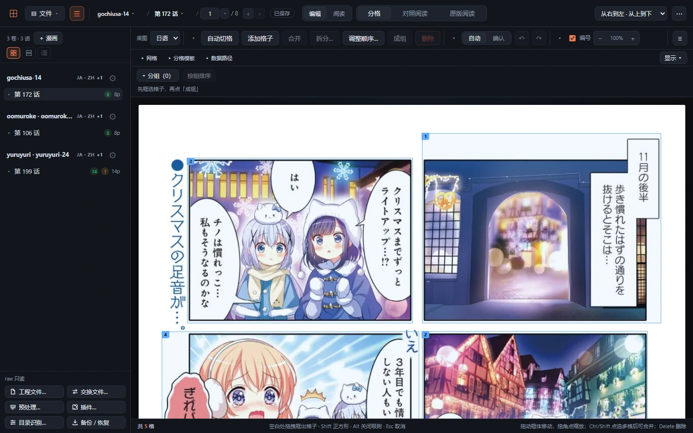
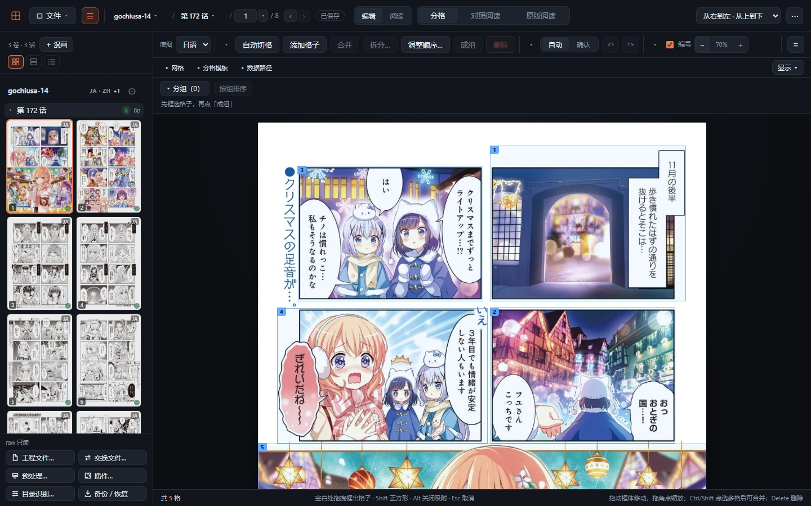
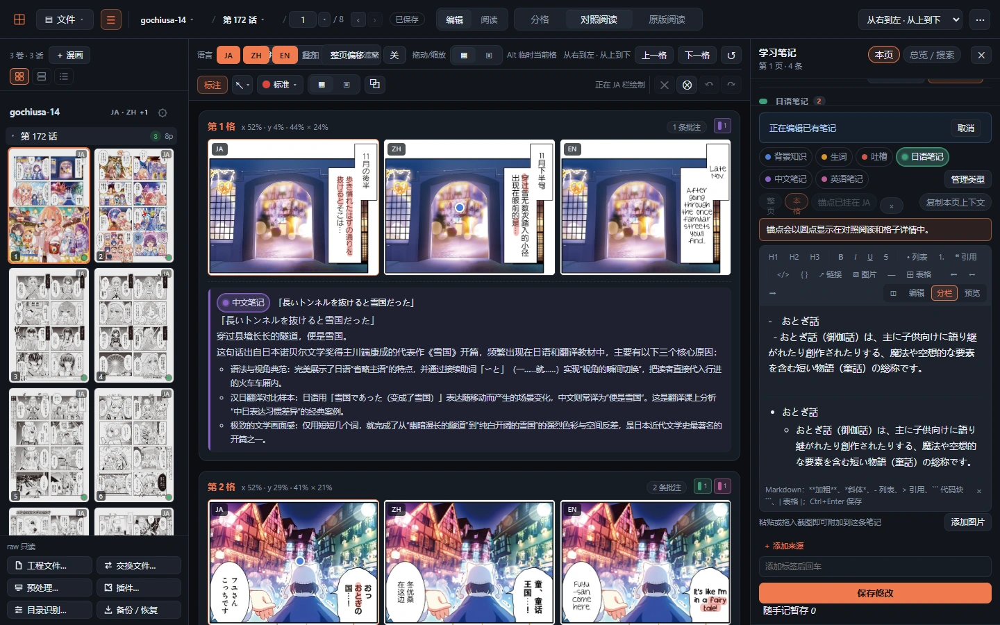
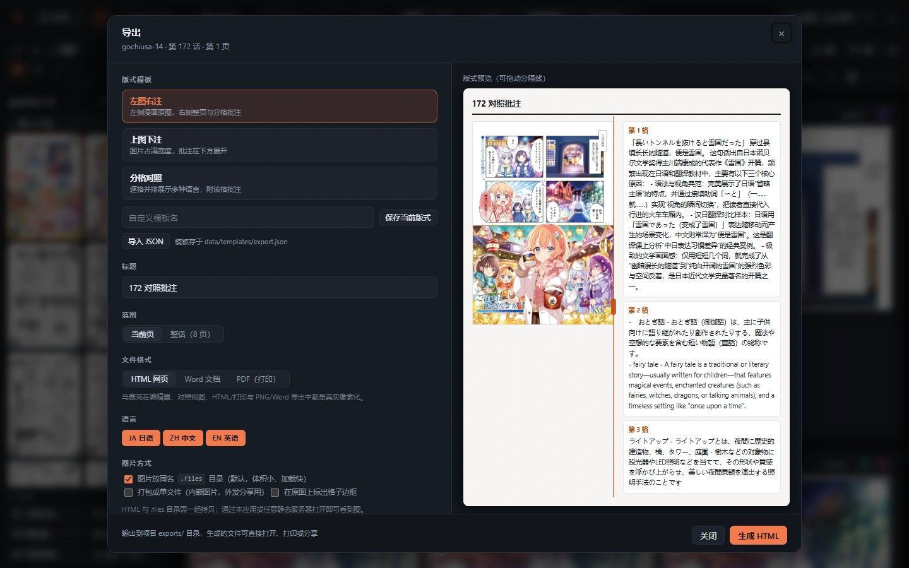
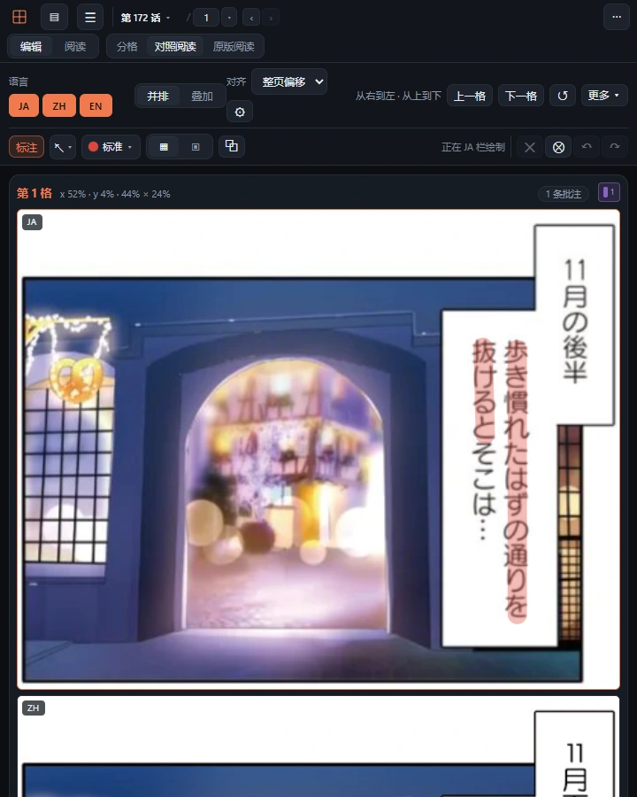

# KomaYomi（格读）

**本地优先，把漫画拆成一格一格来精读。**

**日本語はすべて漫画から学んだ~**

[English](README.md) · [日本語](README.ja.md) · [简体中文](README.zh-CN.md)

作者主页：[X · @payayakamo](https://x.com/payayakamo) · [note · @payayakamo](https://note.com/payayakamo)。这两个是作者个人主页，不是产品官网——KomaYomi 没有单独的产品网站。

用漫画学外语，通常要开三个窗口：原版、译本、词典，再另开一个笔记软件；看到想记的那一句，位置还常常对不上。KomaYomi（**格读**：Koma＝漫画分格，Yomi＝读）把同一页的日文、中文、英文放进同一个窗口，先切成格，再让你把 Markdown 笔记和批注钉在具体画面上。它的工作单位是「格」而不是「页」。图片留在你自己的文件夹，笔记是旁边的纯 JSON：不注册、不上传。

它是学习工具，不是漫画托管服务。请使用自己的素材，在本机逐页阅读。

## 三步跑起来

1. **装好应用**：在 [GitHub Releases](https://github.com/PayayaKamo/KomaYomi/releases) 下载 Windows / macOS / Linux 安装包；或者 `npm install && npm run dev`，用浏览器打开 `http://127.0.0.1:5173`。
2. **指定页面**：把图片放成 `raw/<卷>/<语言>/<话>/001.jpg`，也可以用「文件 → 打开图库文件夹…」或「添加漫画…」。
3. **打开一话**：首次打开会自动分格（先当草稿看），然后到对照阅读里读、写笔记、导出。

<!-- 截图占位：三语对照阅读 + 笔记，等后续替换为新图。 -->

未签名版本的提示、Docker、完整的首次目录结构和其他安装方式都在[下面](#快速开始)。

## 快速开始

### 安装预编译版本

预编译安装包发布在 [GitHub Releases](https://github.com/PayayaKamo/KomaYomi/releases)：Windows（NSIS 安装包与便携版）、macOS（dmg 与 zip）、Linux（AppImage 与 deb），各自都有 x64 与 arm64。

**这些构建没有代码签名。** 目前没有配置签名证书，因此 Windows 会弹出 SmartScreen「Windows 已保护你的电脑」提示（选择「更多信息 → 仍要运行」），macOS 首次启动会被 Gatekeeper 拦截（右键应用 →「打开」，或在「系统设置 → 隐私与安全性」里选择「仍要打开」）。证书密钥的接入位置写在 workflow 里。

### 从源码运行

环境要求：Node.js 22 及以上，附带 npm。批处理 CLI 依赖 Node 的 TypeScript 支持（Node 26 可直接运行 `.ts` 入口）。

```bash
npm install
npm run dev
```

`npm run dev` 会在 `http://127.0.0.1:5173` 启动 Vite；端口被占用时会自动换到下一个空闲端口。API 由 Vite 中间件提供，不需要再启动第二个进程。

`npm run desktop` 会构建前端、把服务端打包到 `dist-server/`，再打开 Electron 窗口。从源码运行时，`raw/`、`data/`、`exports/` 沿用仓库目录；打包版使用 Electron 用户数据目录下的 `library` 文件夹，并在首次启动时询问位置。`Ctrl+Shift+D` 可切换数据目录（需要重启），`MANGA_DATA_DIR` 可覆盖。

推送 `v*` tag 会触发 `.github/workflows/release.yml`，构建全部六个平台/架构组合并上传到对应的 Release。

### Docker

```bash
docker compose up --build
```

容器在 `http://127.0.0.1:3921` 提供相同的 API。它只适合在自己的机器上运行，不是公开服务：没有账号，也没有鉴权。三个绑定挂载把状态放在镜像之外：

| 挂载        | 容器内路径          | 内容                                  |
| ----------- | ------------------- | ------------------------------------- |
| `./raw`     | `/data/raw`         | 漫画页面（`<卷>/<语言>/<话>/`）       |
| `./data`    | `/data/annotations` | 页面 JSON、预设、模板、图库配置       |
| `./exports` | `/data/exports`     | HTML / PNG 导出、备份、`.mnproj` 工程 |

配置写在 `.env`（复制 `.env.example`）：`PORT`、`MANGA_LOCALE`、`LOG_LEVEL`，以及可选的 `WEBDAV_*` 凭据。凭据只在运行时读取，不会写进镜像。健康检查在 `/api/health`。

### 第一次使用

1. 在 `raw/` 下至少放一卷（或在桌面版里指定一个文件夹）：

```text
raw/
  <卷>/
    <语言目录>/       # ja / zh / en，或下面列出的别名
      <话>/
        001.jpg
        002.jpg
```

2. 打开应用，在侧栏里选择一话。首次打开会自动检测分格；把结果当草稿，在工作台里修正框。
3. 切换到对照阅读或原版阅读，再添加笔记与批注。分格、对齐、笔记和批注都会随时写入 `data/`。

## KomaYomi 的四个仓库

KomaYomi 是一个项目，分成四个仓库。本仓库是参考实现。

| 仓库                                                             | 是什么                                                                                                                                                  |
| ---------------------------------------------------------------- | ------------------------------------------------------------------------------------------------------------------------------------------------------- |
| [KomaYomi](https://github.com/PayayaKamo/KomaYomi)（本仓库）     | 桌面端完整版：Electron 窗口加本地 Node 服务。能扫描目录、运行分格检测与插件、连接 WebDAV，包含下面列出的全部功能。                                      |
| [KomaYomi-online](https://github.com/PayayaKamo/KomaYomi-online) | 纯浏览器版。打开 `.mnproj` 工程即可阅读、标注并导出静态 HTML 或 PNG，全程在标签页里完成，不需要服务端，可离线使用。它不能扫描目录，也不带自动分格检测。 |
| [KomaYomi-mobile](https://github.com/PayayaKamo/KomaYomi-mobile) | React Native 的 Android / iOS 应用。鸿蒙 NEXT 目前只有占位。                                                                                            |
| [KomaYomi-docs](https://github.com/PayayaKamo/KomaYomi-docs)     | 本站的构建产物，由 CI 自动生成并推送，不要直接在里面改。                                                                                                |

三种形态共用同一套页面 JSON 和 `.mnproj` 工程格式，工程可以在桌面端、浏览器版和移动端之间迁移。移动端是独立客户端，不是桌面版的套壳。

## 能体验什么

- **同一页并排看三种语言**：左右并排或叠加，可整页看也可逐格看；分格之外还有独立的原版阅读。任意窗格右键可打开 1:1 放大看图。
- **把页面整理成结构**：XY-cut 自动检测给出草稿，再拆分、合并、重排编号、套用模板，直到框和画面吻合。双击分格进入详情视图，画面/笔记可拖动分栏，对着画面拖动即可对齐。
- **笔记跟着画面走**：背景知识、生词、吐槽三种类型，每种启用语言还会自动生成一个语言分类，也可以自建分类并选颜色；笔记能「钉」在画面某个位置，同一处的多条笔记合并成带数量的气泡。
- **在台词旁边做批注**：箭头、文字、高亮、画笔、马赛克、角标，可只作用于单格或整页，并按语言隔离；右键标注能改色、删除、复制到其他语言。
- **对齐对不上的版本**：四种对齐方式，可存成页或话的预设；详情视图里打开「同步移动」，拖动和缩放会让所有语言一起动。
- **不丢上下文**：操作历史按时间倒序列出可撤销的编辑；选中格子变化时对照视图会自动把它滚到视野中央；只读模式把工作台变成纯阅读器，不往磁盘写任何东西。
- **工程文件保持最新**：打开 `.mnproj` 后每次保存都写回同一个文件；「另存为…」另存一份副本，绝不覆盖已链接的原文件。
- **把学到的分享出去**：导出 HTML、PNG、Word 或浏览器打印 PDF，另有小红书分享图（封面、单格、三语对照、长页切条）。
- **按自己的方式运行**：Electron 桌面端、浏览器连本地服务、Docker、安装成 PWA，或用独立的移动端应用；界面支持英文、中文和日文。

### 它不是什么

- **不是用来“刷”漫画的阅读器。** 翻页当然可以，但它的前提是你会停在某一页，把画面拆成分格，再写下点什么。
- **不是 OCR 或机器翻译。** 它不会替你猜原文，也不生成译文；版本和笔记都由你提供，自动结果只是等你确认的草稿。
- **不是云端或多用户服务。** 一个人、一台机器，数据就是磁盘上的普通文件。

### 界面截图



_图库直接由文件夹结构生成，每话会显示页数和可用语言。_



_切格工作台：带编号的分格、八向缩放手柄、坐标数值输入、分格模板与标注层。_


_对照阅读：同一页的日文、中文、英文，按分格逐一对照。_



_笔记以页或格为单位，支持 Markdown、实时预览和标签。_



_导出：整页或整话的 HTML，可带图片目录或打成单文件，也能输出 PNG。_

| 亮色                                                       | 暗色                                                      |
| ---------------------------------------------------------- | --------------------------------------------------------- |
|  |  |



_宽度小于 1024 px 时图库变成抽屉，对照视图改为纵向堆叠；Web 版可作为 PWA 安装。_

示例漫画仅用于演示，所有权利归原作者所有。

## 图库与目录规则

目录结构本身就是配置，没有导入步骤，也没有数据库。

- **卷** 默认是 `raw/` 下的一级文件夹；`raw/` 里并列放多部作品时，卷在作品文件夹下（`raw/<作品>/<卷>/<语言>/<话>/<页面>`），侧栏把作品名作为系列显示，不同作品里的同名卷不会合并。
- **话** 是语言目录里的文件夹；不同语言的话会合并，所以某种语言可以缺少某一话。
- 页面按**排序位置**配对而不是按文件名，使用自然排序（`2.jpg` 排在 `10.jpg` 前）。
- 可识别的语言目录：`ja`、`jp`、`jpn`、`japanese`、`ja-jp`、`日`、`日本語`、`日文`；`zh`、`zh-cn`、`zh-hans`、`zh-sg`、`cn`、`chs`、`zh-tw`、`zh-hk`、`zh-hant`、`cht`、`tw`、`hk`、`中`、`中文`、`繁中`、`简中`；`en`、`en-us`、`en-gb`、`us`、`uk`、`eng`、`english`、`英`、`英文`。
- 无法识别的目录可以在卷设置里手动指定语言，映射写入 `data/library.json`，不会重命名磁盘文件。卷设置还会列出这一卷的章节，可隐藏或恢复；某语言多插了一页导致后续页号错位时，可以按语言设置页偏移。
- URL 哈希可直接打开：`#/<卷>/<话>/<页>/<panels|compare|original>`，单格再加 `.../panel/<id>`。

## 分格与工作台

- XY-cut 自动检测，并排除页面边缘的窄条（如 _あらすじ_），避免误判成格子。
- 手动编辑：拖拽框选，边拖边预览并吸附；支持八向缩放、直接输入 `X / Y / 宽 / 高`、键盘微调、多选、合并、拆分与删除。
- 手工编号：在选中格之后插入新格并顺移后续编号，拆分时新块占原位，或在编号对话框中整体重排。
- 分格模板：把当前页保存为模板，套用到同话其他页。`data/layouts/` 中的声明式布局模板会在检测时自动生效。
- 检测顺序是布局模板 → 插件 → 内置检测器；插件抛错、超时（2.5 秒）或返回零个分格时，会给出提示并回退到内置检测。接口见[布局模板与插件](https://payayakamo.github.io/KomaYomi-docs/zh/extending)。

## 对照阅读与原版阅读

- 对照阅读：左右并排或叠加，按语言遮罩，滚轮缩放与拖动，支持整页或单格对照，上一格 / 下一格可跨页跨话。
- 原版阅读：按语言整页显示未裁切的页面，可独立缩放与拖动，用来检查分格之外的内容。
- 分格详情视图：支持 `#/<卷>/<话>/<页>/panel/<id>` 深链，并在详情内逐格切换。
- 四种对齐方式：整页统一偏移、逐格独立偏移、双锚点点对点、网格／百分比吸附；可保存为页或话的预设。

## 笔记与标注

- 页级与格级 Markdown 笔记，支持编辑／分栏／预览三种模式、格式工具栏和随内容增高的编辑框；编辑已有笔记时复用同一个编辑器。
- 标签、来源（可选抓取网页标题）、粘贴或拖入的截图，以及便签区。
- 跨正文、标签与来源的全文搜索，以及“复制上下文”——把本页笔记整理成一段上下文，交给 LLM 或翻译工具。
- 标注层：箭头、矩形、椭圆、高亮、自由画笔、文字、角标和真正的马赛克，可画在整页或单个分格内。
- 标注按语言分开：在日文格上画的线不会跑到中文、英文格里；一个开关可以让它同时出现在所有语言。右键标注可以改色、删除或「复制到语言」；右键空白画面则是窗格菜单（放大看图、遮罩、只看这一种语言、导出单格 PNG、设置编号）。
- 标注可以带一个锚点或锚框，并选择是否画引出线，这样写在页边的批注仍能指回正确的对话框。标注导出 PNG 时可选择是否烘焙进去。
- 笔记也可以「钉在画面上」：钉子属于某一种语言，同一位置的多条笔记会合并成一个带数量的气泡。

## 保存与导出

- 打开 `.mnproj` 后编辑区就与它链接：每次保存都写回这个文件，顶栏的保存状态可以点开，查看目标路径、上次写回时间、排队情况和重试。「文件 → 保存到工程文件」会立即写回；「文件 → 另存为…」另存一份，绝不改动已链接的原文件。
- 纯浏览器里没有文件选择对话框，所以「另存为…」会打包整个图库后交给下载管理器。
- HTML 两种模式：`.html` 加同名 `.files/` 图片目录（默认），或把图片内嵌成单文件。
- 支持整页或整话导出、选择包含的语言、套用布局模板；打印样式会避免把分格和笔记从中间切开。
- PNG 导出：整页、当前分格、三语拼图。
- 社交平台分享图：1080×1440 封面、单格、三语对照，或把长页切成条；可加页/语言信息条并烘焙标注；超过 18 张或单张约 20 MB 会提示。
- PDF（通过浏览器打印对话框）与 Word（`.docx`）导出，包含页面图片与笔记；标注默认烘焙进文档，某页无法合成时降级为原图并提示。

## 备份、缓存与远程

| 路径                                                | 内容                                                                  |
| --------------------------------------------------- | --------------------------------------------------------------------- |
| `raw/`                                              | 页面图片。体量最大，也是唯一需要你提供的目录。                        |
| `data/pages/<卷>/<话>/<index>.json`                 | 分格、笔记、对齐偏移、标注与阅读顺序，每页一个文件（索引从 0 开始）。 |
| `data/templates/`、`data/presets/`、`data/layouts/` | 分格模板、对齐预设、布局模板；保存第一个时才会创建对应目录。          |
| `data/library.json`                                 | 语言目录映射、章节隐藏状态、页偏移与语言顺序。                        |
| `data/cache/thumbs/`                                | 缩略图缓存，可随时删除。                                              |
| `data/backups/`                                     | 恢复或导入工程前的快照。                                              |
| `exports/`                                          | 导出的 HTML / PNG、备份 ZIP 与 `.mnproj` 工程。                       |

备份 ZIP 覆盖 `data/`（不含缩略图缓存），恢复前会要求确认文件数与页面数，并先给当前数据拍快照。定时自动备份可按设定的间隔运行并保留指定份数；设置对话框可以清理缩略图、远端缓存与 staging 数据，也可以清除分格检测缓存。`.mnproj` 分为引用模式（路径 + SHA-1，体积小）和打包模式（内嵌图片，便于携带，体积大）。完整流程见[远端存储与备份](https://payayakamo.github.io/KomaYomi-docs/zh/guide/remote)。

WebDAV、网络盘与本机目录都可作为远端图片来源，支持按需缓存；保存失败时由浏览器侧的待写队列补写。桌面版的数据目录记录在 `%APPDATA%/manga-memo/config.json`。

## 批处理 CLI

CLI 直接操作 `raw/` 和 `data/`，不需要浏览器或服务进程。

```bash
node scripts/manga-cli.ts report
node scripts/manga-cli.ts detect --volume <卷> --chapter <话> --pages 1,2 --apply
node scripts/manga-cli.ts plugins
```

| 命令                                                  | 用途                                                                    |
| ----------------------------------------------------- | ----------------------------------------------------------------------- |
| `report [--narrow]`                                   | 输出所有页面的分格数分布；`--narrow` 列出贴边的窄条。                   |
| `detect … [--apply]`                                  | 按与界面相同的“模板 → 插件 → 自动”优先级检测；不加 `--apply` 为试运行。 |
| `apply-layout` / `apply-template` / `apply-align`     | 把布局、分格模板或对齐预设套用到某话的页面。                            |
| `templates` / `layouts` / `align-presets` / `plugins` | 列出现有资源。                                                          |
| `regress [--update]`                                  | 与 `scripts/detect-baseline.json` 对比分格数。                          |

## 开发与构建

| 命令                                 | 作用                                             |
| ------------------------------------ | ------------------------------------------------ |
| `npm run dev`                        | 带本地 API 中间件的 Vite 开发服务器              |
| `npm run desktop`                    | 构建前端与服务端，再启动 Electron                |
| `npm run build`                      | 类型检查并构建前端到 `dist/`                     |
| `npm run preview`                    | 预览生产构建的前端                               |
| `npm run server:build`               | 把 Node 服务端打包到 `dist-server/`              |
| `npm start`                          | 提供已构建的前端与 API（独立运行 / Docker 入口） |
| `npm run dist:win`                   | 生成 Windows NSIS 安装包与便携版到 `release/`    |
| `npm run dist:dir`                   | 生成用于调试的未打包目录                         |
| `npm run docker:build` / `docker:up` | 构建 / 启动容器镜像                              |
| `npm run typecheck`                  | 只做类型检查，不产出文件                         |
| `npm run lint` / `lint:fix`          | ESLint                                           |
| `npm run format` / `format:check`    | Prettier                                         |
| `npm run i18n:scan`                  | 扫描语言文件之外硬编码的中文                     |
| `npm run docs:dev` / `docs:build`    | `docs/` 里的文档站                               |

打包配置在 `electron-builder.yml`（应用 ID `com.payayakamo.komayomi`，产品名 `KomaYomi`）。`npm run dist:win` 会把 `KomaYomi-<version>-win-x64.exe`、`KomaYomi-<version>-win-portable-x64.exe` 和 `win-unpacked/` 输出到 `release/`；发布流程通过 `--win/--mac/--linux` 与 `--x64/--arm64` 指定目标，因此每个发布文件都带平台与架构标识。

在 `plugins/` 或 `data/plugins/` 放入一个小的 `.mjs` 即可替换内置分格检测。插件运行在服务端进程中，拥有完整的 Node 权限，请只安装你信任的插件。

```text
src/                React 前端（图库、切格、对照、笔记、导出）
server/             Node HTTP API、图库扫描、检测、导出、备份
shared/             前后端共用代码（类型、Markdown、几何计算）
electron/           Electron 主进程与数据目录处理
plugins/            分格检测插件（含示例）
scripts/            批处理 CLI、服务端构建、i18n 扫描
docs/               VitePress 文档站
public/             图标与 PWA manifest
raw/                你的漫画页面（已 gitignore）
data/               页面 JSON、模板、预设、图库配置
exports/            生成的 HTML / PNG、备份、工程包（已 gitignore）
```

## 路线图

- 跨版本页/格对应辅助：按阅读顺序、分格几何（后续再加图像相似度）给出配对建议，确认一次即可复用，不必逐页手工对应。
- 更聪明的分格检测，让不规则版面的 XY-cut 草稿需要更少手工修正。
- 备份提醒，照顾把多年笔记都存在 `data/` 里的用户。
- 词表导出；PDF、Word 与分享图现在已能在导出对话框中直接使用。
- 应用内的图片格式转换；重命名与拆分已包含在预处理中。
- 针对导入 / 导出往返的自动化集成测试。

## 已知限制

- 单用户、无鉴权。不要把服务端或容器暴露到不受控的网络。
- 自动检测会解码 WebP 页面；AVIF、HEIC、GIF 与 BMP 仍需先转成 JPEG 或 PNG。
- 目录模式的 HTML 导出依赖同名 `.files/` 文件夹，单独移动 HTML 会缺图；单文件模式可以避免，但整话可能达到数十 MB。
- 套用分格模板或重新检测时，旧分格会按矩形重叠匹配到新分格，格级笔记与标注会跟随原画面保留；找不到对应分格的笔记会转为页级笔记，逐格对齐偏移和分组也会一并迁移。
- 界面只提供英文、中文、日文；插件返回的文本与错误信息不做翻译。
- 不做 OCR、机器翻译或语义页面对应：跨版本同一页的配对需要手工完成，分格框也只是等你确认的草稿。
- 本仓库是桌面端 / 参考实现；在线版、移动版和文档站共享工程格式，但功能集合并不相同。

## 文档

完整用户手册发布在 https://payayakamo.github.io/KomaYomi-docs/：

| 语言    | 入口                                           |
| ------- | ---------------------------------------------- |
| English | https://payayakamo.github.io/KomaYomi-docs/    |
| 中文    | https://payayakamo.github.io/KomaYomi-docs/zh/ |
| 日本語  | https://payayakamo.github.io/KomaYomi-docs/ja/ |

## 名字

KomaYomi = **Koma**（コマ，漫画分格）+ **Yomi**（読み，读），直译就是“读格 / 分格阅读”，对应的正是“先解构、再对齐、后锚定”的工作流，而不是“漫画阅读器”这个大类。

- 正式写法是 **KomaYomi（格读）**：格是分格，读是精读。拉丁部分固定为 **KomaYomi**，不写 `komayomi` 或 `Koma Yomi`；这几种写法都指向同一个项目，便于搜索。
- 如果名字本身不够直观，副标题就是它的翻译：_本地优先，把漫画拆成一格一格来精读_。

## 作者与许可

KomaYomi（格读）由 **PayayaKamo** 开发，基于 [MIT License](LICENSE) 发布。作者主页：[X · @payayakamo](https://x.com/payayakamo) 与 [note · @payayakamo](https://note.com/payayakamo)，这两个是作者个人主页，不是产品官网。

KomaYomi 是独立项目，与任何同名或近名的项目、产品或组织无关。截图中的漫画页面仅用于演示，所有权利归原作者所有。仓库不包含第三方漫画。
