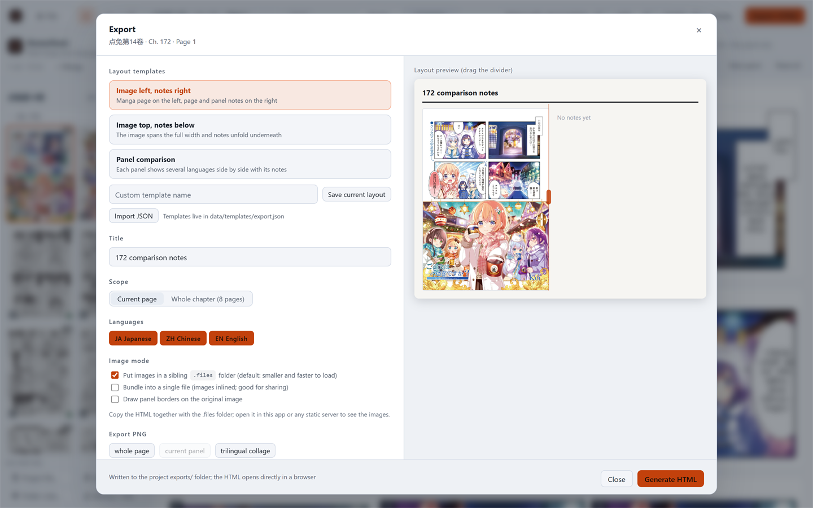

# KomaYomi

**日本語はすべて漫画から学んだ~**

[English](README.md) · [日本語](README.ja.md) · [简体中文](README.zh-CN.md)

KomaYomi 是一个本地优先的漫画阅读与批注应用，面向用漫画学外语的人。指定一个漫画页面文件夹，它会把同一页的日文、中文、英文对应起来，自动切分格，让你并排阅读、对齐画面、添加批注，同时用 Markdown 记笔记。没有账号，也不上传：图片留在你自己的文件夹里，工作成果就存放在旁边的纯 JSON 中。

它是学习工具，不是漫画托管服务。请使用自己的素材，在本机逐页阅读。

## 界面截图


_图库直接由文件夹结构生成，每话会显示页数和可用语言。_


_切格工作台：带编号的分格、八向缩放手柄、坐标数值输入、分格模板与标注层。_


_对照阅读：同一页的日文、中文、英文，按分格逐一对照。_


_笔记以页或格为单位，支持 Markdown、实时预览和标签。_



_导出：整页或整话的 HTML，可带图片目录或打成单文件，也能输出 PNG。_

| 亮色                                                      | 暗色                                                     |
| --------------------------------------------------------- | -------------------------------------------------------- |
|  |  |


_宽度小于 1024 px 时图库变成抽屉，对照视图改为纵向堆叠；Web 版可作为 PWA 安装。_

示例漫画仅用于演示，所有权利归原作者所有。

## 主要功能

**阅读**

- 直接把 `raw/` 当作图库扫描：`raw/<卷>/<语言>/<话>/<页面>`，每卷支持任意数量的语言。
- 跨语言按排序位置配对页面，缺语言的页面会给出提示。
- 对照阅读：左右并排或叠加，按语言遮罩，滚轮缩放与拖动，支持整页或单格对照。
- 四种对齐方式：整页统一偏移、逐格独立偏移、双锚点点对点、网格／百分比吸附；可保存为页或话的预设。

**分格**

- XY-cut 自动检测，并排除页面边缘的窄条（如 _あらすじ_），避免误判成格子。
- 手动编辑：拖拽框选，边拖边预览并吸附；支持八向缩放、直接输入 `X / Y / 宽 / 高`、键盘微调、多选、合并与删除。
- 分格模板：把当前页保存为模板，套用到同话其他页；`data/layouts/` 中的声明式布局模板会在检测时自动生效。
- 标注层：箭头、矩形、椭圆、高亮、自由画笔、文字、角标和真正的马赛克，可画在整页或单个分格内，导出 PNG 时可选择是否烘焙进去。

**笔记**

- 页级与格级 Markdown 笔记，支持编辑／分栏／预览三种模式、格式工具栏和随内容增高的编辑框。
- 标签、来源（可选抓取网页标题）、粘贴或拖入的截图，以及便签区。
- 跨正文、标签与来源的全文搜索，以及“复制上下文”——把本页笔记整理成一段上下文，交给 LLM 或翻译工具。

**导出与备份**

- HTML 两种模式：`.html` 加同名 `.files/` 图片目录（默认），或把图片内嵌成单文件。
- 支持整页或整话导出、选择包含的语言、套用布局模板；打印样式会避免把分格和笔记从中间切开。
- PNG 导出：整页、当前分格、三语拼图。
- PDF（通过浏览器打印对话框）与 Word（`.docx`）导出，包含页面图片与笔记；标注暂不写入 `.docx`。
- `data/` 的备份 ZIP（恢复前可先检查内容），以及 `.mnproj` 工程包：引用模式（路径 + SHA-1）或打包模式（内嵌图片，导入时可重新关联）。

**桌面、离线与界面**

- 既能作为浏览器应用连接本地 Node 服务，也能在 Electron 窗口中运行。
- WebDAV、网络盘与本机目录都可作为远端图片来源，支持按需缓存；保存失败时由浏览器侧的待写队列补写。
- 亮色与暗色主题，英文／中文／日文界面，窄屏下使用抽屉导航和触摸缩放。
- 可安装的 PWA，Web 构建自带 manifest。

**扩展**

- 在 `plugins/` 或 `data/plugins/` 放入一个小的 `.mjs` 即可替换内置分格检测。
- 批处理 CLI，无需打开浏览器就能跑检测、模板、布局与对齐预设。

## 快速开始

环境要求：Node.js 22 及以上，附带 npm。批处理 CLI 依赖 Node 的 TypeScript 支持（Node 26 可直接运行 `.ts` 入口）。

```bash
npm install
npm run dev
```

`npm run dev` 会在 `http://127.0.0.1:5173` 启动 Vite；端口被占用时会自动换到下一个空闲端口。API 由 Vite 中间件提供，不需要再启动第二个进程。

在 `raw/` 下至少放一卷，结构如下：

```text
raw/
  <卷>/
    <语言目录>/       # ja / zh / en，或下面列出的别名
      <话>/
        001.jpg
        002.jpg
```

然后打开应用，在侧栏里选择一话即可开始阅读。

### 桌面应用

```bash
npm run desktop
```

该命令会构建前端、把服务端打包到 `dist-server/`，再打开 Electron 窗口。从源码运行时，`raw/`、`data/`、`exports/` 沿用仓库目录；打包版使用 Electron 用户数据目录下的 `library` 文件夹，并在首次启动时询问位置。`Ctrl+Shift+D` 可切换数据目录（需要重启），`MANGA_DATA_DIR` 可覆盖。

### Docker

```bash
docker compose up --build
```

容器在 `http://127.0.0.1:3921` 提供相同的 API。它只适合在自己的机器上运行，不是公开服务：没有账号，也没有鉴权。三个绑定挂载把状态放在镜像之外：

| 挂载        | 容器内路径          | 内容                                  |
| ----------- | ------------------- | ------------------------------------- |
| `./raw`     | `/data/raw`         | 漫画页面（`<卷>/<语言>/<话>/`）       |
| `./data`    | `/data/annotations` | 页面 JSON、预设、模板、图库配置       |
| `./exports` | `/data/exports`     | HTML / PNG 导出、备份、`.mnproj` 工程 |

配置写在 `.env`（复制 `.env.example`）：`PORT`、`MANGA_LOCALE`、`LOG_LEVEL`，以及可选的 `WEBDAV_*` 凭据。凭据只在运行时读取，不会写进镜像。健康检查在 `/api/health`。

### 批处理 CLI

CLI 直接操作 `raw/` 和 `data/`，不需要浏览器或服务进程。

```bash
node scripts/manga-cli.ts report
node scripts/manga-cli.ts detect --volume <卷> --chapter <话> --pages 1,2 --apply
node scripts/manga-cli.ts plugins
```

| 命令                                                  | 用途                                                                    |
| ----------------------------------------------------- | ----------------------------------------------------------------------- |
| `report [--narrow]`                                   | 输出所有页面的分格数分布；`--narrow` 列出贴边的窄条。                   |
| `detect … [--apply]`                                  | 按与界面相同的“模板 → 插件 → 自动”优先级检测；不加 `--apply` 为试运行。 |
| `apply-layout` / `apply-template` / `apply-align`     | 把布局、分格模板或对齐预设套用到某话的页面。                            |
| `templates` / `layouts` / `align-presets` / `plugins` | 列出现有资源。                                                          |
| `regress [--update]`                                  | 与 `scripts/detect-baseline.json` 对比分格数。                          |

## 脚本

| 命令                                 | 作用                                             |
| ------------------------------------ | ------------------------------------------------ |
| `npm run dev`                        | 带本地 API 中间件的 Vite 开发服务器              |
| `npm run desktop`                    | 构建前端与服务端，再启动 Electron                |
| `npm run build`                      | 类型检查并构建前端到 `dist/`                     |
| `npm run preview`                    | 预览生产构建的前端                               |
| `npm run server:build`               | 把 Node 服务端打包到 `dist-server/`              |
| `npm start`                          | 提供已构建的前端与 API（独立运行 / Docker 入口） |
| `npm run dist:win`                   | 生成 Windows NSIS 安装包与便携版到 `release/`    |
| `npm run dist:dir`                   | 生成用于调试的未打包目录                         |
| `npm run docker:build` / `docker:up` | 构建 / 启动容器镜像                              |
| `npm run typecheck`                  | 只做类型检查，不产出文件                         |
| `npm run lint` / `lint:fix`          | ESLint                                           |
| `npm run format` / `format:check`    | Prettier                                         |
| `npm run i18n:scan`                  | 扫描语言文件之外硬编码的中文                     |
| `npm run docs:dev` / `docs:build`    | `docs/` 里的文档站                               |

打包配置在 `electron-builder.yml`（应用 ID `com.payayakamo.komayomi`，产品名 `KomaYomi`）。`npm run dist:win` 会把 `KomaYomi-<version>-x64.exe`、`KomaYomi-<version>-portable.exe` 和 `win-unpacked/` 输出到 `release/`。

## 目录结构

```text
src/                React 前端（图库、切格、对照、笔记、导出）
server/             Node HTTP API、图库扫描、检测、导出、备份
shared/             前后端共用代码（类型、Markdown、几何计算）
electron/           Electron 主进程与数据目录处理
plugins/            分格检测插件（含示例）
scripts/            批处理 CLI、服务端构建、i18n 扫描
docs/               VitePress 文档站
public/             图标与 PWA manifest
raw/                你的漫画页面（已 gitignore）
data/               页面 JSON、模板、预设、图库配置
exports/            生成的 HTML / PNG、备份、工程包（已 gitignore）
```

## 图库目录规则

目录结构本身就是配置，没有导入步骤，也没有数据库。

- **卷** 是 `raw/` 下任意一级文件夹。
- **话** 是语言目录里的文件夹；不同语言的话会合并，所以某种语言可以缺少某一话。
- 页面按**排序位置**配对而不是按文件名，使用自然排序（`2.jpg` 排在 `10.jpg` 前）。
- 可识别的语言目录：`ja`、`jp`、`jpn`、`japanese`、`ja-jp`、`日`、`日本語`、`日文`；`zh`、`zh-cn`、`zh-hans`、`zh-sg`、`cn`、`chs`、`zh-tw`、`zh-hk`、`zh-hant`、`cht`、`tw`、`hk`、`中`、`中文`、`繁中`、`简中`；`en`、`en-us`、`en-gb`、`us`、`uk`、`eng`、`english`、`英`、`英文`。
- 无法识别的目录可以在卷设置里手动指定语言，映射写入 `data/library.json`，不会重命名磁盘文件。
- URL 哈希可直接打开：`#/<卷>/<话>/<页>/<panels|compare>`。

## 数据与备份

| 路径                                                | 内容                                                                  |
| --------------------------------------------------- | --------------------------------------------------------------------- |
| `raw/`                                              | 页面图片。体量最大，也是唯一需要你提供的目录。                        |
| `data/pages/<卷>/<话>/<index>.json`                 | 分格、笔记、对齐偏移、标注与阅读顺序，每页一个文件（索引从 0 开始）。 |
| `data/templates/`、`data/presets/`、`data/layouts/` | 分格模板、对齐预设、布局模板；保存第一个时才会创建对应目录。          |
| `data/library.json`                                 | 语言目录的手动映射与语言顺序。                                        |
| `data/cache/thumbs/`                                | 缩略图缓存，可随时删除。                                              |
| `data/backups/`                                     | 恢复或导入工程前的快照。                                              |
| `exports/`                                          | 导出的 HTML / PNG、备份 ZIP 与 `.mnproj` 工程。                       |

备份 ZIP 覆盖 `data/`（不含缩略图缓存），恢复前会要求确认文件数与页面数，并先给当前数据拍快照。`.mnproj` 分为引用模式（路径 + SHA-1，体积小）和打包模式（内嵌图片，便于携带，体积大）。完整流程见[远端存储与备份](https://payayakamo.github.io/KomaYomi-docs/zh/guide/remote)。

桌面版的数据目录记录在 `%APPDATA%/manga-memo/config.json`。

## 模板与插件

检测页面时，服务端依次尝试绑定到该页、该话或该卷的布局模板，然后是 `plugins/` 或 `data/plugins/` 中匹配的插件，最后才用内置检测器。插件抛错、超时（2.5 秒）或返回零个分格时会给出提示并回退到内置检测。插件运行在服务端进程中，拥有完整的 Node 权限，请只安装你信任的插件。

插件接口、模板约定与 API 端点见[布局模板与插件](https://payayakamo.github.io/KomaYomi-docs/zh/extending)。

## 文档

完整用户手册发布在 **https://payayakamo.github.io/KomaYomi-docs/**：

| 语言    | 入口                                           |
| ------- | ---------------------------------------------- |
| English | https://payayakamo.github.io/KomaYomi-docs/    |
| 中文    | https://payayakamo.github.io/KomaYomi-docs/zh/ |
| 日本語  | https://payayakamo.github.io/KomaYomi-docs/ja/ |

## 在线体验（开发中）

纯浏览器版本仍在开发中，暂时没有公开的体验地址。源码位于 `https://github.com/PayayaKamo/KomaYomi-online`；上线后会在本节补上正式入口。

目前的定位和边界：

- **纯静态页面，没有服务端。** 它能打开 `.mnproj` 工程文件查看和编辑，但不能扫描你电脑上的目录，自动切格也还没有移植到浏览器。
- **数据在 IndexedDB 里。** 你的工作保存在浏览器的 IndexedDB 中；换设备或清理站点数据、缓存前，请先导出工程。
- **选文件夹只有 Chromium 系支持。** 阶段 2 落地后，Chromium 系浏览器可以选择文件夹；Safari 和 Firefox 需要手动选择文件。
- **漫画始终留在你自己机器上。** 本项目不托管任何漫画内容。

## 路线图

- 词表导出；PDF 与 Word 现在已能在导出对话框中直接使用。
- 定时备份；目前备份需手动启动。
- 针对导入 / 导出往返的自动化集成测试。

## 已知限制

- 单用户、无鉴权。不要把服务端或容器暴露到不受控的网络。
- 自动检测不解码 WebP 页面，请先转成 JPEG 或 PNG。
- 目录模式的 HTML 导出依赖同名 `.files/` 文件夹，单独移动 HTML 会缺图；单文件模式可以避免，但整话可能达到数十 MB。
- 套用分格模板或重新检测导致分格数量变化时，格级笔记会被丢弃（页级笔记保留）。
- 界面只提供英文、中文、日文；插件返回的文本与错误信息不做翻译。

## 作者与许可

KomaYomi 由 **PayayaKamo** 开发，基于 [MIT License](LICENSE) 发布。

KomaYomi 是独立项目，与任何同名或近名的项目、产品或组织无关。截图中的漫画页面仅用于演示，所有权利归原作者所有。仓库不包含第三方漫画。
