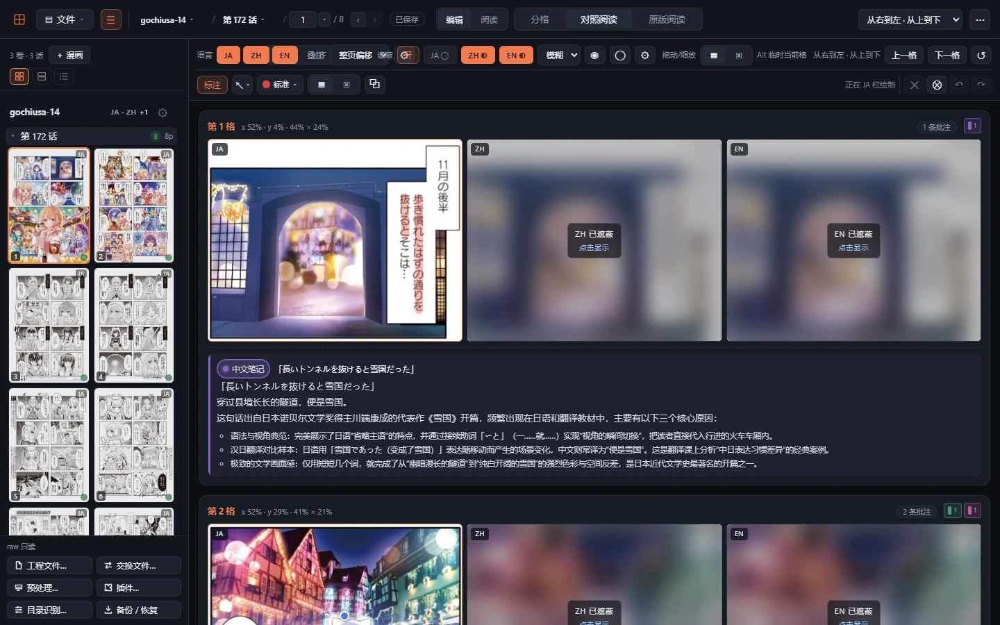
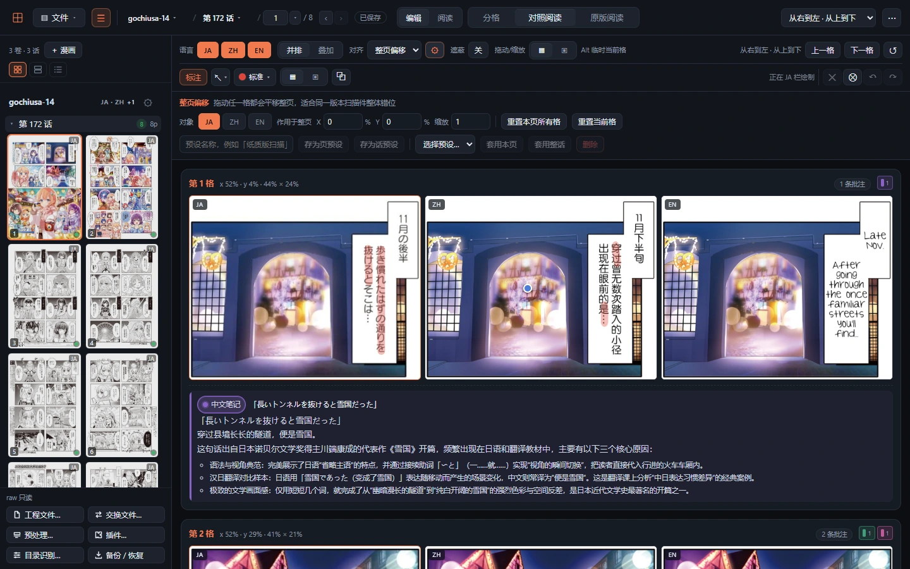

# Compare Reader

The compare reader puts the same panel from two or more languages next to each other — or on top of each other — and lets you align the artwork so the comparison is actually honest.

<figure class="shot">
  
  <figcaption>Side-by-side mode with three languages. Each language is its own pane; alignment is stored per page and applied to exports.</figcaption>
</figure>

## The problem it solves

Two editions of the same book rarely line up exactly: the raw and the scanlation are shifted, cropped or scaled differently. Comparing a page as a whole hides small differences. Comparing **one panel at a time**, with each language independently aligned, makes wording, tone and omissions visible.

## Layouts

| Control | Behaviour |
| --- | --- |
| **Language chips** (`JA`, `ZH`, `EN`, …) | Toggle a language on or off. A language missing on this page is disabled with a tooltip. |
| Drag a chip | Reorders the panes. The order is remembered. |
| `↺` | Restores the library's language order. |
| **Side by side** | One column per selected language. On a narrow window the panes stack vertically. |
| **Overlay** | All selected languages are drawn in the same box. |
| **Multiply** (Overlay only) | Multiplies the layers so line art shows through. |
| **Aligning** chips (Overlay only) | Chooses which language you are dragging, so two panes never move at once. |

## Masking

Masking hides a language's artwork while you test your own comprehension — the manga-learner equivalent of covering the answer.

| Control | Behaviour |
| --- | --- |
| **Mask: On / Off** | Master switch. `H` toggles it; `Shift+H` reveals everything. |
| Per-language `◐` / `◯` chips | Choose which languages are masked. |
| **Mask style** | **Blur** or **Solid**. |
| **Mask all** | Re-masks every currently visible pane. |
| **Reveal all** | Turns the master switch off. |
| **Defaults…** | Remembers which languages start masked, across sessions. |
| Click a masked pane | Reveals it temporarily; click the artwork again to mask it. |

Masks are a **reading preference only**. HTML and PNG exports never include masks. Mask defaults are stored in the browser, not in the page JSON.

<figure class="shot">
  
  <figcaption>Masking with Chinese and English hidden. Default masks remembers which languages start masked; clicking a masked pane reveals it temporarily.</figcaption>
</figure>

## Zoom, pan and scope

- **Wheel** over a pane zooms that language. The wheel is captured only while the pointer is inside a pane, so normal page scrolling still works elsewhere.
- **Drag** a pane to pan it.
- **Drag/zoom** scope has two modes: **Whole page** and **This panel**.
- Hold `Alt` while dragging or scrolling to adjust only the current panel, whatever the default scope is.
- **Previous panel / Next panel** move the focused panel in reading order. Past the first or last panel of the page, they turn to the neighbouring page and focus its last or first panel instead. Pages excluded by preprocessing are skipped, chapter boundaries are crossed, and at the very start or end of the volume nothing moves. Unsaved edits still go through the usual save-mode check first.
- **Reset all** clears offsets in the current scope.

Each language has `{ x, y, scale }`. `x` and `y` are fractions of the panel width and height; `scale` zooms the crop between 0.5× and 3×.

### Auto-centring

When the selected panel changes — previous / next, a keyboard shortcut, a jump from the sidebar or the notes overview, or a cross-page move — the compare reader scrolls the target panel into view.

- If the panel fits, it is centred; if it is taller than the viewport, its top edge is brought in with a small margin so the first line of art is not clipped.
- A panel that is already comfortably visible is left alone; the reader does not yank the page on every selection change, and it stops fighting you once you scroll by hand.
- On a cross-page jump, the scroll waits for the new page to render before aligning.
- The scroll respects the system **Reduce motion** setting and becomes an instant jump when that is on.

## Alignment modes

Alignment is stored in the page JSON, never baked into the images.

| Mode | Behaviour | Good for |
| --- | --- | --- |
| **Whole-page offset** | Dragging any panel translates the whole page for that language. | A whole scan is shifted by the same amount. |
| **Per-panel offset** | Each panel has its own offset. | Digital and print editions have different panel positions. |
| **Anchor alignment** | Click a feature point on the reference language, then the same point on another language; the offset is computed. | Precise, repeatable alignment of one detail. |
| **Grid snap** | Dragging snaps to a step of 0.5%, 1%, 2% or 5%. | Tidy, reproducible numeric offsets. |

Anchor mode shows a prompt with the reference language. Click a feature point in any cell first, then the same spot in another cell. **Cancel anchor** clears the pending point. The pending anchor is not saved.

<figure class="shot">
  
  <figcaption>Step 1: after choosing **Anchor alignment**, click a feature point on the reference language; the prompt shows the pending anchor, and **Cancel anchor** clears it.</figcaption>
</figure>

<figure class="shot">
  
  <figcaption>Step 2: click the same spot on the target language; X and Y are computed immediately (-1.62% / -1.69% here), ready to fine-tune or save as a preset.</figcaption>
</figure>

### Alignment settings

**Alignment settings** opens a panel with:

- The **target** language chips.
- Exact **X**, **Y** and **Scale** inputs for the selected target.
- **Reset all panels on this page** — clears per-panel offsets; whole-page offsets are unaffected.
- **Reset current panel** — clears per-panel offsets for the selected panel only.
- **Save as page preset** / **Save as chapter preset** — stores the current alignment under `data/presets/align.json`.
- Choose a preset, then **Apply to this page** or **Apply to chapter**; **Delete** removes it.

Presets record the alignment mode, offsets, panel offsets and grid step. Applying a chapter preset is the fastest way to fix a uniformly shifted scan across a whole chapter.

<figure class="shot">
  
  <figcaption>Alignment settings: pick the target language, type exact values, or save the current alignment as a page or chapter preset.</figcaption>
</figure>

## Annotations in the compare reader

The annotation toolbar works here too, and compare view is the fastest place to mark a wording difference between the raw and the scanlation.

- New marks follow the same page/panel scope as in the workbench; selecting a panel scopes the next mark to that panel.
- In compare view the layer is shown by default, so marks are visible while you compare. Use the **Annotations** switch to hide them.
- Marks are shared across views: a mark added in the compare reader appears in the panel workbench and in exports.
- `Esc` leaves the current tool; `Delete` removes the selected mark.
- With a mark selected, **Anchor** in the toolbar turns the canvas into locator mode: click to drop a point, or drag a small box around an area. **Clear anchor** removes it.
- **Leader** is on by default and draws the line from the mark to its locator. Text and badge callouts without an anchor fall back to the owning panel, so older annotations still get a sensible line. Turn the switch off to keep the mark alone.
- Anchors are stored in page coordinates, so they stay glued to the artwork while you pan, zoom or switch languages. All three export paths — PNG, HTML and Word (baked annotations) — draw the locator marker and leader exactly as the editor shows them.

### Marks belong to a language

Each mark is tagged with the language lane it was drawn in. Drawing an arrow in the Japanese pane does not put it on the Chinese or English version; the same panel can carry a different mark for each edition. A single toggle shares one mark with all languages when the point is about the edition as a whole.

The switch is deliberate: a note about a translator's word choice usually makes sense in one lane only, while a box around a sound effect belongs everywhere.

### Right-click menus

Right-click a mark for its own menu:

- **Delete** the mark.
- **Colour** — pick another colour without redrawing.
- **Copy to language** — duplicate the mark into another lane, keeping its geometry.

<figure class="shot">
  
  <figcaption>The annotation context menu: delete the mark, recolour it, or copy it to another language at the same coordinates. After copying, each lane holds its own independent mark.</figcaption>
</figure>

Right-click empty artwork for the pane menu: **view the image enlarged**, hide this language, mask it, show only this language, show all languages, reset the pane zoom, export this panel as PNG, copy panel coordinates, set the panel number, toggle panel numbers, and insert a link. The same menu is available in read-only mode where it does not write anything.

## A practical comparison loop

1. Open a page in **Compare** (`C`).
2. Enable `JA` + `ZH` (and `EN` if available — or whichever languages the volume has), in the order you want to read.
3. Choose **Per-panel offset** if the editions differ per panel; otherwise start with **Whole-page offset**.
4. Drag each language's pane until the panel contents line up.
5. Save an alignment preset if the rest of the chapter shares the offset.
6. Switch to **Overlay** with Multiply to spot differences in line art or lettering.
7. Turn on masks to test yourself, then reveal each pane.

## Behaviour details

- Alignment offsets are applied at export time too, so the exported crop matches what you see.
- The reader needs panels first. If a page has none, it shows a hint to visit the panel workbench.
- Switching pages keeps the mask preference but clears temporary reveals.
- Each pane carries a note count; selecting a panel here scopes a new note to that panel in the shared notes column.
- Missing languages show placeholders rather than empty panes.

<figure class="shot">
  
  <figcaption>The compare toolbar: language chips, mask mode, side-by-side / overlay, alignment scope and the drag switch for the current panel.</figcaption>
</figure>

## Panel detail view

Double-click a panel row to open it full-size. The whole row is the target — the language panes, the head with the panel number, and the blank margins around a crop all open the same panel. Clicks inside editors, drag handles, buttons and links are excluded, and on touch layouts a double-tap on the row does the same thing.

- **Page layout** — **Auto**, **Side by side** (artwork left, notes right) or **Stacked** (artwork on top, notes below). Auto follows the window width; when the window is too narrow for two columns the view says so and stacks, instead of squeezing both.
- **Draggable splitter** — in the two-column layout the divider between artwork and notes can be dragged, or moved with the arrow keys when focused. The chosen ratio is remembered across panels, pages and reloads.
- **Language panes** — **Horizontal** keeps the languages side by side; **Vertical** stacks them full-width, which is what you want in a narrow window or on a tall screen. The choice is remembered, and a narrow window falls back to vertical automatically.
- **Alignment by dragging** — drag the artwork itself to nudge that language's offset. With **Sync move** off, only the lane you touch moves; with it on, dragging one language moves every language together. Zoom follows the same switch, so "make them all 10% bigger" is one drag or one click.
- **Exact values** — the Align drawer still exposes each language's `Δx` / `Δy`, 1% arrow nudges, zoom − / + and a per-language reset, plus **Reset all**.
- These detail-view adjustments last for the current session only; they do not write back to the page or the saved alignment.
- **Zoom** — the wheel or a pinch over an image zooms the lane under the pointer; the header has zoom buttons and **Fit width**. **Reset** clears the zoom and every Δ at once.
- The notes column uses the same editor as the sidebar and writes directly to this panel; changing panels, paging or going back flushes the draft first.
- **Navigation bar** — the detail view's footer sits outside the scrolling area, so it never covers the art or the notes: previous page and previous panel on the left, next panel and next page on the right. On desktop the buttons show words; on narrow screens they collapse to icons with tooltips. At a page edge, previous panel jumps to the last panel of the previous page and next panel to the first panel of the next page — the detail view stays open, and the URL follows the new page and panel.
- **Leaving** — `Esc`, the **Back** button and the browser back button all return to the same page and panel you came from. The URL is a deep link (`…/compare/panel/<id>`), so a reload or a shared link reopens the same panel; `Alt`/`Cmd`-clicking a row opens it in a new tab.

<figure class="shot">
  
  <figcaption>The panel detail view: artwork and that panel's notes on one screen. The header switches the layout, opens the alignment drawer or resets the view; the footer navigation sits outside the scroll area and never covers the artwork.</figcaption>
</figure>

<figure class="shot">
  
  <figcaption>Compare reading in focus mode (`R`): every control is tucked away, leaving just the canvas and panels. A brief hint names the way out; press `Esc` or `R` again to return.</figcaption>
</figure>

## Enlarged image viewer

Right-click a pane and choose **View image enlarged** (the same command is in the detail view's pane menu) to inspect the artwork without leaving the reader.

- The image is shown at its original resolution, with wheel zoom and drag to pan — useful for checking a glyph, a dotted screentone or a retouch seam.
- **Switch language** inside the viewer to compare the same moment across editions without closing it.
- **Previous / next** move through panels in reading order, so you can inspect a whole page of small art quickly.
- `Esc` or a click on the backdrop closes it. The page keeps its previous zoom, scroll position and any note draft; nothing is saved or changed by looking.
- It is available in read-only mode too, because it never writes.

<figure class="shot">
  
  <figcaption>The enlarged image viewer: inspect a glyph, a screentone or a retouch seam at original resolution, switch languages and step to the previous / next panel. It works in read-only mode too.</figcaption>
</figure>

## Original view

The **Original** view (`O`) shows the uncropped page for each active language side by side, with wheel zoom from 0.5× to 6×, drag to pan, and the same per-language masks. It is the place to check what sits outside the detected panels.

- **Linked / independent** — the toggle in the original-view toolbar decides whether pan and zoom are shared. In **Linked** mode, dragging or zooming one column applies the same relative position and scale to every column; each column resolves those fractions against its own displayed size, so pages of different dimensions stay aligned. **Independent** mode keeps a separate view per column.
- Turning linking on adopts the first visible column's current view and applies it to the others.
- The setting is remembered per browser in `localStorage` (`manga-memo.original-linked`), is on by default, and only matters when two or more languages are displayed.

<figure class="shot">
  
  <figcaption>The original view (`O`): uncropped pages side by side; the Linked / independent toggle in the toolbar decides whether pan and zoom are shared across every language column.</figcaption>
</figure>

## Common pitfalls

- **“This page has no panels yet.”** Go to **Panels** (`P`) and run **Auto split**, then come back.
- **I dragged but the other languages moved.** In Overlay mode, check the **Aligning** chip; only the selected language is dragged.
- **Scale drifted.** Per-panel zoom and per-panel offset are stored separately from the whole-page values. Reset the current panel if a test zoom was left behind.
- **The pane jumps while scrolling.** The wheel is captured only inside a pane; move the pointer to the page margin to scroll normally.
- **Masks appear in a screenshot.** Masks are a UI preference and are not part of exports, but a normal screen capture will show them.
- **A chip is greyed out.** That language has no image on this page. Check the library warning or the volume language mapping.

## Related

- [Panel Workbench](/guide/panels) — panels must exist first.
- [Notes](/guide/notes) — write down what you notice.
- [Remote Storage & Backup](/guide/remote) — behaviour when an image is not cached locally.
