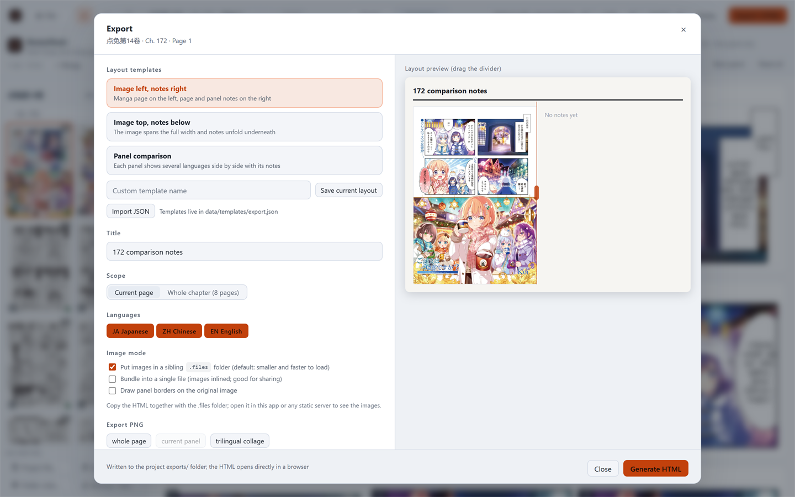
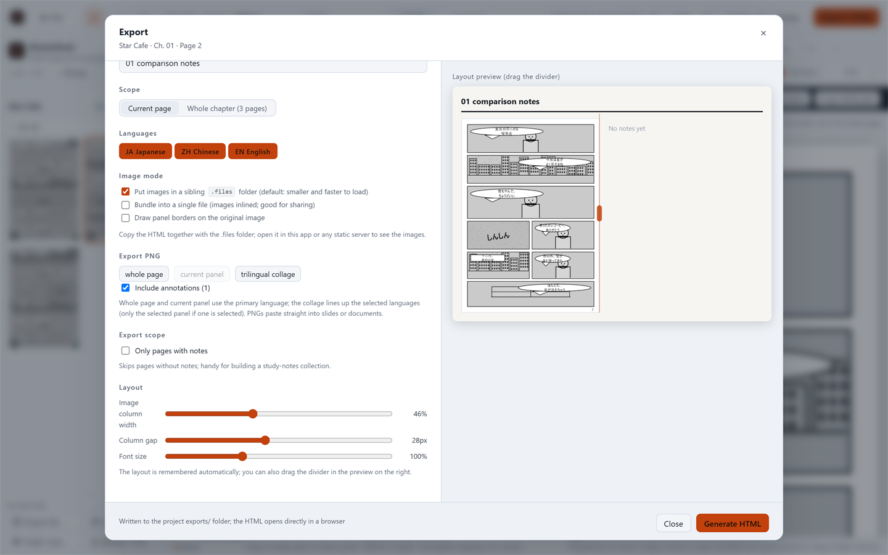

# Export

Export turns a chapter of panels and notes into something you can actually carry: an HTML study document, PNG images for slides, a `.docx` for people who live in Word, or a print view for the PDF crowd.

<figure class="shot">
  
  <figcaption>The export dialog. The left column configures the document; the right side previews the layout and can be resized by dragging the divider.</figcaption>
</figure>

## The problem it solves

Your notes live inside the app, glued to panels. Reviewing them on a tablet, printing them, or dropping a comparison into a slide deck all need a portable artifact that keeps the page image and the matching notes together — without uploading anything.

## Opening the dialog

Press `E`, or click **Export** in the top bar. The dialog always exports the page or chapter you are looking at.

## HTML export

### Title and scope

| Control | What it does |
| --- | --- |
| **Title** | Document title, also used for the suggested file name. |
| **Current page** | Exports only the open page. |
| **Whole chapter (n pages)** | Exports every annotated page in the chapter. |
| **Only pages with notes** | Skips pages without notes; useful for a study-notes collection. |
| **Languages** | Which languages appear in the document. |

### Image mode

| Mode | Behaviour |
| --- | --- |
| **Sibling `.files` folder** (default) | The HTML references images in a folder next to it. Smaller and faster to load. Copy both together. |
| **Bundle into a single file** | Images are inlined as data URLs. One file to share, but a full chapter can be tens of megabytes. |

**Draw panel borders on the original image** overlays the panel rectangles on the exported artwork. This is independent of annotations.

**Only export notes with these tags** filters notes by tag; **Clear filters** removes the selection.

### Layout

Three built-in layout templates:

| Template | Result |
| --- | --- |
| **Image left, notes right** | Manga page on the left, page and panel notes on the right. |
| **Image top, notes below** | The image spans the full width and notes unfold underneath. |
| **Panel comparison** | Each panel shows several languages side by side with its notes. |

Layout templates can be saved under a custom name, exported as JSON and imported again. They live in `data/templates/export.json`. The layout controls are:

| Control | Effect |
| --- | --- |
| **Image column width** | Width of the image column, in percent. |
| **Column gap** | Space between image and notes. |
| **Font size** | Base font scale for the document. |
| **Columns per row** | Number of page blocks per row. |

The layout is remembered automatically. You can also drag the divider in the live preview to set the image width.

### Generating

1. Choose scope, languages, image mode and layout.
2. Click **Generate HTML**.
3. When it finishes, the dialog reports how many pages were exported and where the file went.
4. Use **Open HTML** to open it in the browser, or **Download HTML** to save a copy. With the default image mode, copy the `.files` folder as well.

Files are written to the project's `exports/` folder. The HTML opens directly from disk.

### Printing

The generated HTML includes print styles: backgrounds are removed, the page width is unconstrained, and page blocks avoid breaking mid-image. Open the file in a browser and use the normal **Print** command to produce a PDF via the browser's print dialog.

::: tip Printing to PDF
Choose **PDF (print)** in the export dialog — the print view opens with the browser print dialog, where you pick **Save as PDF**. See [PDF and Word](#pdf-and-word).
:::

## PNG export

The **Export PNG** section produces images directly, without a document:

| Mode | Content |
| --- | --- |
| **Whole page** | The page image with panel borders and annotations. |
| **Current panel** | The selected panel, cropped and aligned. |
| **Trilingual collage** | The selected languages placed side by side for the same panel (or the whole page when no panel is selected). |

Options:

- **Include annotations (n)** — draws the annotation layer into the PNG. The count shows how many marks will be included.
- Whole-page and current-panel PNG use the **primary (base) language**; the collage uses the selected compare languages.
- **Current panel** is disabled until a panel is selected in the workbench.

PNGs are generated in the browser and land in the browser's download folder. They paste straight into slides, documents or chat.

<figure class="shot">
  
  <figcaption>The export dialog with the PNG modes visible. Whole page and current panel use the primary language; the trilingual collage uses the selected languages.</figcaption>
</figure>

## PDF and Word

The export dialog has three output formats: **HTML**, **Word document** and **PDF (print)**.

### Word (`.docx`)

1. Press `E` and choose **Word document**.
2. Set the scope, languages and note tag filter as usual.
3. Click **Generate Word**, then **Download .docx**.

The document keeps the page images and turns page and panel notes into editable Word text. Annotations are **not** embedded in the `.docx` yet — use a PNG or the HTML export when you need the marks.

### PDF (print)

1. Choose **PDF (print)** and click **Generate print view**.
2. The print view opens in a new tab and brings up the browser print dialog.
3. Choose **Save as PDF**.

Images are fitted to one page and notes stay with their page. Backgrounds are removed, the page width is unconstrained and page blocks avoid breaking mid-image.

### Plain text / Markdown

Use **Copy page context** or the **Rendered / Source** toggle on a note; the note body is Markdown.

## Export templates

An export template (`.mnexp`) stores the layout and style settings so the same look can be reused or shared. Export and import templates through **Exchange files…** in the sidebar. Imported templates are validated and the original file is backed up under `data/backups/exchange/`.

## Common pitfalls

- **The HTML has broken images.** With the default mode, the `.files` folder must travel with the HTML. Move them together.
- **A single-file export is enormous.** That is expected: every image is inlined. Use the `.files` mode for a whole chapter.
- **A page is missing from the export.** It has no notes and **Only pages with notes** is on, or it has no images in the selected languages.
- **Panel borders are not in the PNG.** PNG export uses the annotation toggle; enable **Include annotations**, and remember that panel borders are drawn from the panel rectangles, not from annotations.
- **Print output is cropped.** Set the browser print scale to “Fit to page” and enable background graphics only if you need the shading.
- **Word ignored the layout.** Paste the rendered HTML rather than the Markdown source; Word keeps HTML tables and images but not the two-column drag width.
- **The `.docx` or PDF button is missing.** Both are in the export dialog: choose **Word document** or **PDF (print)** at the top. Annotations are not embedded in Word yet.
- **The output folder is not writable.** In a packaged desktop build, `exports/` lives inside the chosen library folder.

<figure class="shot">
  
  <figcaption>The exported HTML opened in a browser: manga on the left, page and panel notes on the right.</figcaption>
</figure>

## Missing screenshots

| Figure | Needed for |
| --- | --- |
| PNG mode comparison | Whole page / panel / collage |
| export template controls | Save, import and apply |

## Related

- [Notes](/guide/notes) — what ends up in the document.
- [Project Files & Formats](/guide/project-files) — exporting the whole project instead.
- [Keyboard Shortcuts](/guide/shortcuts) — `E` opens this dialog.
