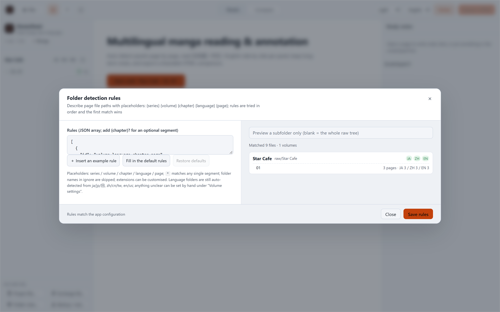

# Folder Detection Rules

Folder rules teach the scanner where the volume, language, chapter and page sit inside a path. They exist for libraries that refuse to follow the default `raw/<volume>/<language>/<chapter>/<page>` shape.

## The problem it solves

Real collections are not tidy. A series may sit under an author folder, a publisher may put the language last, and a single-language set may have no language folder at all. Renaming thousands of files is the wrong fix. Rules let the scanner understand the shape you already have.

<figure class="shot">
  
  <figcaption>The rules dialog: edit the rule array on the left, preview a subtree on the right, then save. The footer says whether the rules match the running configuration.</figcaption>
</figure>

## Using the dialog

1. Open **Folder rules…** at the bottom of the library sidebar.
2. Edit the JSON array of rules. **＋ Insert an example rule** adds a starting point; **Fill in the default rules** restores the built-in shape.
3. Type a subfolder in **Preview a subfolder only** to test one branch, or leave it blank to scan the whole `raw/` tree.
4. Check **Matched n files · m volumes**, the unrecognized-file list and the pages listed under each chapter.
5. Click **Save rules**. The library is rescanned with the new rules.

The preview updates while you type. **Restore defaults** discards your edits; **Save rules** is the only action that changes the library.

## Placeholders

| Placeholder | Aliases | Meaning |
| --- | --- | --- |
| `{series}` | `{seriesName}`, `{work}` | A series folder above the volume; include it only when that level exists. |
| `{volume}` | `{vol}`, `{book}` | The volume shown in the sidebar. |
| `{chapter}` | `{chap}`, `{ch}`, `{episode}` | A chapter folder. |
| `{language}` | `{lang}`, `{locale}` | A folder recognised as a language: a built-in alias such as `ja` or `zh-cn`, or a folder mapped in volume settings. |
| `{page}` | `{file}`, `{image}`, `{img}` | The image file. Required in every rule. |

Matching is case-insensitive on every platform, so a rule copied from a Windows machine still works elsewhere.

### Optional and wildcard segments

| Syntax | Behaviour |
| --- | --- |
| `{chapter}?` | The segment may be missing. `{volume}/{language}/{chapter}?/{page}` matches both with and without a chapter folder. |
| `*` or `**` | Matches exactly one segment that you do not care about. Both spellings behave the same. |
| Literal text | Must match the folder name exactly, e.g. `manga` in `manga/{volume}/…`. |

A rule must contain `{page}`. It must also contain `{language}`, unless it declares a fallback `language`.

## A rule object

```json
[
  {
    "id": "series-volume-language-chapter-page",
    "name": "Series / volume / language / chapter / page",
    "pattern": "{series}/{volume}/{language}/{chapter}?/{page}",
    "ignore": ["_extras", "covers"],
    "extensions": [".jpg", ".jpeg", ".png"]
  },
  {
    "id": "flat-japanese",
    "name": "Flat folder, Japanese only",
    "pattern": "{volume}/{chapter}/{page}",
    "language": "ja"
  }
]
```

| Field | Required | Meaning |
| --- | --- | --- |
| `id` | No | Stable identifier; generated when omitted. Duplicate ids are rejected. |
| `name` | No | Label shown in the dialog. |
| `pattern` | Yes | Slash-separated path with placeholders. |
| `ignore` | No | Folder names that are never descended into. |
| `extensions` | No | Accepted file extensions, with or without a leading dot. Defaults to `.jpg`, `.jpeg`, `.png`, `.webp`, `.gif`, `.avif`, `.bmp`. |
| `language` | No | Fallback language for patterns without `{language}`; a language id such as `ja`, `zh` or `en`. |
| `enabled` | No | Set to `false` to keep a rule without using it. |

## Order, language and conflicts

- Rules are tried **in order** and the first match wins. Put the most specific rule first.
- Inside a `{language}` segment, folder names are still recognised by alias — `ja`, `jp`, `日本語`, `zh-cn`, `cn`, `english`, a folder mapped in volume settings, and so on. See [Library & Import](/guide/gallery#language-directory-names).
- Without a `{language}` segment, the rule's `language` value is used for every page it matches.
- A file that matches no enabled rule appears in the **unrecognized** list and is not added to the library.
- Rules only affect detection. They never rename, move, copy or convert a file.

## When rules can break existing work

Page data is stored under `data/pages/<volume>/<chapter>/<index>.json`. Changing a rule can change the detected volume id or chapter id, and existing panels and notes will not follow automatically. Apply rules **before** annotating a new collection; if you must change them later, create a backup first and check a few pages afterwards.

## Common pitfalls

- **The preview is empty.** The pattern is anchored to the scanned root. Include every level, including a literal folder such as `manga/`.
- **A required segment is missing in some chapters.** Mark it optional with `?`, or add a second rule for the flatter shape.
- **All pages land in one chapter.** The `{chapter}` placeholder is missing, or a wildcard replaced it.
- **A language is not recognised.** The folder alias is unknown; map it in [volume settings](/guide/gallery#volume-settings) or add a `language` fallback.
- **Saving changed my volume list.** That is expected: the library is rescanned. Check the unrecognized list before writing notes.
- **Two rules match.** The first one wins. Drag the specific rule above the general one.

## Related

- [Library & Import](/guide/gallery) — the default layout and volume settings.
- [Preparing & Renaming Images](/guide/preprocess) — what to fix before scanning.
- [Data Formats](/data-format) — how volume and chapter ids appear in page data.
- [Terminology](/terminology) — the shared vocabulary for panels, pages and annotations.
