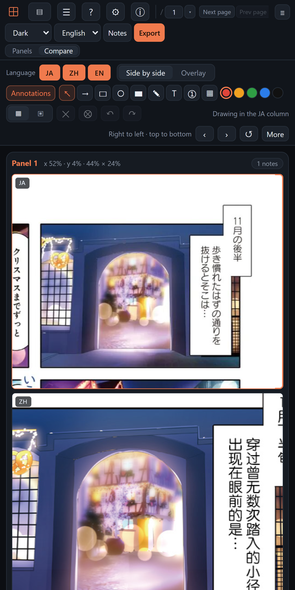
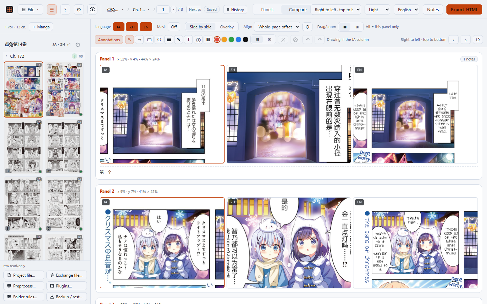

# Introduction

KomaYomi — **Manga Learner** — is a local-first web app for reading manga in more than one language at once. Maybe you are learning Japanese with one eye on the translation, maybe you are doing scanlation and want to check your typesetting against the raw, maybe you just need to know how that one line was handled in the official release. KomaYomi splits a page into panels, lines up the same panel across Japanese, Chinese and English, and lets you pin Markdown notes — TL notes, typesetting questions, vocabulary — to the exact panel they belong to.

It is neither a general-purpose manga reader nor a distribution platform. Everything runs on your own machine, against your own image folders.

## The problem it solves

Translations are easiest to study panel by panel, not page by page. But three scans of the same book almost never line up: the page is shifted, the panel is cropped differently, the lettering sits somewhere else. A normal image viewer gives you one zoom level, no notes, and no way to say "this balloon, in these three editions".

KomaYomi adds the missing middle layer:

1. **Structure** — panels are detected and stored as normalized rectangles, so your boxes survive any zoom, window size or export resolution.
2. **Alignment** — each language can be nudged independently until the same panel really overlaps. Yes, finally.
3. **Notes** — every remark is scoped to a page or a panel, in Markdown, with tags and sources. "I'll remember it later" is no longer a plan.

## The workflow

| Step | What you do | Page |
| --- | --- | --- |
| 1 | Get the scans in order: `raw/<volume>/<language>/<chapter>/01.jpg`, or point the app at a folder you already have. | [Preparing & Renaming Images](/guide/preprocess), [Library & Import](/guide/gallery) |
| 2 | Open a page, let it auto-split, then fix the boxes by hand. Detection is a draft, not a verdict. | [Panel Workbench](/guide/panels) |
| 3 | Read 2–3 languages side by side or in overlay, align them, mask the ones you are testing yourself on. | [Compare Reader](/guide/compare) |
| 4 | Write page and panel notes with tags, sources and screenshots. TL notes very much welcome. | [Notes](/guide/notes) |
| 5 | Export a study HTML, PNGs for slides, or a project package for another machine. | [Export](/guide/export) |

## A tour of the screen

<figure class="shot">
  
  <figcaption>The panel workbench. Top bar: page navigation, Panels / Compare, reading order, theme, interface language, Notes and Export. Left: library. Right: notes. Middle: the page with panel boxes — where you will spend most of your time.</figcaption>
</figure>

The window has five regions that never move, so muscle memory can take over:

- **Top bar** — brand (back to the library), volume / chapter / page, `‹` `›` page arrows, the save indicator, the **Edit / Read** usage mode, the **Panels / Compare / Original** switch, the reading-direction selector, focus mode (`⛶`), help (`?`), settings (`⚙`, edit mode only), about (`ⓘ`), the UI theme, the interface language, **Notes** and **Export**.
- **Library sidebar** (`S`) — volumes → chapters → pages, with per-page warnings and the entry points for adding a manga, folder rules, project files, exchange files and backup.
- **Stage** — the panel workbench, the compare reader or the original-page view, depending on the view switch.
- **Notes column** (`N`) — page notes, panel notes, overview search and the scratchpad.
- **Pane splitters** — drag the vertical handle between library and stage, or between stage and notes, to resize; double-click to reset.

A page can carry any number of languages. The language chips in the compare reader are enabled only for languages that exist on the current page.

When the window gets narrow, the top bar and the panel-workbench toolbar do not squeeze: secondary actions fold into a `≡` overflow menu, and at phone widths only essentials such as page turning and the view switch stay visible. The menu contains exactly the same entries as the wide layout, so nothing disappears.

## Edit mode and read mode

The **Edit / Read** switch in the middle of the top bar decides whether the workspace is an authoring tool or a viewer. The choice is kept in the browser and survives reloads.

- **Edit mode** — split panels, draw annotations, write notes and change the reading direction; edits are saved to `data/` according to the save mode, and the first visit to a page auto-detects its panels.
- **Read mode** — switching saves anything still pending on the current page, then clears the panel selection and closes the history and settings dialogs. A **Read-only** badge appears in the top bar. Useful for showing finished work to someone, or for review without accidental edits.

What read mode turns off:

| Area | Behaviour in read mode |
| --- | --- |
| Panel workbench | The split and edit toolbars, save / history, grid and templates, annotation drawing tools and keyboard nudging are hidden or inert; only zoom and pan remain. |
| Compare reader | Annotation drawing tools are hidden while existing annotations stay visible; alignment presets, anchor inputs and other controls that write data are hidden. Dragging and the wheel still pan/zoom temporarily, but nothing is written back. |
| Notes column | Viewing and searching only, with a "read mode: notes are view-only" notice; creating, editing, deleting and the scratchpad are unavailable. |
| Library sidebar | Adding manga, the volume settings gear, preprocessing, plugins, folder rules and backup are hidden; project files, recent pages and refresh stay. |
| Top bar and file menu | The reading-direction selector is disabled; the file menu keeps only open project, recent pages and export; `Ctrl+S` does not save. |

These limits are not just hidden buttons: while read mode is on, write requests are rejected by the server (`ERR_READ_ONLY`). Export, preview and project inspection keep working.

## Focus mode

Focus mode (the `⛶` button in the top bar, or `R`) is a different thing: it only hides the top bar, the stage toolbar, the panel section rail and the status bar so the page fills the window. It does not change the edit/read mode. Press `Esc` or `R` again to leave, or double-click empty space on touch devices. A brief tip names the exit gesture when you enter; it fades away and never sits over the artwork.

## The first ten minutes

1. Get the app running — `npm run dev` from the repo, or just launch the desktop build — then open `http://127.0.0.1:5173` in your browser.
2. Give the library something to read: drop a volume into `raw/`, or click **＋ Add manga** in the sidebar and pick a folder you already have.
3. Open any page from the sidebar. The first visit splits it into panels automatically and keeps the result in `data/pages/`.
4. To read two languages against each other, switch to **Compare** (`C`), tick `JA` and `ZH`, and drag one pane until the same panel lines up in both. Working panel by panel is much easier than nudging the whole page.
5. When something is worth keeping, open **Notes** (`N`), select a panel, and write your first note. `Ctrl+Enter` saves it.
6. Finally, press `E` to export an HTML file and open it in your browser to see how it reads.

## What is implemented

  
<strong>Library</strong> — scans volumes, including several works side by side under one root, recognizes language folder aliases, pairs pages by sorted position, warns about missing pages and naming mismatches.

  
<strong>Panels</strong> — automatic XY-cut detection, add / move / eight-direction resize / merge / group / split / delete, manual reordering of the numbering, percentage inputs, grid generator, panel templates, declarative layouts, plugins, cross-session page history.

  
<strong>Annotations</strong> — arrow, rectangle, ellipse, highlighter, freehand pen, text, number badge and mosaic, optional anchor points with leader lines, page-level visibility switch, PNG export support.

  
<strong>Compare</strong> — 2–3 languages, side-by-side or overlay, per-language blur/solid masks, wheel zoom, pan, page/panel/anchor/grid alignment, saved presets, custom language order, a third original-page view, previous/next panel across page and chapter boundaries, and panel detail views with per-panel deep links.

  
<strong>Notes</strong> — page/panel notes, Markdown with a toolbar and live preview, editing an existing note in the same single editor, tags, sources, attached images, overview search, copy-for-LLM, scratchpad.

  
<strong>Export</strong> — HTML (image folder or single file), PNG (whole page, current panel, trilingual collage), PDF via the browser print dialog, Word (`.docx`) with page images and notes and annotations baked by default, panel-border overlay, print styles, export templates.

  
<strong>Modes</strong> — edit and read modes; switching to read saves first and then disables every write, and focus mode (`R`) clears the interface for immersive reading.

  
<strong>Storage</strong> — local folders, mounted network shares and WebDAV, with on-demand image fetching, a bounded LRU cache, scheduled automatic backups and cache management.

  
<strong>Portability</strong> — `.mnproj` project packages, `.mntpl` / `.mnexp` / `.mnpage.json` exchange files, backup and restore ZIPs, versioned schemas.

## What is not implemented

These items are marked <Badge type="warning" text="Planned" /> wherever they appear:

- Vocabulary-list export. PDF and Word are available as **PDF (print)** and **Word document** in the export dialog.
- An in-app image format converter. Renaming and splitting images are part of [preprocessing](/guide/preprocess); converting between formats still has to happen outside the app.
- A full native mobile app. The responsive web UI does work in a narrow browser window (see below).
- Broader automated integration tests for the import / export round trip.

<figure class="shot">
  
  <figcaption>Narrow window: panes stack vertically, the library becomes a drawer. A responsive web layout, not a native app — but it still works on a phone-sized screen.</figcaption>
</figure>

## Light and dark

The UI theme follows the system by default and can be fixed to light or dark from the top bar. The exported HTML is light-only, so screenshots and printouts stay consistent.

<figure class="shot">
  
  <figcaption>Light theme.</figcaption>
</figure>

<figure class="shot">
  
  <figcaption>Dark theme.</figcaption>
</figure>

## Common pitfalls

- **Nothing appears in the library.** The sidebar only scans `raw/`; add a folder or mount a remote tree first. See [Library & Import](/guide/gallery).
- **Panels are wrong on the first page.** Detection is a draft, not a verdict. Fix the boxes before writing panel notes; re-running detection later discards hand edits.
- **A language chip is greyed out.** That language has no image on this page. Check page counts and the volume language mapping.
- **Notes seem to disappear on another machine.** Notes live in `data/`, images in `raw/`; move both, or export a `.mnproj`. See [Project Files & Formats](/guide/project-files).
- **An image request fails offline.** Only pages that were opened before going offline are cached. See [Remote Storage & Backup](/guide/remote).

## Where to go next

- New install: [Install & Run](/guide/installation).
- Images not ready yet: [Preparing & Renaming Images](/guide/preprocess).
- Ready to add images: [Library & Import](/guide/gallery).
- Folders have an unusual shape: [Folder Detection Rules](/guide/folder-rules).
- Looking for a key: [Keyboard Shortcuts](/guide/shortcuts).
- Something is wrong: [FAQ & Troubleshooting](/faq).
