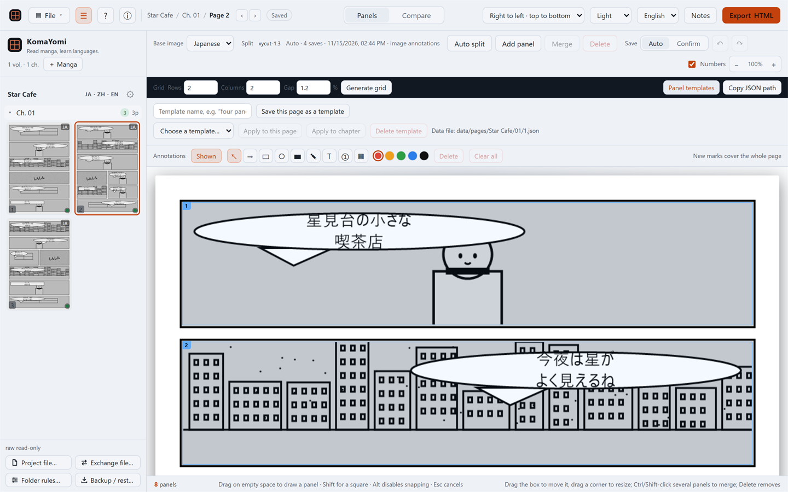
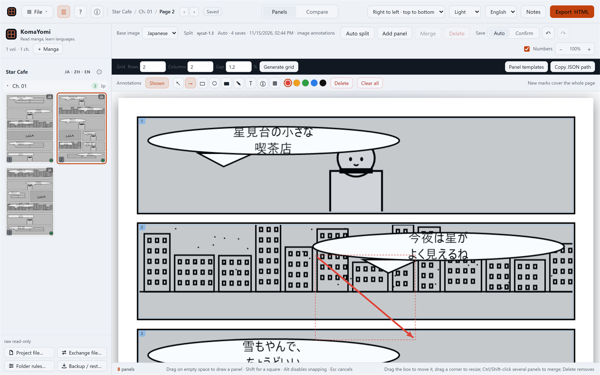
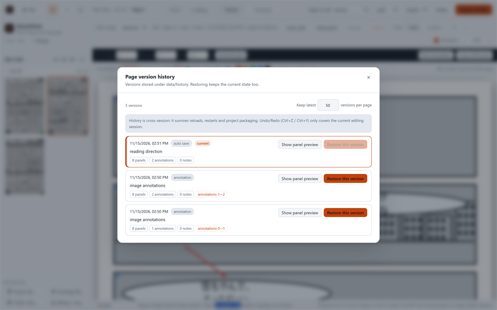

# Panel Workbench

The panel workbench is where a page becomes structured data. Automatic detection is only the first pass; the workbench exists so you can argue with it — quickly, and without breaking anything permanently.

<figure class="shot">
  
  <figcaption>Detected panels are drawn as numbered boxes over the base image. The selected box shows eight resize handles. The annotation toolbar sits below the panel tools.</figcaption>
</figure>

## The problem it solves

Every later feature stands on panels: compare reading, panel-scoped notes, PNG panel export, HTML export. If the boxes are wrong, everything downstream inherits the mistake. Automatic detection handles most pages fine, but splash pages, spreads, edge strips and whatever the magazine decided to do that month always need a hand.

## The toolbar, control by control

<figure class="shot">
  
  <figcaption>The two toolbar rows: detection and saving on top, the rectangle fields, grid generator and panel templates below. The annotation toolbar follows underneath.</figcaption>
</figure>

### Row 1 — base image and splitting

| Control | What it does | Notes |
| --- | --- | --- |
| **Base image** selector | Chooses which language's artwork is shown and used for detection. | Panel rectangles are shared by all languages on the page, so this only changes the picture you draw on. |
| Detector chip | Shows the algorithm version that produced the current panels, e.g. `xycut-1.3`, `layout:<id>`, `plugin:<name>`. | `Legacy data` means the page JSON predates version tracking. |
| Status text | Shows whether the panels are *Auto*, *Template*, *Plugin* or *Manually edited*, plus the save count and the last edit summary. | This is an edit counter, not an audit log. |
| **Auto split** | Runs detection on the base image and replaces the current panels. | Disabled while detection is running or when the page has no image. Re-running detection discards hand edits. |
| **Add panel** | Adds a default panel near the centre of the page. | Faster alternative: double-click empty space. |
| **Merge (n)** | Merges the selected panels into one box with `source: "merged"`. | Enabled with two or more selected panels. |
| **Group (n)** | Creates a group from the selected panels. | Enabled with at least one selected panel. See [Groups](#groups). |
| **Delete** | Deletes the selected panels and their panel-scoped notes. | Same as `Delete` / `Backspace`. |

### Row 1 — saving

| Control | What it does |
| --- | --- |
| **Auto** | Saves automatically about 0.7 s after a change. |
| **Confirm** | Keeps edits dirty until you click **✓** or press `Enter`. **×** or `Esc` discards and restores the last save. |
| `↶` / `↷` | Undo / redo (`Ctrl+Z`, `Ctrl+Shift+Z`, `Ctrl+Y`). |
| **✓** | Saves the dirty page (Confirm mode only). |
| **×** | Discards unsaved edits (Confirm mode only). |
| **Unsaved** flag | Appears in Confirm mode while the page has unsaved changes. |
| **Numbers** | Shows or hides the panel index badges. |

The save mode is remembered in the browser. The top bar always shows the current state: *Saved*, *Saving…*, *Pending save* or *Unsaved changes*.

### Row 1 — zoom

The `−` / percentage / `＋` control changes the stage zoom from 50% to 300% in 15% steps. Zoom is a display setting only; panel coordinates are normalized to `0..1` and do not change.

### Row 2 — numeric rectangle

With exactly one panel selected, the second row shows **Panel rect** with four percentage inputs:

| Field | Meaning |
| --- | --- |
| `X` | Left edge, percent of page width. |
| `Y` | Top edge, percent of page height. |
| `W` | Width, percent of page width. |
| `H` | Height, percent of page height. |

Typing a value updates the panel immediately. Values outside the page are clamped when saved.

### Row 2 — grid generator

| Field | Range | Meaning |
| --- | --- | --- |
| **Rows** | 1–8 | Number of rows. |
| **Columns** | 1–6 | Number of columns. |
| **Gap** | 0–8 % | Gutter between cells, in percent of the page. |
| **Generate grid** | — | Replaces the current panels with an evenly divided grid. |

Use the grid for a chapter with a fixed magazine layout; use **Panel templates** when the layout repeats exactly.

### Row 2 — templates and JSON

**Panel templates** captures the rectangles of the current page:

1. Open **Panel templates**, type a name, click **Save this page as a template**.
2. Select the template, then **Apply to this page** or **Apply to chapter**.
3. Applying to a chapter asks for confirmation because existing panels are overwritten.

When the new page has the same number of panels as the template, panel-scoped notes are remapped by reading order. When the count differs, panel notes are dropped rather than silently attached to the wrong panel; page notes are always kept. Templates live in `data/templates/panel.json`.

**Copy JSON path** copies `data/pages/<volume>/<chapter>/<index>.json`. Editing that file by hand is supported; the server normalizes rectangles, repairs missing ids and drops dangling references on read.

## Mouse and keyboard on the canvas

| Action | Gesture |
| --- | --- |
| Move a panel | Drag the box body. |
| Resize | Drag one of the eight handles. |
| Add a panel quickly | Double-click empty space. |
| Draw a panel precisely | Drag on empty space. |
| Constrain to a square | Hold `Shift` while drawing. |
| Disable snapping | Hold `Alt` while drawing or dragging. |
| Cancel the current box | `Esc`. |
| Multi-select | `Ctrl`-click or `Shift`-click boxes. |
| Nudge | Arrow keys move the selection by 0.2%; `Shift` + arrow moves by 1%. |
| Delete | `Delete` or `Backspace`. |
| Save / discard (Confirm mode) | `Enter` / `Esc`. |

All coordinates are normalized to the page, so a panel stays in the same place at any zoom level or export resolution.

## Numbering and reading direction

- **Numbers** toggles the index badges.
- Reading direction is stored per page: `rtl` (right to left, top to bottom), `ltr` (left to right, top to bottom) or `ttb` (right to left, vertical columns). Change it in the top bar.
- A panel may carry an explicit `number` that overrides automatic reading order; otherwise numbering is derived from the rectangle and the direction.
- The same order drives the compare reader, the notes overview and HTML export.

::: tip Reading order first
If the numbers look wrong before you have touched anything, fix the reading-direction selector first. Hand-numbering panels in the JSON is possible, but changing the direction repairs the whole chapter at once.
:::

## Annotation tools

The annotation layer draws on top of the artwork and lives separately from panels — think of it as your red pen, not part of the page geometry.

<figure class="shot">
  
  <figcaption>The annotation toolbar. The hint on the right names the current scope — here, new marks cover the whole page. The same toolbar appears in the compare reader.</figcaption>
</figure>

| Control | What it does |
| --- | --- |
| **Annotations: Shown / Hidden** | Global visibility. Hiding keeps the data and hides it in exports. |
| **Select and move** | Select an existing mark; drag to move it. |
| **Arrow** | Drag from tail to head. |
| **Rectangle** / **Ellipse** | Drag a box or oval. |
| **Highlighter** | Semi-transparent freehand stroke. |
| **Freehand** | Opaque pen stroke; keeps the full polyline. |
| **Text** | Click, then type the label. |
| **Number badge** | Click, then type a number. |
| **Mosaic** | Drag a rectangle; the area is pixelated. |
| **Colour swatches** | Sets the colour for new marks; clicking a swatch while a mark is selected recolours it. |
| **Delete** | Deletes the selected mark. |
| **Clear all** | Deletes every mark on the page after confirmation. |

Scope follows the selection: with one panel selected, the hint reads *New marks go inside panel N*; with nothing selected, *New marks cover the whole page*. `Esc` leaves the current tool or deselects a mark.

Exported HTML and PNG include annotations only when the layer is shown. The HTML export also has a **Draw panel borders on the original image** option, which is separate from annotations.

## Groups

A group is a named set of panels that should be read as one unit: a double-page spread split into two boxes, a recurring establishing shot, or a sequence you want to talk about as a block. Groups are layout metadata only — they never merge artwork, move notes or change annotations.

### Create a group

1. Select one or more panels: `Ctrl`-click, `Shift`-click, or drag a marquee on empty space.
2. Click **Group (n)** in the first toolbar row.
3. The new group appears in the **Groups (n)** panel. Give it a name and a colour.

Creating a group removes its panels from any earlier group, so groups never overlap.

### Edit a group

| Control | What it does |
| --- | --- |
| Colour swatch | Colours the group's panel outlines and chips. |
| Name field | Free text; defaults to *Group n*. |
| Numbered chips | The panels in the group. Drag a chip to change the order inside the group. |
| `×` on a chip | Removes that panel from the group; the panel itself stays on the page. |
| **Merge up** | Appends this group's panels to the group above it. Disabled for the first group. |
| **Split** | Splits a multi-panel group into one group per panel. |
| **Delete** | Deletes the group only; its panels, notes and annotations remain. |

**Sort by group** in the groups header renumbers the page so that each group follows its first panel in reading order. This changes panel numbering, so use it deliberately; export and compare reading follow the same order.

Groups are stored in the page JSON as `groups: [{ id, name, panelIds, number, color }]` and travel with page exchange files, project packages and backups.

## Page history

Every save also appends a version to `data/history/<volume>/<chapter>/<page>.json`. Unlike the in-session undo stack, history survives reloads, restarts and project packaging — your safety net for the day a template eats the panels.

1. Open a page.
2. Click **≡ History** in the top bar.
3. Pick a version to inspect it, then **Restore this version** if it is the one you want.

<figure class="shot">
  
  <figcaption>Page version history. Each row records why the version was created and the structural change; the current version is marked and cannot be restored over itself.</figcaption>
</figure>

| Control | What it does |
| --- | --- |
| Version row | Timestamp, source label and the structural diff against the previous version. |
| Source labels | *auto save*, *manual save*, *batch*, *template*, *alignment*, *annotation*, *import*, *restore*, *auto-detect*. |
| Counts | Panels, annotations and notes in that version. |
| **Show panel preview** | Compares the panel rectangles of this version with the previous one. |
| **Keep latest n versions per page** | History cap, default 50. Older versions are pruned on the next save. |
| **Restore this version** | Saves the current state as a new version first, then restores the chosen one. |
| **Undo restore** | Puts back the state from before the last restore. |

Restoring is not the same as undo: it writes a new version, so the state you restored *from* is still in the list. History files are included in backups and project packages; they are not removed by clearing the thumbnail cache.

## A safe correction workflow

A rhythm that keeps you out of trouble:

1. Open the page and let automatic detection run.
2. Fix obvious boxes: move, resize, add, delete.
3. Merge splash-page panels that span a spread.
4. Save (or press `✓` in Confirm mode).
5. Switch to **Compare** (`C`) and check that the same panel really contains the same artwork.

Avoid re-running **Auto split** after hand edits unless you are willing to lose them.

## Common pitfalls

- **Auto split replaced my boxes.** Detection overwrites. Use a panel template or edit by hand after the first successful split.
- **A page has no image.** Detection is disabled and the stage shows an empty state. Add the missing language folder or map it in volume settings.
- **WebP pages do not detect.** WebP is displayed but not decoded for detection; convert to JPEG or PNG.
- **Panel notes disappeared after applying a template.** The template had a different panel count, so panel notes were dropped; page notes were kept. Restore from a backup if needed.
- **“Unsaved changes” will not go away.** You are in Confirm mode. Press `✓` or `Enter`; `×` discards.
- **Marks are invisible.** The annotation layer is hidden, or a panel filter is active. Check **Annotations: Shown**.
- **Grouping changed the numbering.** **Sort by group** rewrites reading order. Undo it, or create the groups before writing panel notes.
- **A restored version lost newer notes.** Restoring replaces the whole page. The state you restored from is kept as a version, so use **Undo restore** or restore that version again.

## Missing screenshots

| Figure | Needed for |
| --- | --- |
| groups panel close-up | Colour, name, chips and group actions |
| panel template panel | Template save / apply controls |

## Related

- [Compare Reader](/guide/compare) — what panels are for.
- [Project Files & Formats](/guide/project-files) — how history and groups are packaged.
- [Data Formats](/data-format) — the page JSON contract.
- [Keyboard Shortcuts](/guide/shortcuts) — one table for every key.
