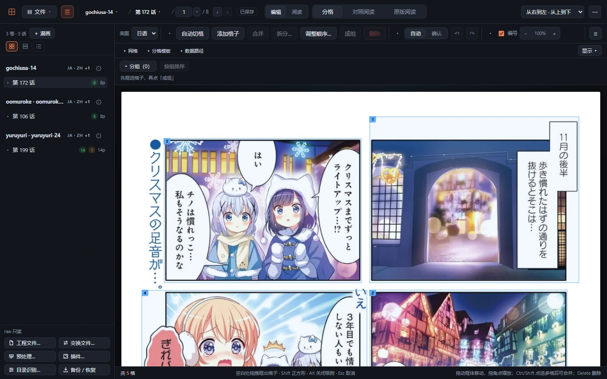

# Preparing & Renaming Images

KomaYomi reads image folders in place. It never copies or converts your files, and it only renames or splits them when you explicitly ask for it in the preprocessing wizard. That means the minutes you spend tidying a volume before adding it decide how well detection, page pairing and compare reading go. Slightly annoying, much cheaper than fixing the same page three times.

## The problem it solves

Panel detection is happiest with clean page scans. A volume with rotated pages, scanner borders, a pile of AVIF/HEIC files or one edition missing a page will still open, but every later step — pairing, alignment, notes, export — inherits the mess. Fix it once, at the source.

## What KomaYomi does with your files

| Behaviour | Consequence |
| --- | --- |
| Images are read from the folder you point at. | Nothing is imported or duplicated; edits stay in `data/`. Renaming and splitting happen only when you use the wizard. |
| Pages are paired by **sorted position**, not by filename. | Renaming changes the order. Insert one page and every later page shifts. |
| Sorting is natural: digit runs compare as numbers. | `2.jpg` comes before `10.jpg` even without zero padding. |
| WebP is decoded for detection and splitting; AVIF, HEIC, GIF and BMP are not. | Convert AVIF/HEIC/GIF/BMP to JPEG or PNG if you rely on **Auto split**. Splitting a WebP page works and writes PNG halves. |
| One image is one page. | A scanned spread must be split in every language, either in the wizard or before importing. |

<figure class="shot">
  
  <figcaption>A prepared volume: one folder per language, one folder per chapter, and matching page counts so the language badges line up.</figcaption>
</figure>

## A preparation checklist

Work on a copy if the originals matter. The order below matters more than the tools you use.

1. **Rotate and deskew.** Reading direction is stored per page; a sideways scan cannot be fixed by the compare reader.
2. **Crop scanner borders and facing-page shadows.** Panels that touch the edge are detected more reliably when the page edge is square.
3. **Convert AVIF, HEIC, GIF or BMP to JPEG or PNG** if you want automatic splitting; WebP pages can stay as they are. Keep the quality high enough that the lettering stays legible.
4. **One chapter per folder.** Do not mix two chapters in one directory; the chapter becomes the unit for templates, alignment presets and export.
5. **Remove non-page images** such as covers, credits, colour inserts or bonus art that does not exist in the other editions. One extra page shifts every page after it.
6. **Keep spreads unsplit, or split every edition at the same place.** A spread counts as one page. If you split the Japanese raw but not the Chinese scanlation, page 12 in one language becomes pages 12–13 in the other and pairing breaks. Use **Split…** in the wizard so every language is cut at once.
7. **Normalise filenames only if it helps you.** Zero-padded numbers (`001.jpg`) make diffs and manual checks easier, but the scanner uses sorted position and natural order, so `1.jpg` and `001.jpg` both work. **Rename files** in the wizard renumbers a whole chapter and moves the saved page data with it.

## Renaming and splitting inside KomaYomi

Open **Preprocess…** and pick the volume. Besides titles, page order, exclusions and page roles, each chapter section has a **Files on disk** area with two real file operations. Image format conversion is still not part of the app.

**Batch rename.** Choose a prefix, a start number and the number of digits, then press **Rename files**. The images are renumbered in the page order shown above the button — the order you arranged with the arrow buttons — and the files on disk are genuinely renamed (`001.jpg`, `002.jpg`, … keeping each file's extension). Every language in the chapter that contains all pages is renamed in the same pass, so page *n* stays the same artwork in every language. Languages with a missing page are left untouched and listed in the result message.

Page data, history, exclusions, page roles and the saved order are keyed by page index, so they are moved and re-pointed in the same transaction. An in-app rename therefore does not orphan annotations, notes or panel edits. Renaming reloads the volume, so apply other wizard changes first; unsaved drafts are discarded.

Before anything moves, a manifest is written to `data/file-ops/`. It lists every old and new name. If a rename fails midway, the whole batch is rolled back, the manifest is marked `rolled-back`, and the folder is left exactly as it was. A target name that already belongs to another file is refused with an error instead of being overwritten.

**Split a page.** Press **Split…** under a page, choose **Left / right** for a spread or **Top / bottom**, set the cut position as a percentage and confirm. The image is cut into `<name>-a` and `<name>-b`; the second half becomes the next page and every later page shifts down. Every language that contains this page is cut at the same position, so pairing stays intact. Splitting accepts PNG, JPEG and WebP; WebP halves are written as PNG. GIF and BMP are refused. The original image is copied to `data/file-ops/` before it is removed.

The page document is clipped into both halves: panels and annotations on a half are kept there with rescaled coordinates, panel notes follow their panel, and page-level notes stay on the first half. Both halves keep the page's reading direction. Check both pages afterwards, especially when the cut crossed a panel.

::: warning Renaming and splitting cannot be undone from the wizard
The **Restore previous** banner only rolls back `library.json`. File renames and splits are one-way in the UI; use the manifest and backup folder under `data/file-ops/` if you need the previous names or images. Renaming outside the app is still unsafe: page data is keyed by page index, so Explorer/shell renames do not move annotations.
:::

## Verify before you annotate

1. Add the volume and open it in the sidebar.
2. Read the warnings on the volume and chapter rows. *Page counts differ across languages* and *Filename does not match page number* usually mean a preparation mistake.
3. If the folder shape is unusual, open **Folder rules…** and use its preview before saving; see [Folder Detection Rules](/guide/folder-rules).
4. Open the first, middle and last page. Confirm that the same panel really contains the same artwork in every language; if not, the page counts or the spread handling are wrong.
5. Only then run **Auto split** and start writing notes.

## Common pitfalls

- **One language is one page longer.** Usually an extra cover or credits page. Remove it or add the equivalent page to the other languages.
- **A spread is split in only one edition.** Keep spreads whole, or split every edition at the same place.
- **Auto split produces nonsense on an AVIF or HEIC page.** Convert the file; detection does not decode AVIF, HEIC, GIF or BMP.
- **Renaming shifted a note to the next page.** Page data is keyed by index, so renames done in Explorer or a shell do not move it. Use **Rename files** in the wizard, or rename before annotating.
- **The split cut through a panel.** Pick a cut position between panels, or correct the panels on both halves afterwards. Page-level notes stay on the first half by design.
- **Pages look fine but thumbnails are mixed.** Thumbnails follow the file content, not the extension; a `.png` that is really a JPEG still renders. This is cosmetic.
- **Folders were reorganised after annotating.** Detection ids changed, so old page data is not found. Apply folder rules before annotating, not after.

## Missing screenshots

| Figure | Needed for |
| --- | --- |
| before/after page naming | The zero-padding, natural-sort and **Files on disk** panel |
| split form | Direction and cut position for a scanned spread |
| spread handling | One spread kept as a single page versus split pages |
| library warnings strip | The three warnings used for verification |

## Related

- [Library & Import](/guide/gallery) — folder shape, language aliases and volume settings.
- [Folder Detection Rules](/guide/folder-rules) — supporting unusual directory layouts.
- [Panel Workbench](/guide/panels) — what happens after the first page opens.
- [Project Files & Formats](/guide/project-files) — how page data is keyed and versioned.
- [Terminology](/terminology) — the shared vocabulary for panels, pages and annotations.
