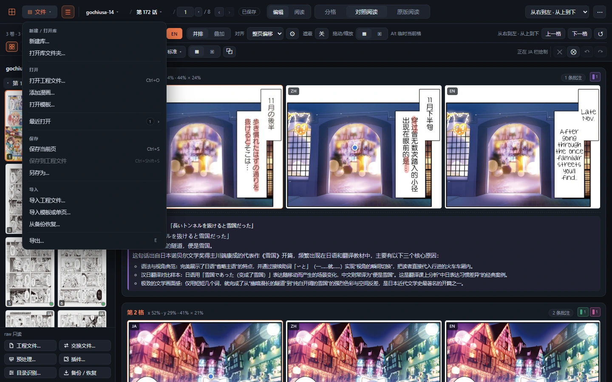

# Project Files & Formats

Everything KomaYomi stores lives in plain files: images in `raw/`, annotations in `data/`, generated output in `exports/`. A `.mnproj` is the working container: open one and saves go back into it. This page covers that link, the ways to move work elsewhere, and the versioning rules that keep old files readable instead of turning them into archaeology.

## The problem it solves

Annotations are the expensive part — hours of panel correction, alignment and notes. They must survive a machine change, a dead disk, a study partner, and future app versions. A database backup would be a black box; these formats are plain ZIP and JSON, inspectable with ordinary tools.

## Three portability layers

| Layer | File | Contains | Use when |
| --- | --- | --- | --- |
| **Project package** | `.mnproj` | Images (packaged mode), page JSON, templates, presets, language mapping | Moving to another machine or archiving a finished volume. |
| **Exchange files** | `.mntpl`, `.mnexp`, `.mnpage.json` | One layout, one export style, or one page | Sharing a reusable layout or a single annotated page. |
| **Backup ZIP** | `.zip` | The whole `data/` folder | Restoring after a mistake, or keeping a periodic safety copy. |

<figure class="shot">
  
  <figcaption>The File menu gathers opening, saving back to the linked project, saving a copy, importing and restoring a backup. The save indicator beside it opens the write-back status panel.</figcaption>
</figure>

## Project packages (`.mnproj`)

A `.mnproj` is a ZIP with a text manifest:

```text
manifest.json
pages/<volume>/<chapter>/<index>.json
history/<volume>/<chapter>/<index>.json
templates/...
presets/...
config/library.json          (optional)
assets/<sha1>.<ext>          (packaged mode only)
```

Page version history travels with the project, so reopening it keeps the audit trail described in [Panel Workbench](/guide/panels#page-history).

### Reference vs packaged mode

| Mode | Images | Size | Portability |
| --- | --- | --- | --- |
| **Reference** | Only paths and SHA-1 hashes in the manifest. | Small. | Needs the original image folder. Supports relinking by hash or filename. |
| **Packaged** | Deduplicated into `assets/<sha1>.<ext>`. | Large. | Self-contained; importing writes images into `raw/`. |

### Saving back to the opened file

Opening a project does not take a copy. It links the current library to that `.mnproj`, and from then on every save is written back into the same file — images, page JSON, notes, annotations and templates. There is no separate "export the project again" step, and no risk of editing a stale copy.

- **File → Save to project file** forces a write-back immediately and skips the save debounce. It is disabled when no project is linked (the menu says so) and in read-only mode.
- The save indicator in the top bar is the status panel. Click it to see the linked path, the last write-back time, whether edits are queued, the current state (saved / writing / failed) and the failure reason. It offers **Write back now**, **Retry** and, when nothing is linked, a pointer to **Save as…**. In read-only mode it explains that nothing is written to disk.
- Failed write-backs surface as a non-blocking notice; the panel keeps the reason and the retry button, so a temporary lock or a removed folder does not silently lose work.

### Saving a copy

**File → Save as…** packs the current library into a new `.mnproj` at a path you choose. It never overwrites the linked original: if you are working on `vol-01.mnproj`, the copy is a separate file.

In the desktop app this opens a native save dialog. In the browser there is no file dialog, so the same command packs the library and hands it to the download manager instead — rename it while downloading if you like. Located at **File → Save as…**, the dialog shows whether you are in the desktop or browser fallback before it starts.

The manifest records the app version, creation time, language mapping, an inventory of volumes / chapters / pages and image hashes, and note and annotation counts.

### Importing

1. **Choose a project file…**. The dialog summarises volumes, chapters, pages, notes, annotations, images and templates before writing anything.
2. Pick a conflict policy: **Overwrite**, **Merge** or **Skip**.
   - **Merge** keeps existing panels and annotations when the incoming page lacks them, and unions notes by id without deleting existing notes.
3. For a reference-mode project with missing images, optionally choose a **Relink folder** that holds the originals.
4. Click **Import**.

Safety behaviour:

- The current `data/` is snapshotted to `exports/` before the import.
- The original project file is backed up under `data/backups/projects/`.
- Missing images are reported after the import; put them in the relink folder and import again with **Merge** to recover them.

## Exchange files

**Exchange files…** handles three small formats without touching the whole library.

### `.mntpl` — layout template

Exports strip the volume / chapter / page binding, so the template can be imported into another manga and rebound to the current volume, chapter or page. The import dialog lets you bind it and optionally apply it immediately; existing pages are saved first.

### `.mnexp` — export template

Stores the layout and style settings for the HTML, Word and print document. Export it now, import it later. Template storage lives in `data/templates/export.json`.

### `.mnpage.json` — one page

A readable page document with panels, notes, tags, groups, annotations and alignment offsets. Older page JSON without the schema envelope can be imported too and is migrated.

- **Export current page** writes the current page.
- **Choose a page JSON…** then **Overwrite current page** replaces panels, notes and annotations of the selected page.
- Validation failures report the exact field path and never write half-finished data.
- Original files are backed up under `data/backups/exchange/`.

::: warning Unsaved changes
If the page has unsaved edits, exchange exports will not include them and a page import may overwrite them. Save first — the dialog warns, but it is easy to click past.
:::

## Format versions

Every exchange format carries a schema envelope:

```json
{
  "$schema": "https://manga-memo.dev/schemas/page.schema.json",
  "schemaVersion": 4,
  "appVersion": "1.1.0",
  "kind": "page"
}
```

| Kind | File | Current version |
| --- | --- | --- |
| `mnproj` | `.mnproj` manifest | **2** |
| `mntpl` | layout template | **1** |
| `mnexp` | export template | **1** |
| `page` | page document | **4** |
| `mntp` | panel template (stored) | **1** |
| `mnalign` | alignment preset (stored) | **1** |
| `mnlayout` | declarative layout (stored) | **1** |
| `mnconfig` | library config (stored) | **1** |
| `mnstorage` | storage config (stored) | **1** |

Version rules:

- A file declaring a **higher** version than the app supports is rejected with a clear message: upgrade the app first. The app never guesses at a future format.
- A missing version is treated as **v0** and migrated on import. Early experimental manifests (top-level `images`, a flat `langDirs` map) are converted to the current shape.
- Missing optional fields are filled with defaults; invalid images are dropped rather than aborting the whole import.
- On read, page JSON is **normalized**: rectangles are clamped, dangling group references removed, missing ids generated. Fields the app does not recognize are preserved instead of dropped, so a newer file survives an older build.
- A page JSON that cannot be parsed is treated as absent; the app re-detects and recreates it.

## Backup ZIP

A backup is a ZIP whose entries are prefixed with `data/`:

```text
data/pages/...
data/templates/...
data/presets/...
data/layouts/...
data/library.json
data/.backup-meta.json
```

Excluded: `data/cache/` (thumbnails and remote cache), `.tmp` files and logs. Restoring overwrites same-named files, keeps pages that are absent from the backup, and writes a snapshot first.

## Scheduled backups

Open **Backup / restore** at the bottom of the library sidebar (or **Restore from backup…** in the File menu) and use the **Scheduled backups** section:

- **Enable scheduled backups** — off by default.
- **Interval (hours)** — 1 to 168, default 24.
- **Keep** — 1 to 50 automatic archives, default 7.
- **Save** stores the settings in `data/library.json`; **Run now** produces one archive immediately.

The server checks once a minute (and five seconds after start) whether the interval has elapsed since the last run. A run writes `exports/auto-backup-<timestamp>_000.zip` — the same archive as the manual backup — then deletes the oldest automatic archives beyond **Keep**. Manual `backup-*.zip` files are never touched. The dialog shows the last run, its file and size, and any failure; a failed run also surfaces as `ERR_AUTO_BACKUP_FAILED` with the underlying reason. Run state is kept in `data/cache/backup-schedule.json`, so it is not bundled into the next archive. Scheduled runs write to the local `exports/` folder only; uploading to a remote backup target is still manual.

## What is not implemented

- **Vocabulary-list export.** PDF and Word are handled by the **PDF (print)** and **Word document** formats in the export dialog.
- **An in-app image format converter.** Renaming and splitting images are part of [preprocessing](/guide/preprocess); converting between formats still has to happen outside the app.

## Common pitfalls

- **A reference-mode project shows missing images.** The manifest only stores hashes and paths. Use the relink folder, or export in packaged mode next time.
- **“Schema version too new.”** The file came from a newer build. Update the app; do not hand-edit `schemaVersion`.
- **Import overwrote newer notes.** **Overwrite** is destructive by design. Use **Merge** when in doubt; a snapshot was written, but restoring it replaces current data.
- **A layout template does not appear.** It is bound to the current chapter/volume filter; check the binding in the import dialog.
- **A `.mnpage.json` import has no images.** Page data never contains images; those come from `raw/` or a packaged project.

<figure class="shot">
  
  <figcaption>Project import summary: storage mode, inventory counts, conflict policy, relink folder and the Import button.</figcaption>
</figure>

## Missing screenshots

| Figure | Needed for |
| --- | --- |
| project export form | Mode, name and note |
| exchange files dialog | Three file types |

## Related

- [Data Formats](/data-format) — full JSON field reference.
- [Export](/guide/export) — HTML, Word, PDF and PNG output.
- [Remote Storage & Backup](/guide/remote) — backup targets.
