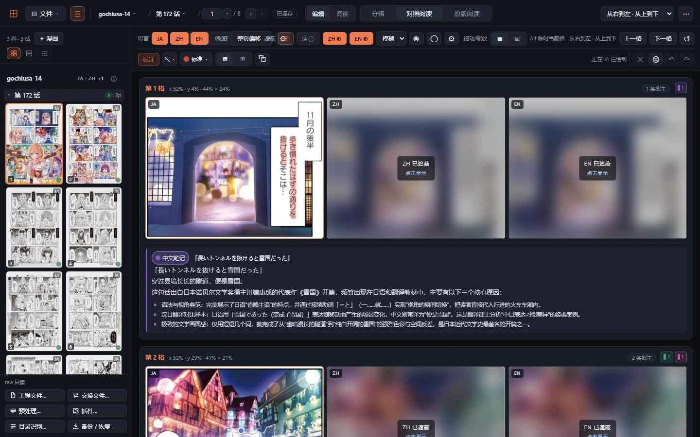
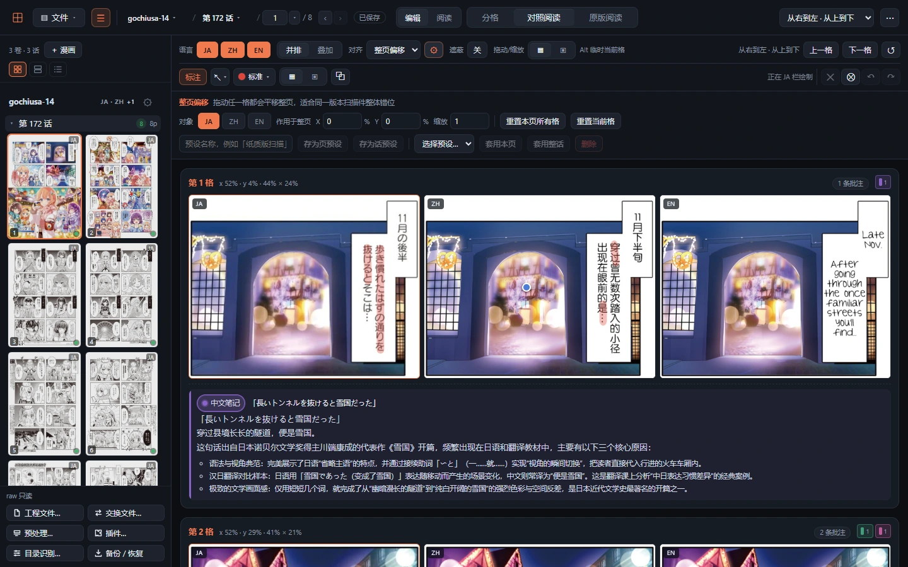

# 比較リーダー

比較リーダーは、2つ以上の言語の同じコマを並べて、または重ねて表示し、比較が正確になるように絵を位置合わせできる機能です。

<figure class="shot">
  
  <figcaption>3言語の並列モード。言語ごとに独立したペインで、位置合わせはページごとに保存され、エクスポートにも適用されます。</figcaption>
</figure>

## 解決する課題

同じ本の2つの版が正確に同じ形状を持つことはほとんどありません。生肉と翻訳版では位置、切り取り、倍率が違います。ページ全体を比較すると、小さな違いは隠れてしまいます。**コマを1つずつ**、言語ごとに独立して位置合わせしながら比較すると、言い回し、語気、省略が見えてきます。

## レイアウト

| コントロール | 動作 |
| --- | --- |
| **言語チップ**（`JA`、`ZH`、`EN` など） | 言語をオン / オフにします。このページにない言語は、ツールチップ付きで無効になります。 |
| チップをドラッグ | ペインの順序を変更します。順序は記憶されます。 |
| `↺` | ライブラリの言語順に戻します。 |
| **並列** | 選択した言語ごとに1列。狭いウィンドウではペインが縦に積み重なります。 |
| **重ね表示** | 選択したすべての言語を同じ枠に描画します。 |
| **乗算**（重ね表示のみ） | レイヤーを乗算し、線画が透けて見えるようにします。 |
| **位置合わせ対象** チップ（重ね表示のみ） | ドラッグする言語を選び、2つのペインが同時に動かないようにします。 |

## マスク

マスクは、自分の理解度を試す間、その言語の画像を隠します——答えを隠して自分の実力を測る、あれと同じです。

| コントロール | 動作 |
| --- | --- |
| **マスク：オン / オフ** | 全体の切り替え。`H` で切り替え、`Shift+H` ですべて表示します。 |
| 言語ごとの `◐` / `◯` チップ | マスクする言語を選びます。 |
| **マスク表示** | **ぼかし** または **塗りつぶし**。 |
| **全マスク** | 現在表示中のすべてのペインをマスクします。 |
| **全表示** | 全体の切り替えをオフにします。 |
| **既定…** | セッションをまたいで、最初からマスクする言語を記憶します。 |
| マスク中のペインをクリック | 一時的に表示します。もう一度絵をクリックするとマスクに戻ります。 |

マスクは**読むときの好み**にすぎません。HTML と PNG のエクスポートにマスクは含まれません。マスクの既定値はページ JSON ではなくブラウザに保存されます。

<figure class="shot">
  
  <figcaption>中国語と英語をマスクした状態。既定マスクは、最初から隠す言語を記憶します。マスクされたペインをクリックすると一時的に表示できます。</figcaption>
</figure>

## ズーム、パン、範囲

- ペイン上での**ホイール**はその言語を拡大縮小します。ホイールはポインターがペイン内にある間だけ捕捉されるため、それ以外の場所では通常のページスクロールが使えます。
- ペインを**ドラッグ**するとパンします。
- **ドラッグ/拡大縮小** の範囲には **ページ全体** と **このコマ** の2つのモードがあります。
- 既定の範囲にかかわらず、ドラッグやスクロール中に `Alt` を押すと現在のコマだけを調整できます。
- **前のコマ / 次のコマ** は読む順にフォーカス中のコマを移動します。ページの先頭のコマでさらに前へ、末尾のコマでさらに次へ進むと、隣のページへ移ってそのページの最後／最初のコマにフォーカスします。前処理で除外したページは飛ばし、話の境界もまたぎます。巻の最初／最後では移動しません。未保存の変更がある場合は、通常どおり保存モードの確認が先に入ります。
- **すべてリセット** は現在の範囲のオフセットを消去します。

各言語は `{ x, y, scale }` を持ちます。`x` と `y` はコマの幅と高さに対する比率で、`scale` は切り取り範囲を0.5倍から3倍に拡大縮小します。

### 自動センタリング

選択中のコマが変わると——前のコマ / 次のコマ、キーボードショートカット、サイドバーやノート一覧からのジャンプ、ページをまたぐ移動——比較リーダーは対象のコマを画面内にスクロールします。

- コマが収まるなら中央に。ビューポートより高い場合は上端を少し余白を残して入れ、絵の最初の行が切れないようにします。
- すでに十分見えているコマはそのままにします。選択が変わるたびに画面を引っ張るのは邪魔なので、手でスクロールした後は追いかけません。
- ページをまたぐジャンプでは、新しいページが描画されてから位置を合わせます。
- スクロールは OS の「視差効果を減らす」設定に従い、オンのときは即時ジャンプになります。

## 位置合わせモード

位置合わせはページ JSON に保存され、画像に焼き込まれることはありません。

| モード | 動作 | 向いている場面 |
| --- | --- | --- |
| **ページ全体のオフセット** | どのコマをドラッグしても、その言語のページ全体が平行移動します。 | スキャン全体が同じ量だけずれている場合。 |
| **コマごとのオフセット** | コマごとに個別のオフセットを持ちます。 | 電子版と紙版でコマの位置が違う場合。 |
| **アンカー合わせ** | 基準言語の特徴点をクリックし、別の言語の同じ点をクリックすると、オフセットが計算されます。 | 1つの細部を正確に、再現性をもって位置合わせする場合。 |
| **グリッド吸着** | ドラッグ時に0.5%、1%、2%、5%のステップに吸着します。 | 数値が整い、再現できるオフセットが必要な場合。 |

アンカーモードでは、基準言語を示すプロンプトが表示されます。まず任意のセルで特徴点をクリックし、次に別のセルで同じ位置をクリックします。**基準点をキャンセル** は保留中の点を消去します。保留中のアンカーは保存されません。

<figure class="shot">
  
  <figcaption>手順 1：**アンカー合わせ** を選び、基準言語の特徴点をクリックします。保留中のアンカーが表示され、**基準点をキャンセル** でいつでも消せます。</figcaption>
</figure>

<figure class="shot">
  
  <figcaption>手順 2：対象言語の同じ位置をクリックすると X / Y が即座に計算されます（図では -1.62% / -1.69%）。微調整するか、そのままプリセットとして保存できます。</figcaption>
</figure>

### 位置合わせ設定

**位置合わせ設定** を開くと、次のパネルが表示されます。

- **対象** の言語チップ。
- 選択した対象の正確な **X**、**Y**、**拡大率** 入力。
- **このページの全コマをリセット** — コマごとのオフセットを消去します。ページ全体のオフセットは影響を受けません。
- **現在のコマをリセット** — 選択中のコマのコマごとのオフセットだけを消去します。
- **ページプリセットとして保存** / **話プリセットとして保存** — 現在の位置合わせを `data/presets/align.json` に保存します。
- プリセットを選択して **このページに適用** または **話全体に適用**。**削除** で削除します。

プリセットには位置合わせモード、オフセット、コマごとのオフセット、グリッドのステップが記録されます。話プリセットを適用するのが、話全体にわたって一様にずれたスキャンを修正する最速の方法です。

<figure class="shot">
  
  <figcaption>位置合わせ設定。対象言語を選び、数値を直接入力するか、現在の位置合わせをページ / 話プリセットとして保存できます。</figcaption>
</figure>

## 比較リーダーでの注釈

注釈ツールバーはここでも使えます。生肉と翻訳版の言い回しの違いを印すのに、一番速い場所です。

- 新しい注釈はワークベンチと同じ適用範囲に従います。コマを選んでいれば、次の注釈はそのコマの中に入ります。
- 比較表示では注釈レイヤーが既定で表示されるので、見比べながら印を付けられます。**注釈** スイッチで隠せます。
- 注釈は表示をまたいで共有されます。比較リーダーで付けた印は、コマ分割ワークベンチにもエクスポートにも出ます。
- `Esc` で現在のツールを終了し、`Delete` で選択中の注釈を削除します。
- 注釈を選択すると、ツールバーの**アンカー**が位置指定モードになります。クリックで点を置くか、小さな枠をドラッグして範囲を囲みます。**アンカーを解除** で位置指定を消します。
- **引き出し線** は既定でオンで、注釈からアンカーへ線を引きます。テキストとバッジはアンカーが無くても所属コマにつながるため、古い注釈でも自然に表示されます。オフにすると注釈だけが残ります。
- アンカーはページ座標で保存されるため、パン・ズーム・言語切り替えでも絵に追従します。PNG、HTML、Word（注釈の焼き込み）の3つの書き出しすべてで、エディターと同じアンカーマーカーと引き出し線が描かれます。

### 注釈は言語に属する

各注釈には「どの言語ペインで描いたか」が記録されます。日本語ペインで描いた矢印が中国語や英語版に出ることはなく、同じコマに版ごとの印を残せます。内容が版全体に関わる場合は、1つのスイッチで全言語に共有できます。

この区別は意図的です。訳者の語選びについてのメモは普通1つのペインにしか意味がなく、効果音を囲む枠はどこにでもあるべきものです。

### 右クリックメニュー

注釈を右クリックすると、その注釈専用のメニューが開きます。

- **削除** — 注釈を消します。
- **色** — 描き直さずに色を変えます。
- **言語へコピー** — 同じ座標のまま別のペインへ複製します。

<figure class="shot">
  
  <figcaption>注釈の右クリックメニュー。削除、色の変更、同じ座標のまま別の言語へのコピーができます。コピー後は各ペインに独立した注釈が1つずつ残ります。</figcaption>
</figure>

何もない絵を右クリックするとペインメニューが開きます。**拡大表示**、この言語を隠す、マスクする、この言語だけ表示、すべて表示、ペインのズームをリセット、このコマを PNG で書き出す、コマ座標をコピー、コマ番号を設定、コマ番号の表示切り替え、リンクの挿入。読み取り専用モードでも使えます（何も書き込まないため）。

## 実用的な比較の流れ

1. **比較読み**（`C`）でページを開きます。
2. `JA` + `ZH`（あれば `EN` も）を、読みたい順に有効にします。
3. 版によってコマごとに違いがあるなら **コマごとのオフセット** を選び、そうでなければ **ページ全体のオフセット** から始めます。
4. コマの内容がそろうまで、各言語のペインをドラッグします。
5. 話の残りも同じオフセットなら、位置合わせプリセットを保存します。
6. **乗算** 付きの **重ね表示** に切り替え、線画や文字の違いを探します。
7. マスクをオンにして自分を試し、その後ペインを順に表示します。

## 動作の詳細

- 位置合わせのオフセットはエクスポート時にも適用されるため、書き出した切り取り範囲は見た目と一致します。
- リーダーにはまずコマが必要です。コマがないページでは、コマ分割ワークベンチへ行くようヒントが表示されます。
- ページを切り替えると、マスクの設定は保持されますが、一時的な表示は解除されます。
- 各ペインにはノート件数が表示されます。ここでコマを選ぶと、共有のノート列で新しいノートがそのコマに紐付きます。
- 画像のない言語は、空のペインではなくプレースホルダーを表示します。

<figure class="shot">
  
  <figcaption>比較ツールバー。言語チップ、マスク、並列 / 重ね表示、位置合わせの範囲、コマ単位のドラッグ切り替え。</figcaption>
</figure>

## コマ詳細ビュー

コマの行をダブルクリックすると、そのコマが拡大表示されます。行全体が対象です。言語ペイン、コマ番号のある見出し、切り取り範囲の外側の余白も、同じコマを開きます。エディター、ドラッグハンドル、ボタン、リンクの内側のクリックは除外され、タッチ環境では行のダブルタップが同じ働きをします。

- **ページレイアウト** — **自動**、**並列**（左に絵、右にノート）、**積み重ね**（上に絵、下にノート）。自動はウィンドウ幅に従い、2列に狭すぎる場合はその旨を表示して積み重ねに切り替えます。無理に詰め込みません。
- **ドラッグできる分割線** — 2列レイアウトでは絵とノートの間の線をドラッグでき、フォーカス時は方向キーでも動かせます。比率はコマ、ページ、再読み込みをまたいで記憶されます。
- **言語ペインの向き** — **横**は言語を並べ、**縦**は1言語ずつ全幅で積みます。狭いウィンドウや縦長画面に向いています。選択は記憶され、狭すぎるウィンドウでは自動的に縦へ戻ります。
- **絵をドラッグして位置合わせ** — 絵そのものをドラッグすると、その言語のオフセットを微調整できます。**同期移動** がオフなら触った列だけ、オンなら1言語を動かすと全言語が一緒に動きます。ズームも同じスイッチに従うので、「全部10%大きく」は1回のドラッグか1回のクリックで済みます。
- **正確な数値** — 位置合わせドロワーには言語ごとの `Δx` / `Δy`、1% 刻みの矢印ナッジ、ズーム − / +、列ごとのリセット、そして **すべてリセット** があります。
- これらの詳細ビューの調整はセッション限りで、ページや保存済みの位置合わせには書き戻しません。
- **ズーム** — 絵の上のホイールやピンチでポインター下の言語を拡大し、見出しのボタンと **幅に合わせる**、**リセット** でズームとすべての Δ をまとめて戻せます。
- 下のノート列はサイドバーと同じエディターを使い、このコマへ直接書き込みます。コマの切り替え、ページ送り、戻るの前に下書きを保存します。
- **ナビゲーションバー** — 詳細ビューの下部バーはスクロール領域の外にあり、絵やノートを覆いません。左に前のページ・前のコマ、右に次のコマ・次のページ。デスクトップでは文字、狭い画面ではアイコンとツールチップになります。ページの端では、前のコマが前ページの最後のコマへ、次のコマが次ページの最初のコマへ移動し、詳細ビューは開いたまま URL が新しいページとコマに同期します。
- **終了** — `Esc`、**戻る** ボタン、ブラウザーの戻るは、元のページとコマへ戻ります。URL は深リンク（`…/compare/panel/<id>`）なので、再読み込みや共有でも同じコマが開きます。行を `Alt` / `Cmd` クリックすると新しいタブで開きます。

<figure class="shot">
  
  <figcaption>コマ詳細ビュー。絵とそのコマのノートを同じ画面で扱えます。見出しからレイアウトの切り替え、位置合わせドロワー、表示のリセットができ、下部のナビゲーションはスクロール領域の外にあって絵を覆いません。</figcaption>
</figure>

<figure class="shot">
  
  <figcaption>集中モード（`R`）の比較読み。操作部はすべて収まり、キャンバスとコマだけが残ります。入ると終了方法が短く表示され、`Esc` またはもう一度 `R` で戻れます。</figcaption>
</figure>

## 拡大ビュー

ペインを右クリックして **拡大表示** を選ぶと（詳細ビューのペインメニューにも同じコマンドがあります）、リーダーを離れずに絵を確認できます。

- 元の解像度で表示し、ホイールでズーム、ドラッグでパン。1文字、網点、レタッチの継ぎ目を確かめるのに向いています。
- ビュー内で **言語を切り替え** ると、閉じ直さずに同じ場面の各版を見比べられます。
- **前のコマ / 次のコマ** は読み順に移動するので、小さなコマが並ぶページも素早く確認できます。
- `Esc` または背景のクリックで閉じます。ページのズーム、スクロール位置、編集中のノート下書きはそのまま残ります。見るだけの操作で保存や変更は行われません。
- 何も書き込まないため、読み取り専用モードでも使えます。

<figure class="shot">
  
  <figcaption>拡大ビュー。1文字、網点、レタッチの継ぎ目を元の解像度で確認でき、言語の切り替えや前後のコマへの移動もできます。読み取り専用モードでも使えます。</figcaption>
</figure>

## 原版ビュー

**原版**（`O`）は、利用できる言語ごとに未裁切のページ全体を横に並べ、0.5×〜6× のホイールズーム、ドラッグでのパン、同じ言語別マスクを提供します。検出したコマの外側を確認するためのビューです。

- **連動 / 独立** — 原版ビューのツールバーにある切り替えで、パンとズームを共有するかを決めます。**連動**では、どれか 1 列をドラッグまたはズームすると、同じ相対位置と倍率がすべての列に適用されます。各列はその割合を自分の表示サイズに換算するため、ページの寸法が違っても位置がそろいます。**独立**では列ごとに別々の表示を保ちます。
- 連動をオンにすると、最初に見えている列の現在の表示を採用し、残りの列へ適用します。
- 設定はブラウザごとに `localStorage`（`manga-memo.original-linked`）へ保存され、既定はオンです。2 言語以上を表示しているときだけ意味を持ちます。

<figure class="shot">
  
  <figcaption>原版ビュー（`O`）。未裁切のページを並べ、ツールバーの 連動 / 独立 でパンとズームを全言語の列で共有するかを決めます。</figcaption>
</figure>

## よくある落とし穴

- **「このページにはまだコマがありません。」** **コマ**（`P`）に移動して **自動分割** を実行し、戻ってください。
- **ドラッグしたら他の言語も動いた。** 重ね表示モードでは **位置合わせ対象** のチップを確認してください。ドラッグされるのは選択中の言語だけです。
- **拡大率がずれた。** コマごとのズームとコマごとのオフセットは、ページ全体の値とは別に保存されます。試しに拡大したままなら、現在のコマをリセットしてください。
- **スクロール中にペインが動く。** ホイールはペイン内でのみ捕捉されます。通常どおりスクロールするには、ポインターをページの余白へ移動してください。
- **スクリーンショットにマスクが写る。** マスクは UI の設定でありエクスポートには含まれませんが、通常の画面キャプチャには写ります。
- **チップが灰色になっている。** その言語の画像がこのページにありません。ライブラリの警告か、巻の言語マッピングを確認してください。

## 関連項目

- [コマ分割ワークベンチ](/ja/guide/panels) — まずコマが必要です。
- [ノート](/ja/guide/notes) — 気づいたことを書き留めます。
- [リモート保存とバックアップ](/ja/guide/remote) — 画像がローカルにキャッシュされていない場合の動作。
