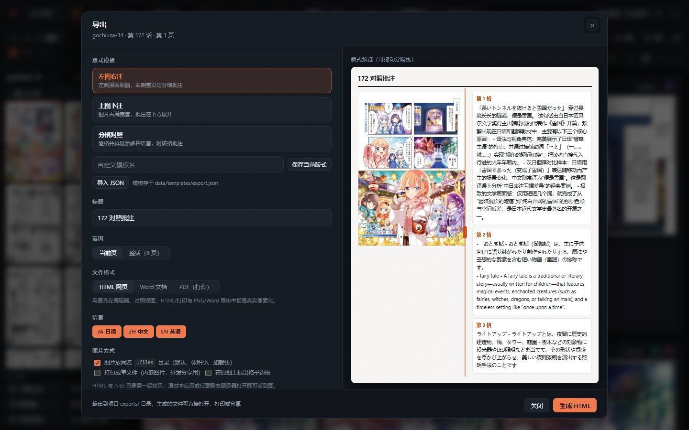
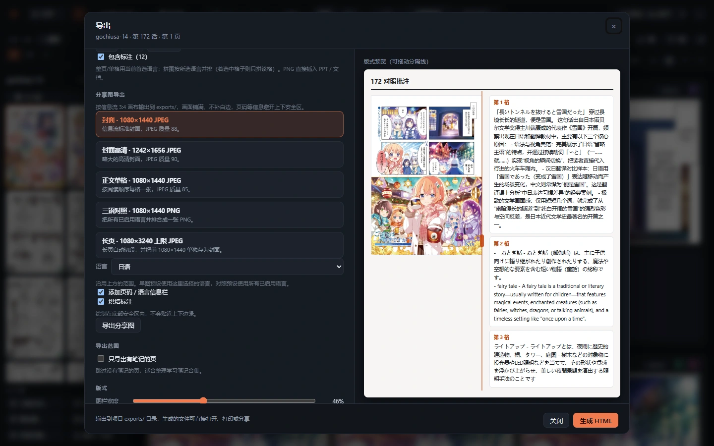

# エクスポート

エクスポートは、コマとノートの集まりを持ち運べる形に変えます。学習用の HTML ドキュメント、スライド用の PNG、Word 派のための `.docx`、そして PDF 派のための印刷ビューです。

<figure class="shot">
  
  <figcaption>エクスポートダイアログ。左の列でドキュメントを設定し、右側でレイアウトをプレビューします。区切り線をドラッグすると幅を変更できます。</figcaption>
</figure>

## 解決する課題

ノートはアプリの中に、コマにがっちり紐付いて存在します。タブレットで見直したり、印刷したり、比較をスライドに貼ったりするには、ページ画像と対応するノートを一緒に保った可搬な成果物が必要です。しかも、何もアップロードせずに。

## ダイアログを開く

`E` を押すか、上部バーの **エクスポート** をクリックします。ダイアログは常に、表示中のページまたは話をエクスポートします。

## HTML エクスポート

### タイトルと範囲

| コントロール | 動作 |
| --- | --- |
| **タイトル** | ドキュメントのタイトル。推奨ファイル名にも使われます。 |
| **現在のページ** | 開いているページだけをエクスポートします。 |
| **話全体（n ページ）** | 話の中で注釈のあるすべてのページをエクスポートします。 |
| **ノートのあるページだけ** | ノートのないページを飛ばします。学習ノートのまとめに便利です。 |
| **言語** | ドキュメントに表示する言語。 |

### 画像の扱い

| モード | 動作 |
| --- | --- |
| **同名の `.files` フォルダ**（既定） | HTML は隣のフォルダの画像を参照します。軽く、読み込みも速くなります。両方を一緒にコピーしてください。 |
| **単一ファイルにまとめる** | 画像を data URL として埋め込みます。共有するファイルは1つですが、話全体では数十 MB になることがあります。 |

**原画にコマ枠を描く** は、エクスポートする原画にコマの矩形を重ねます。これは注釈とは独立しています。

**これらのタグを含む注釈だけ書き出す** はタグでノートを絞り込み、**絞り込みを解除** は選択を解除します。

### レイアウト

組み込みのレイアウトテンプレートは3つあります。

| テンプレート | 結果 |
| --- | --- |
| **左画像・右注釈** | 左に漫画ページ、右にページとコマのノート。 |
| **上画像・下注釈** | 画像が全幅に広がり、ノートが下に展開されます。 |
| **コマ比較** | 各コマに複数言語を並べ、そのノートを添えます。 |

レイアウトテンプレートは任意の名前で保存し、JSON としてエクスポートし、再びインポートできます。`data/templates/export.json` に保存されます。レイアウトのコントロールは次のとおりです。

| コントロール | 効果 |
| --- | --- |
| **画像列の幅** | 画像列の幅（パーセント）。 |
| **列の間隔** | 画像とノートの間隔。 |
| **文字サイズ** | ドキュメントの基本フォント倍率。 |
| **1行あたりの列数** | 1行に並べるページブロックの数。 |

レイアウトは自動で記憶されます。ライブプレビューの区切り線をドラッグして画像幅を設定することもできます。

<figure class="shot">
  
  <figcaption>テンプレート操作。名前を付けて現在のレイアウトを保存し、JSON をインポートできます。保存済みテンプレートは適用・書き出し・削除ができます。</figcaption>
</figure>

### 生成

1. 範囲、言語、画像の扱い、レイアウトを選びます。
2. **HTML を生成** をクリックします。
3. 完了すると、エクスポートしたページ数とファイルの場所が表示されます。
4. **HTML を開く** でブラウザで開くか、**HTML をダウンロード** でコピーを保存します。既定の画像モードでは、`.files` フォルダも一緒にコピーしてください。

ファイルはプロジェクトの `exports/` フォルダに書き出されます。HTML はディスクから直接開けます。

### 印刷

生成された HTML には印刷用スタイルが含まれます。背景は削除され、ページ幅は制限されず、ページブロックは画像の途中で分割されません。ブラウザでファイルを開き、通常の **印刷** コマンドで、ブラウザの印刷ダイアログから PDF を作成してください。

::: tip PDF への印刷
エクスポートダイアログで **PDF（印刷）** を選ぶと、印刷ページがブラウザの印刷ダイアログと一緒に開きます。そこで **PDF に保存** を選んでください。[PDF と Word](#pdf-と-word) を参照してください。
:::

## PNG エクスポート

**PNG を書き出し** セクションは、ドキュメントを介さずに画像を生成します。

| モード | 内容 |
| --- | --- |
| **ページ全体** | コマ枠と注釈を付けたページ画像。 |
| **現在のコマ** | 選択したコマを切り取り、位置合わせした画像。 |
| **3言語コラージュ** | 同じコマ（コマを選択していない場合はページ全体）について、選択した言語を並べた画像。 |

オプション:

- **注釈を含める（n）** — 注釈レイヤーを PNG に描画します。件数は含まれるマークの数を示します。
- **出力サイズ** — 既定では元のピクセルを維持します。小红书 3:4（1080×1440）、1:1、4:3、長図（幅 1080）、Instagram 4:5 と 9:16、Pinterest 2:3、縦読み幅 800、B5 / A4 / A5 の 300 dpi 印刷サイズも選べます。画像は比率を保って余白付きで収め、トリミングはしません。選択は次回も保持されます。
- ページ全体と現在のコマの PNG は **優先言語（下地画像）** を使い、コラージュは選択した比較言語を使います。
- **現在のコマ** は、ワークベンチでコマを選択するまで無効です。

PNG はブラウザで生成され、ブラウザのダウンロードフォルダに保存されます。スライド、文書、チャットにそのまま貼れます。

<figure class="shot">
  
  <figcaption>エクスポートダイアログで PNG モードを選んだ状態。ページ全体と現在のコマは優先言語（下地画像）、3 言語コラージュは選択した比較言語を使います。</figcaption>
</figure>

<figure class="shot">
  
  <figcaption>同じページから書き出した 3 種類の PNG。ページ全体、現在のコマ、3 言語コラージュ（この図では注釈を含めていません）。</figcaption>
</figure>

## 共有画像

エクスポートダイアログの **共有画像** セクションは、そのまま投稿できる比率で画像を書き出します。仕上げにもう一度画像編集ソフトを開く必要はありません。

| プリセット | 出力 |
| --- | --- |
| **カバー · 1080×1440 JPEG** | 通常のフィード用カバー、JPEG 品質 88。 |
| **高画質カバー · 1242×1656 JPEG** | 少し大きいカバー、JPEG 品質 90。 |
| **単一コマ · 1080×1440 JPEG** | 読み順にコマごとに1枚、品質 85。 |
| **3言語比較 · 1080×1440 PNG** | 有効な全言語を並べて1枚の PNG に。 |
| **長いページ · 最大 1080×3240 JPEG** | 長いページは帯に分割。上部 1080×1440 はカバーとしても保存されます。 |

- **範囲** はダイアログに従い、現在のページまたは話全体です。進捗は `n / 全ページ` で表示し、飛ばしたページは理由（選択言語に画像がない、コマが検出されていない）とともに一覧に出ます。黙って失敗することはありません。
- **言語** は単一コマとカバーの絵を選びます。3言語比較プリセットは有効な全言語を使います。
- **ページ / 言語バーを追加** は下部のセーフエリア内に小さなラベルを描きます。端には置かないため、プラットフォームが切り取っても読めます。
- **注釈を焼き込む** は、アンカーと引き出し線を含む注釈レイヤーを合成してから描画します。きれいな絵が欲しいときはオフにします。
- ファイルはデスクトップ版では `exports/<バッチ>/` に、Web 版ではブラウザーのダウンロード先に保存されます。1バッチが 18 枚を超える場合や、1枚が 20 MB に近づく場合に警告が出ます。

<figure class="shot">
  
  <figcaption>共有画像。ダイアログからプラットフォーム別のプリセットをそのまま書き出せます。1080×1440 のカバー、読み順に1コマずつ、3言語比較、帯に分割した長いページ。ページ / 言語バーの追加と注釈の焼き込みにも対応します。</figcaption>
</figure>

## PDF と Word

エクスポートダイアログの出力形式は **HTML**、**Word 文書**、**PDF（印刷）** の3つです。

### Word（`.docx`）

1. `E` を押し、**Word 文書** を選びます。
2. 範囲、言語、ノートのタグ絞り込みをいつもどおり設定します。
3. **Word を生成** をクリックし、**​.docx をダウンロード** を押します。

文書にはページ画像が残り、ページノートとコマノートは編集可能な Word テキストになります。既定では**注釈をページ画像に焼き込みます**: ブラウザーが各ページの PNG にベクター注釈を合成してから生成するため、`.docx` には注釈付きの画面が入ります。合成画像が届かなかった場合（書き出しの中断、または選択した言語にそのページの画像が無い場合）は、そのページだけ元の画像に戻り、結果に `WARN_EXPORT_ANNOTATIONS_UNBAKED` の警告が付きます。**注釈を含める** を外せば、常に元のページ画像を書き出します。

### PDF（印刷）

1. **PDF（印刷）** を選び、**印刷ページを生成** をクリックします。
2. 印刷ページが新しいタブで開き、ブラウザの印刷ダイアログも立ち上がります。
3. 印刷ダイアログで **PDF に保存** を選びます。

画像は1ページに収まるよう調整され、ノートはページに付随します。背景は削除され、ページ幅の制限は解除され、画像の途中での改ページも避けられます。

### プレーンテキスト / Markdown

**ページのコンテキストをコピー**、またはノートの**描画 / ソース**切り替えを使います。本文は Markdown です。

## エクスポートテンプレート

エクスポートテンプレート（`.mnexp`）はレイアウトとスタイルの設定を保存し、同じ見た目を再利用・共有できるようにします。テンプレートのエクスポートとインポートは、サイドバーの **交換ファイル…** から行います。インポートしたテンプレートは検証され、元のファイルは `data/backups/exchange/` にバックアップされます。

## よくある落とし穴

- **HTML の画像が壊れている。** 既定のモードでは、`.files` フォルダも HTML と一緒に移動する必要があります。
- **単一ファイルのエクスポートが巨大になる。** 想定どおりです。すべての画像が埋め込まれます。話全体には `.files` モードを使ってください。
- **エクスポートにページが出てこない。** ノートがなく **ノートのあるページだけ** がオンになっているか、選択した言語の画像がないページです。
- **PNG にコマ枠がない。** PNG エクスポートは注釈の切り替えを使います。**注釈を含める** を有効にしてください。コマ枠は注釈ではなくコマの矩形から描かれる点に注意してください。
- **印刷結果が切れる。** ブラウザの印刷倍率を「ページに合わせる」にし、網掛けが必要な場合だけ背景のグラフィックを有効にしてください。
- **Word でレイアウトが崩れる。** Markdown のソースではなく、描画済みの HTML を貼り付けてください。Word は HTML の表や画像を保てますが、2 カラムのドラッグ幅は保てません。
- **.docx / PDF のボタンがない。** どちらもエクスポートダイアログにあります。まず **Word 文書** か **PDF（印刷）** を選んでください。Word は既定で注釈を画像に焼き込みます。`WARN_EXPORT_ANNOTATIONS_UNBAKED` の警告だけが出た場合は、そのページの合成画像が届いていないので再生成してください。
- **出力フォルダに書き込めない。** パッケージ化したデスクトップ版では、`exports/` は選択したライブラリフォルダの中にあります。

<figure class="shot">
  
  <figcaption>ブラウザで開いた書き出し HTML。左に漫画ページ、右にページとコマのノート。</figcaption>
</figure>

## 関連項目

- [ノート](/ja/guide/notes) — ドキュメントに入る内容。
- [プロジェクトファイルと形式](/ja/guide/project-files) — 開いた `.mnproj` へ書き戻す場合や、コピーとして保存する場合。
- [キーボードショートカット](/ja/guide/shortcuts) — `E` でこのダイアログが開きます。
