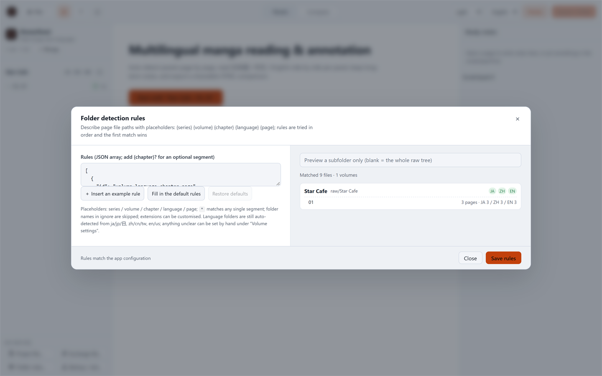

# フォルダ検出の規則

フォルダ検出の規則は、巻・言語・話・ページがパスのどこにあるかを記述するためのものです。既定の `raw/<巻>/<言語>/<話>/<ページ>` という形をどうしても取れないライブラリのための仕組みです。

## この工程で解決すること

実際のコレクションはそう揃っていません。シリーズ名が先頭に付くもの、出版社が言語を最後に置くもの、1 言語しかないので言語フォルダ自体がないものもあります。何千ものファイルを改名するのは本末転倒です。規則を使えば、すでにある形をそのまま読み取れます。

<figure class="shot">
  
  <figcaption>規則ダイアログ。左で規則の配列を編集し、右でサブツリーをプレビューしてから保存します。下部には、実行中の設定と規則が一致しているかが表示されます。</figcaption>
</figure>

## ダイアログの使い方

1. ライブラリサイドバー下部の**フォルダ検出の規則…**を開きます。
2. JSON の規則配列を編集します。**＋ 例の規則を挿入**で雛形を追加、**既定の規則を入力**で組み込みの形に戻せます。
3. **このサブフォルダだけをプレビュー**にサブフォルダを入力すると、その枝だけを試せます。空欄なら `raw/` 全体を走査します。
4. **一致 n ファイル · m 巻**、未認識ファイルの一覧、各話に含まれるページを確認します。
5. **規則を保存**を押すと、新しい規則でライブラリが再走査されます。

プレビューは入力中に更新されます。**既定に戻す**は編集を破棄するだけで、**規則を保存**だけがライブラリを変更します。

## プレースホルダー

| プレースホルダー | 別名 | 意味 |
| --- | --- | --- |
| `{series}` | `{seriesName}`、`{work}` | 巻の上にあるシリーズ階層。実際に存在する場合だけ書きます。 |
| `{volume}` | `{vol}`、`{book}` | サイドバーに表示される巻。 |
| `{chapter}` | `{chap}`、`{ch}`、`{episode}` | 話のフォルダ。 |
| `{language}` | `{lang}`、`{locale}` | 言語として認識されるフォルダ。`ja` や `zh-cn` などの組み込み別名、または巻の設定で割り当てたディレクトリ。 |
| `{page}` | `{file}`、`{image}`、`{img}` | 画像ファイル。すべての規則に必須です。 |

照合はどのプラットフォームでも大文字小文字を区別しません。Windows で作った規則をそのまま別の環境へ持って行けます。

### 省略可能なセグメントとワイルドカード

| 書き方 | 動作 |
| --- | --- |
| `{chapter}?` | このセグメントは無くてもかまいません。`{volume}/{language}/{chapter}?/{page}` は話フォルダがある場合も無い場合も一致します。 |
| `*` または `**` | 関心のない 1 セグメントだけに一致します。どちらの書き方も同じ動作です。 |
| 固定文字列 | フォルダ名と完全に一致する必要があります。例：`manga/{volume}/…` の `manga`。 |

規則には `{page}` が必要です。また、`language` のフォールバックを書かない限り `{language}` も必要です。

## 規則オブジェクト

```json
[
  {
    "id": "series-volume-language-chapter-page",
    "name": "シリーズ / 巻 / 言語 / 話 / ページ",
    "pattern": "{series}/{volume}/{language}/{chapter}?/{page}",
    "ignore": ["_extras", "covers"],
    "extensions": [".jpg", ".jpeg", ".png"]
  },
  {
    "id": "flat-japanese",
    "name": "フラット構成・日本語のみ",
    "pattern": "{volume}/{chapter}/{page}",
    "language": "ja"
  }
]
```

| フィールド | 必須 | 意味 |
| --- | --- | --- |
| `id` | いいえ | 安定した識別子。省略時は自動生成され、重複は拒否されます。 |
| `name` | いいえ | ダイアログに表示する名前。 |
| `pattern` | はい | プレースホルダーを含むスラッシュ区切りのパス。 |
| `ignore` | いいえ | 決して入らないフォルダ名。 |
| `extensions` | いいえ | 受け付ける拡張子。先頭のドットは有無どちらでも可。既定は `.jpg`、`.jpeg`、`.png`、`.webp`、`.gif`、`.avif`、`.bmp`。 |
| `language` | いいえ | `{language}` が無い場合のフォールバック言語。`ja`、`zh`、`en` などの言語 ID。 |
| `enabled` | いいえ | `false` にすると規則を残したまま無効化できます。 |

## 順序・言語・競合

- 規則は**上から順**に試し、最初に一致したものが使われます。具体的な規則を先に置いてください。
- `{language}` セグメント内のフォルダ名は、これまでどおり別名で認識されます。`ja`、`jp`、`日本語`、`zh-cn`、`cn`、`english`、巻の設定で割り当てたディレクトリなどです。[ライブラリと取り込み](/ja/guide/gallery#言語ディレクトリ名)を参照してください。
- `{language}` が無い規則では、その規則の `language` が一致した全ページに使われます。
- 有効な規則のどれにも一致しないファイルは**未認識**一覧に出て、ライブラリには入りません。
- 規則は検出だけに影響します。改名・移動・コピー・変換は行いません。

## 既存の作業が壊れるとき

ページデータは `data/pages/<巻>/<話>/<番号>.json` に保存されます。規則を変えると検出される巻 ID や話 ID が変わり、既存のコマやノートは自動では付いてきません。新しいコレクションでは注釈の**前に**規則を適用してください。あとから変更する必要がある場合は、先にバックアップを取り、数ページを確認します。

## よくある落とし穴

- **プレビューが空になる。** 規則は走査ルートからパス全体に一致します。`manga/` のような固定フォルダも含め、すべての階層を書いてください。
- **一部の話に必須セグメントが無い。** `?` で省略可能にするか、よりフラットな形の規則を追加します。
- **全ページが 1 つの話に入る。** `{chapter}` が抜けているか、ワイルドカードに置き換わっています。
- **言語が認識されない。** フォルダの別名が未知です。[巻の設定](/ja/guide/gallery#巻の設定)で割り当てるか、規則に `language` を追加してください。
- **保存したら巻の一覧が変わった。** 再走査の想定どおりの結果です。ノートを書く前に未認識一覧を確認してください。
- **2 つの規則が一致する。** 先の規則が優先されます。具体的な規則を上へ移動してください。

## 関連

- [ライブラリと取り込み](/ja/guide/gallery) — 既定の構成と巻の設定。
- [画像の前処理と名前変更](/ja/guide/preprocess) — 走査前に整えておくこと。
- [データ形式](/ja/data-format) — ページデータ内の巻・話 ID の扱い。
- [用語集](/ja/terminology) — コマ・ページ・注釈の共通語彙。
