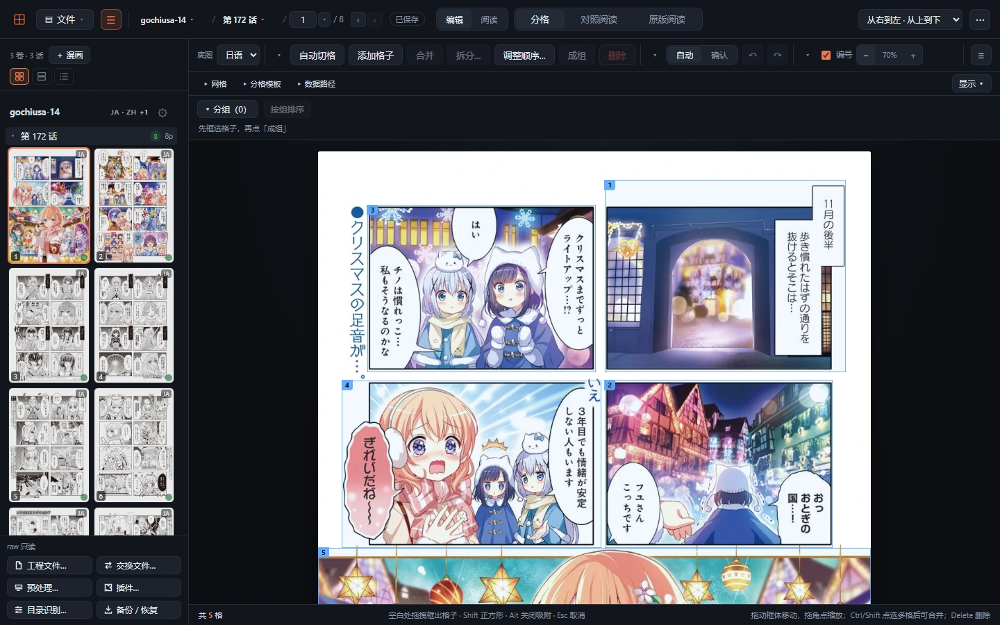
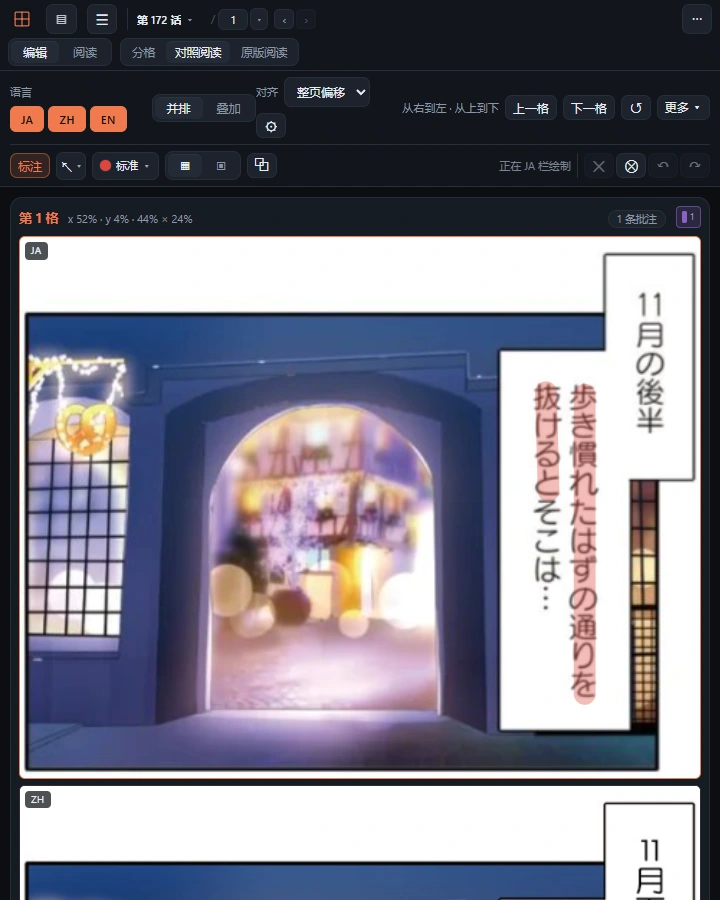
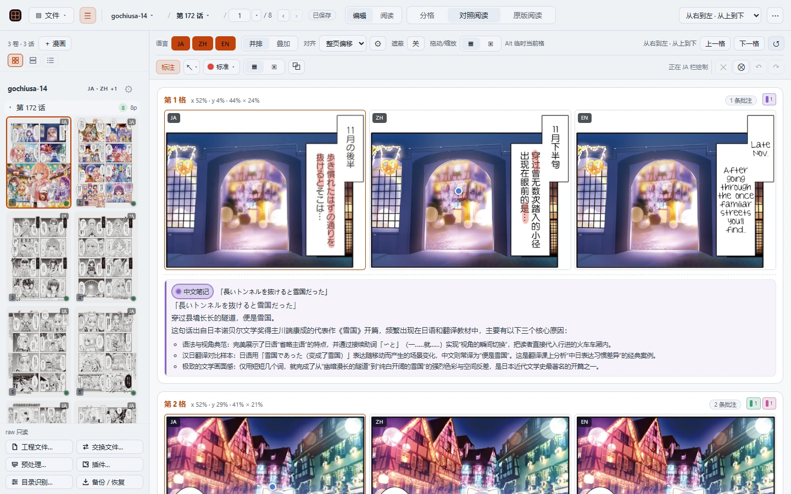

# はじめに

KomaYomi（格读）は、同じページの漫画を複数の言語で並べて読むためのローカル優先 Web アプリです。よくあるのは、原作・翻訳・辞書の三つの窓に、ページと決して位置が合わないノートアプリ。KomaYomi はページをコマに分割し、同じコマを日本語・中国語・英語でそろえ、Markdown ノートと注釈——訳注、写植の相談、語彙メモ——を、そのコマのその場所に貼れるようにします。日本語を勉強しながら翻訳版を横に置きたい人にも、翻訳版と生肉を突き合わせたい人にも、このセリフが各版でどうなっているかを知りたい人にも使えます。

気軽な読書用のマンガリーダーでも、配信プラットフォームでもありません。すべては自分のマシン上で、自分の画像フォルダだけを相手に動きます。

すでに導入済みなら[最初の10分](#最初の10分)へ。ゼロからなら、[インストールと起動](/ja/guide/installation)にデスクトップ版、`npm run dev`、Docker、PWA のすべての方法があります。

作者ページ：[X · @payayakamo](https://x.com/payayakamo) · [note · @payayakamo](https://note.com/payayakamo)。どちらも作者個人のページで、製品サイトではありません。

## 解決する課題

翻訳の勉強は、ページ単位よりコマ単位のほうが捗ります。ただ、同じ本のスキャンを3言語そろえても、そう都合よくはそろいません。ページはずれ、コマの切り出しは違い、文字の位置もそれぞれ。普通の画像ビューアではズームは1段階きり、ノートも取れず、「この吹き出し、3つの版でどうなってる？」と聞くこともできません。

KomaYomi は、その間に欠けている層を足します。

1. **構造** — コマは正規化した矩形として保存されるので、ズームしてもウィンドウを変えても、書き出しサイズが変わっても枠は生き残ります。
2. **位置合わせ** — 言語ごとに個別にずらして、同じコマをちゃんと重ねられます。ようやく。
3. **ノート** — 所見はページかコマに紐付き、タグと出典付きの Markdown で残せます。「あとで覚えておく」はもう作戦にはなりません。

## 5ステップのワークフロー

| 手順 | 行うこと | ページ |
| --- | --- | --- |
| 1 | 生肉と翻訳版を `raw/<volume>/<language>/<chapter>/01.jpg` に整理するか、すでにあるフォルダを指定します。 | [画像の前処理と名前変更](/ja/guide/preprocess)、[ライブラリとインポート](/ja/guide/gallery) |
| 2 | ページを開いて自動分割を実行し、枠を手作業で修正します。自動検出は下書きであって、結論ではありません。 | [コマ分割ワークベンチ](/ja/guide/panels) |
| 3 | 複数言語を並列または重ね表示で読み、位置合わせを行い、確認したい言語をマスクします。 | [比較リーダー](/ja/guide/compare) |
| 4 | タグ、出典、スクリーンショット付きのページノートとコマノートを書きます。訳注も大歓迎です。 | [ノート](/ja/guide/notes) |
| 5 | 学習用 HTML、スライド用 PNG、別のマシン用のプロジェクトパッケージをエクスポートします。 | [エクスポート](/ja/guide/export) |

## 画面の構成

<figure class="shot">
  
  <figcaption>コマ分割ワークベンチ。上部バー：ページ移動、コマ / 比較読み、読み順、テーマ、表示言語、ノート、エクスポート。左：ライブラリ。右：ノート。中央：コマ枠付きのページ——いちばん長居する場所です。</figcaption>
</figure>

ウィンドウには、常に同じ位置にある5つの領域があります。慣れれば指が覚えてくれます。

- **上部バー** — ブランド（ライブラリに戻る）、巻 / 話 / ページ、`‹` `›` のページ矢印、保存インジケーター、**編集 / 閲覧** の使用モード、**コマ / 比較読み / 原版** の切り替え、読み順のセレクター、集中モード（`⛶`）、ヘルプ（`?`）、設定（`⚙`、編集モードのみ）、アプリ情報（`ⓘ`）、UI テーマ、表示言語、**ノート**、**エクスポート**。
- **ライブラリサイドバー**（`S`） — 巻 → 話 → ページ。ページごとの警告に加え、マンガの追加、フォルダ規則、プロジェクトファイル、交換ファイル、バックアップへの入口があります。
- **ステージ** — 表示の切り替えに応じて、コマ分割ワークベンチ、比較リーダー、または原版ビューを表示します。
- **ノート列**（`N`） — ページノート、コマノート、一覧検索、一時メモ。
- **ペインスプリッター** — ライブラリとステージの間、またはステージとノートの間の縦ハンドルをドラッグしてサイズを変更します。ダブルクリックで既定値に戻ります。

ページは任意の数の言語を持てます。比較リーダーの言語チップは、現在のページに存在する言語だけが有効になります。

ウィンドウが狭くなっても、上部バーとコマ分割ワークベンチのツールバーは無理に詰め込みません。入りきらない次要の操作は `≡` のオーバーフローメニューにまとまり、スマートフォン幅ではページ送りや表示切り替えなど必要最小限だけが残ります。メニューの中身は広い画面のボタンと同じで、入口が消えることはありません。

## スタート画面

ライブラリを開く前は、スタート画面が表示されます。**画像をインポート / フォルダをスキャン**、**ライブラリを新規作成**、**`.mnproj` を開く**、**ガイド** の4つの入口があり、初回の6ステップをカードで並べます。スキャンを取り込む、ライブラリを作るかプロジェクトを開く、ページを選ぶ、コマを分割する、言語を比較する、最後に注釈とエクスポートです。

カードは広い画面で 3×2、中くらいの幅で 2×3、狭い画面で1列になります。読み取り専用モードではインポートと新規作成の入口が隠れ、プロジェクトを開く・ガイドだけが残ります。

## 編集モードと閲覧モード

上部バー中央の **編集 / 閲覧** 切り替えで、このワークスペースが作業台か閲覧ビューアかが決まります。選択はブラウザーに保存され、再読み込みしても維持されます。

- **編集モード** — コマ分割、注釈、ノート、読み順の変更ができ、変更は保存モードに従って `data/` に書き込まれます。初めて開くページはコマの自動検出も走ります。
- **閲覧モード** — 切り替えると、まだ保存していない現在ページの変更を先に保存し、コマの選択を解除して履歴と設定のダイアログを閉じます。上部バーに **読み取り専用** のバッジが出ます。完成した成果を人に見せるときや、誤って編集したくない復習に向いています。

閲覧モードで無効になる操作：

| 領域 | 閲覧モードでの動作 |
| --- | --- |
| コマ分割ワークベンチ | 分割・編集ツールバー、保存 / 履歴、グリッドとテンプレート、注釈の描画ツール、キーボードでの微調整が非表示または無効になり、ズームとパンだけが使えます。 |
| 比較リーダー | 注釈の描画ツールは隠れ、既存の注釈はそのまま表示されます。位置合わせのプリセットやアンカー入力など、データを書き込む操作は非表示です。ドラッグとホイールによる一時的なパン / ズームはできますが、ページには書き戻されません。 |
| ノート列 | 閲覧と検索のみになり、「閲覧モードではノートは閲覧のみ」と表示されます。新規作成、編集、削除、一時メモは使えません。 |
| ライブラリサイドバー | マンガの追加、巻設定の歯車、前処理、プラグイン、フォルダー規則、バックアップが隠れます。プロジェクトファイル、最近のページ、再読み込みは残ります。 |
| 上部バーとファイルメニュー | 読み順セレクターは無効になり、ファイルメニューはプロジェクトを開く・最近のページ・エクスポートだけになります。`Ctrl+S` では保存されません。 |

これらの制限はボタンを隠すだけではありません。閲覧モード中は書き込みリクエストがサーバー側で拒否されます（`ERR_READ_ONLY`）。エクスポート、プレビュー、プロジェクトの検査は引き続き使えます。

## 集中モード

集中モード（上部バーの `⛶` ボタン、または `R`）は別の機能です。上部バー、ステージのツールバー、コマのセクションレール、ステータスバーを一時的に隠してページを画面いっぱいに広げるだけで、編集 / 閲覧モードは変わりません。`Esc` または `R` で戻り、タッチ端末では空白部分をダブルタップして終了します。入ったときに終了方法を短く表示しますが、自動で消え、絵の上に居座ることはありません。

## 最初の10分

1. まずアプリを動かします。リポジトリで `npm run dev` を実行するか、デスクトップ版を起動して、`http://127.0.0.1:5173` を開いてください。
2. ライブラリに1巻分を認識させます。`raw/` に置くか、サイドバーの **＋ マンガを追加** から手持ちのフォルダを指定します。
3. サイドバーでページを開きます。初回はコマの自動検出が走り、結果は `data/pages/` に保存されます。
4. 2言語を見比べたいときは **比較読み**（`C`）に切り替え、`JA` と `ZH` にチェックを入れて、同じコマが上下でそろうまで片方のペインをドラッグします。ページ全体をいじるより、コマ単位で合わせるほうがずっと楽です。
5. 書き留めたいところが出てきたら **ノート**（`N`）を開き、コマを選んで最初のノートを書きます。保存は `Ctrl+Enter` です。
6. 最後に `E` で HTML をエクスポートし、ブラウザで開いてみてください。

## 実装済みの機能

  
<strong>ライブラリ</strong> — 巻をスキャンし、1つのルートに複数作品が並ぶ構成にも対応し、言語フォルダの別名を認識し、ページを並び順で対応付け、欠けているページや命名の不一致を警告します。サイドバーのページ一覧は 2 列サムネイル、1 列サムネイル、言語とノート数付きのリストから選べ、ブラウザごとに記憶されます。

  
<strong>コマ</strong> — XY カットによる自動検出、追加 / 移動 / 8方向のリサイズ / 結合 / グループ化 / 分割 / 削除、1–10 のクイック位置と右クリック移動に対応した番号の手動並べ替え、パーセント入力、グリッド生成、コマテンプレート、宣言的レイアウト、プラグイン、セッションをまたぐページ版履歴。

  
<strong>注釈</strong> — 矢印、矩形、楕円、マーカー、フリーハンドペン、テキスト、番号バッジ、モザイク、任意のアンカーと引き出し線、ページ単位の表示切り替え、言語ごとの分離と右クリックメニュー（削除・色変更・他の言語へコピー）、PNG エクスポート対応。

  
<strong>比較</strong> — 複数言語、並列または重ね表示、言語ごとのぼかし / 塗りつぶしマスク、ホイールズーム、パン、ページ / コマ / アンカー / グリッドの位置合わせ、保存済みプリセット、言語順のカスタマイズ。さらに原版ビュー（ズームとパンを連動 / 独立で切り替え）、ペインの右クリックから開く 1:1 拡大ビュー、ページ・話をまたぐ前のコマ / 次のコマと自動センタリング、コマ ID による深リンク付きのコマ詳細ビュー。比較リーダーの行（言語ペイン、見出し、余白）をダブルクリックするとそのコマが開き、絵をドラッグして位置合わせでき、ペインの並列 / 積み重ねと言語バーの横 / 縦を切り替えられます。位置合わせはセッション限りです。

  
<strong>ノート</strong> — ページ / コマのノートをいくつでも、ツールバーとライブプレビュー付きの Markdown、既存ノートを同じ単一エディターで編集、タグ、出典、添付画像、一覧検索、LLM 用コピー、一時メモ。さらにノートの種類として背景知識 / 単語 / つぶやき、有効な言語ごとの種類、`data/library.json` に保存するカスタム種類があります。種類付きカードはどの表示位置でも「8% の色付き背景 + 3px の色バー + 種類バッジ」で統一され、ライト / ダーク両方で読めます。ノートは絵の一点にピン留めでき、同じ場所の複数ノートは件数付きのポップオーバーにまとまります。ノート列は 絞り込み → 一覧 → エディター の順で、グループ化と種類別の追加に対応し、コマ詳細ビューにも同じエディターが埋め込まれます。

  
<strong>エクスポート</strong> — HTML（画像フォルダまたは単一ファイル）、PNG（ページ全体、現在のコマ、3言語コラージュ）、共有画像（1080×1440 カバー、単一コマ、3言語比較、長いページの分割、18 枚 / 20MB の警告付き）、ブラウザの印刷ダイアログ経由の PDF、ページ画像とノートを含み注釈を既定で焼き込む Word（`.docx`）、コマ枠の重ね描き、印刷用スタイル、エクスポートテンプレート。

  
<strong>履歴</strong> — 上部バーの `↺` で操作履歴を開くと、取り消せる編集が新しい順に並び、現在位置が強調されます。任意の地点へ戻れます。Undo スタックそのものを表示しているだけで、別のログではありません。読み取り専用モードでは表示のみで、戻す操作はできません。

  
<strong>モード</strong> — 編集 / 閲覧の2モード。閲覧に切り替えると先に保存してからすべての書き込みを無効にします。集中モード（`R`）では画面を没入表示にし、ページ / コマ操作用の小さなカプセルだけを残します。

  
<strong>ストレージ</strong> — ローカルフォルダ、マウントしたネットワーク共有、WebDAV。オンデマンドの画像取得、上限付き LRU キャッシュ、定期的な自動バックアップとキャッシュ管理に対応します。ページの書き込みはアトミックでスキーマ検証を行い、`.bak` をローテーションし、ページごとの書き込みロックを取ります。

  
<strong>可搬性</strong> — `.mnproj` プロジェクトは開くとライブラリとリンクし、保存のたびに同じファイルへ書き戻します。デスクトップ版のファイルメニューには **プロジェクトファイルへ保存** と **名前を付けて保存…**（ブラウザーではダウンロードにフォールバック）があり、`.mntpl` / `.mnexp` / `.mnpage.json` の交換ファイル、バックアップと復元の ZIP、バージョン付きスキーマ（ページ文書は 4、プロジェクトマニフェストは 2）を備えます。

## 未実装の機能

以下の項目は、登場する箇所で <Badge type="warning" text="予定" /> と表示されます。

- 語彙リストのエクスポート。PDF と Word はエクスポートダイアログの **PDF（印刷）** と **Word 文書** から利用できます。
- アプリ内の画像形式変換。名前変更と分割は[前処理](/ja/guide/preprocess)に含まれます。形式変換はアプリの外で行ってください。
- インポート / エクスポートの往復を対象とした、より広範な自動統合テスト。

Android / iOS 向けには、別リポジトリのネイティブアプリ [KomaYomi-mobile](https://github.com/PayayaKamo/KomaYomi-mobile) があります（HarmonyOS NEXT はプレースホルダー）。`.mnproj` を開け、0.2.1 ではアーカイブをネイティブ側で展開するようになったため、大きなプロジェクトの読み込みで画面が固まりません。

<figure class="shot">
  
  <figcaption>狭いウィンドウ：ペインは縦に積み重なり、ライブラリはドロワーになります。デスクトップ版がスマホくらいの画面で使うのと同じレスポンシブレイアウトです。</figcaption>
</figure>

## ライトとダーク

UI テーマは既定でシステムに従い、上部バーからライトまたはダークに固定できます。エクスポートされる HTML はライトテーマのみなので、スクリーンショットや印刷結果が一定になります。

<figure class="shot">
  
  <figcaption>ライトテーマ。</figcaption>
</figure>

<figure class="shot">
  
  <figcaption>ダークテーマ。</figcaption>
</figure>

## よくある落とし穴

- **ライブラリに何も出ない。** サイドバーは `raw/` だけを走査します。先にフォルダーを追加するか、リモートツリーをマウントしてください。[ライブラリと取り込み](/ja/guide/gallery) を参照。
- **最初のページのコマがずれている。** 自動検出は下書きで、結論ではありません。コマ単位のノートを書く前に枠を直してください。あとで再検出すると手作業の修正は失われます。
- **言語チップが灰色。** そのページにその言語の画像がありません。ページ数と言語の対応付けを確認してください。
- **別のマシンでノートが消えたように見える。** ノートは `data/`、画像は `raw/` にあります。両方を移すか、`.mnproj` を書き出してください。[プロジェクトファイルと形式](/ja/guide/project-files) を参照。
- **オフラインで画像取得に失敗する。** オフライン前に開いたページだけがキャッシュされています。[バックアップとリモート](/ja/guide/remote) を参照。

## 次に読む

- 新規インストール：[インストールと起動](/ja/guide/installation)。
- 画像の準備がまだ：[画像の前処理と名前変更](/ja/guide/preprocess)。
- 画像を追加する：[ライブラリと取り込み](/ja/guide/gallery)。
- フォルダ構成が特殊：[フォルダ検出の規則](/ja/guide/folder-rules)。
- キーを探す：[ショートカット一覧](/ja/guide/shortcuts)。
- 問題が起きた：[FAQ とトラブルシューティング](/ja/faq)。
