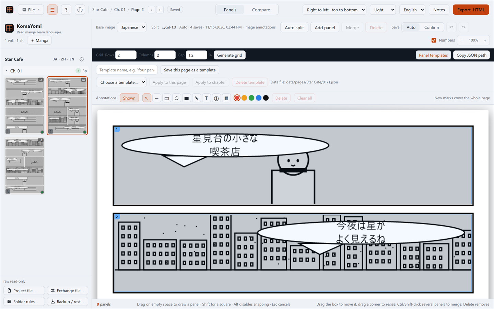
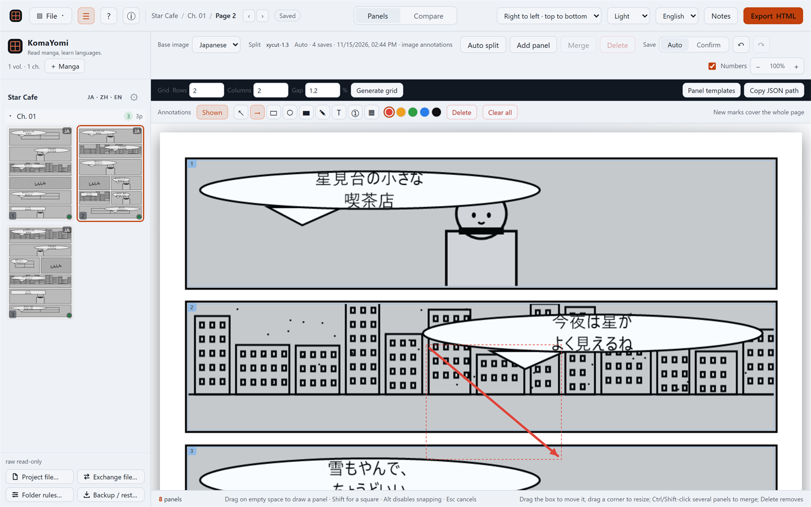
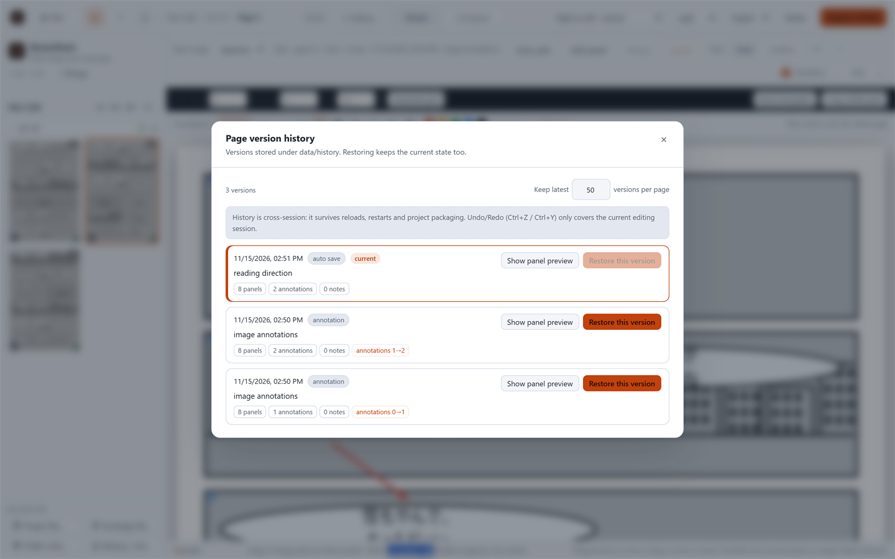

# コマ分割ワークベンチ

コマ分割ワークベンチは、ページを構造化データに変える場所です。自動検出はあくまで下書き。ワークベンチは、その下書きととことん付き合うための場所です——すばやく、しかも後戻りできる形で。

<figure class="shot">
  
  <figcaption>検出されたコマは、下地画像の上に番号付きの枠として描画されます。選択中の枠には8つのリサイズハンドルが表示されます。注釈ツールバーはコマのツールの下にあります。</figcaption>
</figure>

## 解決する課題

以降のすべての機能はコマの上に立っています。比較読み、コマ単位のノート、コマの PNG エクスポート、HTML エクスポート。枠が誤っていれば、後ろのすべてがその誤りを引き継ぎます。自動検出はほとんどのページで十分ですが、扉ページ、見開き、端の細い帯、そして雑誌がその月に思い付いたレイアウトには、どうしても手を入れる必要があります。

## ツールバーの各コントロール

<figure class="shot">
  
  <figcaption>2 行のツールバー。上段が検出と保存、下段が矩形の数値、グリッド生成、コマテンプレートです。注釈ツールバーはそのさらに下にあります。</figcaption>
</figure>

### 1行目 — 下地画像と分割

| コントロール | 動作 | 補足 |
| --- | --- | --- |
| **下地画像** セレクター | 表示し、検出に使う言語の画像を選びます。 | コマの矩形はページの全言語で共有されるため、変わるのは描画の対象となる画像だけです。 |
| 検出器チップ | 現在のコマを生成したアルゴリズムのバージョン（例：`xycut-1.3`、`layout:<id>`、`plugin:<name>`）を表示します。 | `旧データ` は、ページ JSON がバージョン追跡より前のものであることを示します。 |
| 状態テキスト | コマが *自動*、*テンプレート適用*、*プラグイン適用*、*手動編集* のどれか、保存回数、最後の編集概要を表示します。 | これは編集カウンターであり、監査ログではありません。 |
| **自動分割** | 下地画像に対して検出を実行し、現在のコマを置き換えます。 | 検出中、またはページに画像がないときは無効になります。再実行すると手作業の編集は破棄されます。 |
| **コマを追加** | ページ中央付近に既定のコマを追加します。 | より速い方法：空白をダブルクリックします。 |
| **結合**（n） | 選択したコマを `source: "merged"` の1つの枠に結合します。 | 2つ以上のコマを選択すると有効になります。 |
| **分割…** | 選択した1つのコマを 2〜12 個に切ります。 | ベース画像の読み込み後に有効。コマの右クリックメニューにもあります。 |
| **順序…** | 番号付けダイアログを開き、読み順を手動で変更します。 | コマが2つ以上あるときに有効です。 |
| **グループ化**（n） | 選択したコマからグループを作ります。 | 1つ以上選択すると有効です。[グループ](#グループ)を参照してください。 |
| **削除** | 選択したコマと、そのコマに紐付くノートを削除します。 | `Delete` / `Backspace` と同じです。 |

### 1行目 — 保存

| コントロール | 動作 |
| --- | --- |
| **自動** | 変更から約0.7秒後に自動保存します。 |
| **確認** | **✓** をクリックするか `Enter` を押すまで、編集を未保存のまま保持します。**×** または `Esc` で破棄し、最後に保存した状態に戻します。 |
| `↶` / `↷` | 元に戻す / やり直す（`Ctrl+Z`、`Ctrl+Shift+Z`、`Ctrl+Y`）。 |
| **✓** | 未保存のページを保存します（確認モードのみ）。 |
| **×** | 未保存の編集を破棄します（確認モードのみ）。 |
| **未保存** フラグ | 確認モードで、未保存の変更がある間に表示されます。 |
| **番号** | コマのインデックスバッジを表示または非表示にします。 |

保存モードはブラウザに記憶されます。上部バーには常に現在の状態（*保存済み*、*保存中…*、*保存待ち*、*未保存の変更*）が表示されます。

### 1行目 — ズーム

`−` / パーセント / `＋` のコントロールで、ステージのズームを50%から300%まで15%刻みで変更します。ズームは表示だけの設定です。コマの座標は `0..1` に正規化されており、変化しません。

### 2行目 — 数値の矩形

コマを1つだけ選択すると、2行目に **コマ座標** と4つのパーセント入力が表示されます。

| フィールド | 意味 |
| --- | --- |
| `X` | 左端（ページ幅に対する割合）。 |
| `Y` | 上端（ページ高さに対する割合）。 |
| `W` | 幅（ページ幅に対する割合）。 |
| `H` | 高さ（ページ高さに対する割合）。 |

値を入力するとコマがすぐに更新されます。ページ外の値は保存時に範囲内に丸められます。

### 2行目 — グリッド生成

| フィールド | 範囲 | 意味 |
| --- | --- | --- |
| **行** | 1〜8 | 行数。 |
| **列** | 1〜6 | 列数。 |
| **間隔** | 0〜8 % | セル間の余白（ページに対する割合）。 |
| **グリッドを生成** | — | 現在のコマを均等分割したグリッドで置き換えます。 |

雑誌の固定レイアウトが続く話にはグリッドを使い、同じレイアウトが正確に繰り返される場合は **コマテンプレート** を使います。

### 2行目 — テンプレートと JSON

**コマテンプレート** は現在のページの矩形を記録します。

1. **コマテンプレート** を開き、名前を入力して **このページをテンプレートに保存** をクリックします。
2. テンプレートを選択し、**このページに適用** または **話全体に適用** をクリックします。
3. 話に適用すると既存のコマが上書きされるため、確認を求められます。

新しいページのコマ数がテンプレートと同じ場合、コマ単位のノートは読み順で再マッピングされます。コマ数が異なる場合、コマノートは誤ったコマに黙って結び付くのではなく破棄されますが、ページノートは常に保持されます。テンプレートは `data/templates/panel.json` に保存されます。

**JSON パスをコピー** は `data/pages/<volume>/<chapter>/<index>.json` をコピーします。このファイルを手で編集することも可能で、サーバーは読み込み時に矩形を正規化し、欠けた id を補い、ぶら下がった参照を削除します。

## キャンバス上のマウスとキーボード

| 操作 | ジェスチャー |
| --- | --- |
| コマを移動 | 枠の本体をドラッグします。 |
| リサイズ | 8つのハンドルのいずれかをドラッグします。 |
| コマをすばやく追加 | 空白をダブルクリックします。 |
| コマを正確に描く | 空白の上をドラッグします。 |
| 正方形に固定 | 描画中に `Shift` を押します。 |
| 吸着を無効にする | 描画またはドラッグ中に `Alt` を押します。 |
| 現在の枠をキャンセル | `Esc`。 |
| 複数選択 | `Ctrl` クリックまたは `Shift` クリックで枠を選びます。 |
| 微調整 | 矢印キーで選択範囲を0.2%移動します。`Shift` + 矢印で1%移動します。 |
| 削除 | `Delete` または `Backspace`。 |
| 保存 / 破棄（確認モード） | `Enter` / `Esc`。 |

すべての座標はページに対して正規化されるため、ズームレベルやエクスポート解像度が変わってもコマは同じ位置にとどまります。

## 番号付けと読み方向

- **番号** でインデックスバッジを切り替えます。
- 読み方向はページごとに保存され、7 つの値のいずれかです：`rtl`、`ltr`、`ttb`、`horizontal-rl`、`horizontal-lr`、`vertical-rl`、`vertical-lr`。最初の3つは横書き・縦書き形式の旧名です。上部バーで変更します。
- コマは明示的な `number` を持て、自動の読み順を上書きします。それ以外の場合、番号は矩形と方向から導かれます。
- 追加・分割・手動の並べ替えはいずれも番号を振り直します。コマを選択していなければ末尾に追加され、選択していればその直後に挿入されて以降の番号がずれます。
- 同じ順序が比較リーダー、ノートの一覧、HTML エクスポートでも使われます。

::: tip まず読み順
編集を始める前にコマ番号がおかしいと感じたら、まず読み順のセレクターを直してください。JSON で手作業で番号を振り直すこともできますが、方向を変えれば話全体のページがまとめて直ります。
:::

## 注釈ツール

注釈レイヤーは原画の上に描画され、コマとは別に保存されます——ページの幾何ではなく、赤ペンだと思ってください。

<figure class="shot">
  
  <figcaption>注釈ツールバー。右側のヒントが現在の適用範囲を示しています。ここでは「新しい注釈はページ全体」。比較リーダーにも同じツールバーが出ます。</figcaption>
</figure>

| コントロール | 動作 |
| --- | --- |
| **注釈：表示中 / 非表示** | 全体の表示切り替え。非表示にしてもデータは保持され、エクスポートでは隠れます。 |
| **選択と移動** | 既存のマークを選択します。ドラッグで移動します。 |
| **矢印** | 尾から頭へドラッグします。 |
| **矩形** / **楕円** | 矩形または楕円をドラッグで描きます。 |
| **マーカー** | 半透明のフリーハンド線。 |
| **フリーハンド** | 不透明のペン線。折れ線全体を保持します。 |
| **テキスト** | クリックしてからラベルを入力します。 |
| **番号バッジ** | クリックしてから番号を入力します。 |
| **モザイク** | 矩形をドラッグすると、その範囲がピクセル化されます。 |
| **色見本** | 新しいマークの色を設定します。マークを選択した状態で色見本をクリックすると、そのマークの色を変更します。 |
| **削除** | 選択中のマークを削除します。 |
| **すべて消す** | 確認後、ページ上のすべてのマークを削除します。 |

適用範囲は選択に従います。コマを1つ選択している場合は「新しい注釈は N コマ目の中に描画」、何も選択していない場合は「新しい注釈はページ全体に描画」と表示されます。`Esc` で現在のツールを終了するか、マークの選択を解除します。

エクスポートした HTML と PNG に注釈が含まれるのは、レイヤーが表示されている場合だけです。HTML エクスポートには **原画にコマ枠を描く** オプションもあり、これは注釈とは別です。

## グループ

グループは、ひとまとまりとして読むべきコマの集合です。2 つの枠に分かれた見開き、繰り返し出てくる全景カット、まとめて論じたい一連のコマ。グループはレイアウト上の情報でしかなく、絵を結合したり、ノートを動かしたり、注釈を変えたりはしません。

### グループを作る

1. コマを 1 つ以上選びます。`Ctrl` クリック、`Shift` クリック、または空白のドラッグで範囲選択します。
2. 1 行目の**グループ化**を押します。
3. **グループ（n）**パネルに新しいグループができます。名前と色を設定してください。

グループを作ると、そのコマは以前のグループから外れます。グループ同士が重なることはありません。

### グループを編集する

| コントロール | 動作 |
| --- | --- |
| 色見本 | グループのコマ枠とチップの色を変えます。 |
| 名前欄 | 自由入力。既定は*グループ n*。 |
| 番号チップ | グループ内のコマ。ドラッグでグループ内の順序を変えられます。 |
| チップの `×` | そのコマをグループから外します。コマ自体はページに残ります。 |
| **前のグループに統合** | このグループのコマを前のグループへ追加します。先頭のグループでは使えません。 |
| **分割** | 複数コマのグループを 1 コマずつのグループに分けます。 |
| **削除** | グループだけを削除します。コマ、ノート、注釈は残ります。 |

グループ見出しの**グループ順に整列**は、各グループの先頭コマの読み位置に合わせてページ全体を振り直します。コマ番号が変わるので、意図して使ってください。エクスポートと比較読みも同じ順序に従います。

グループは `groups: [{ id, name, panelIds, number, color }]` としてページ JSON に保存され、ページ交換ファイル、プロジェクトパッケージ、バックアップにも含まれます。

## コマの分割

分割は、1つの枠にまとめて描かれた大きな絵（見開き、1つの枠に2つの場面）を独立したコマに切る機能です。コマを選択して **分割…** を押すか、コマの右クリックメニューから同じ項目を選びます。

1. **分割数**（2〜12）と切る方向（**縦** / **横**）を選びます。
2. 既定では均等割りです。プレビューで切り線をドラッグするか、選択中の線を矢印キーで微調整します（線の間隔は最低 4%）。**均等分割** でやり直せます。
3. **分割** を押すと適用されます。

新しいコマは元のコマの読み順の位置を引き継ぎ、後ろのコマの番号はずれます。注釈とコマノートは最初のコマに付き、残りは空の状態で始まります。手動の移動やリサイズと同じく、元に戻せます。

## 番号を手動で並べ替える

番号は本来、矩形と読み方向から導かれますが、上書きできます。コマを選択して **順序…**（または右クリック → **コマ番号を設定**。2つ以上のコマが必要）を押します。

- 一覧は現在の読み順に並び、各行に番号・座標・↑ / ↓ ボタンが表示されます。
- ⠿ ハンドルをドラッグする、↑ / ↓ を押す、**選択中のコマを n 番目へ移動** に位置を入れて **移動** を押す、のいずれかで並べ替えます。
- **保存** で初めて書き戻され、配列の順序が書き換えられて 1..n に振り直されます。**キャンセル** では何も変わりません。

自動検出とテンプレートはコマ一覧を丸ごと作り直すため、手動の番号も失われます。再検出の前には確認が出ます。

## ページ版履歴

保存のたびに、`data/history/<巻>/<話>/<ページ>.json` へ版が追加されます。セッション内の元に戻す履歴とは違い、再読み込みや再起動、プロジェクトのパッケージ後も残ります——テンプレートがコマを食べてしまった日のための安全網です。

1. ページを開きます。
2. 上部バーの **≡ 履歴**を押します。
3. 版を選んで内容を確認し、よければ**この版に復元**を押します。

<figure class="shot">
  
  <figcaption>ページ版履歴。各行に版が作られた理由と構造の変化が記録されます。現在の版には印が付き、その版自身へは復元できません。</figcaption>
</figure>

| コントロール | 動作 |
| --- | --- |
| 版の行 | 時刻、出典ラベル、前の版との構造差分。 |
| 出典ラベル | *自動保存*、*手動保存*、*一括*、*テンプレート適用*、*位置合わせ*、*注釈*、*読み込み*、*復元*、*自動検出*。 |
| 件数 | その版のコマ数、注釈数、ノート数。 |
| **コマ枠プレビューを開く** | この版のコマ矩形を前の版と比べます。 |
| **各ページで最新 n 版を保持** | 履歴の上限。既定は 50。古い版は次の保存時に整理されます。 |
| **この版に復元** | 現在の状態を新しい版として保存してから、選んだ版を復元します。 |
| **復元を元に戻す** | 直前の復元前の状態に戻します。 |

復元は元に戻す操作とは別です。新しい版が書き込まれるので、復元元の状態も一覧に残ります。履歴ファイルはバックアップとプロジェクトパッケージに含まれ、サムネイルキャッシュを消しても削除されません。

## 安全な修正手順

1. ページを開き、自動検出を実行させます。
2. 明らかな枠を修正します。移動、リサイズ、追加、削除です。
3. 見開きにまたがる扉ページのコマを結合します。
4. 保存します（確認モードでは **✓** を押します）。
5. **比較読み**（`C`）に切り替え、同じコマに本当に同じ絵が入っているか確認します。

手作業の編集を失う覚悟がない限り、編集後に **自動分割** を再実行しないでください。

## よくある落とし穴

- **自動分割で枠が置き換わった。** 検出は上書きします。コマテンプレートを使うか、最初の分割が成功した後に手作業で編集してください。
- **ページに画像がない。** 検出が無効になり、ステージには空の状態が表示されます。欠けている言語フォルダを追加するか、巻の設定で割り当ててください。
- **WebP のページは検出されない。** WebP は表示されますが、検出用にデコードされません。JPEG または PNG に変換してください。
- **テンプレート適用後にコマノートが消えた。** テンプレートのコマ数が異なっていたためコマノートが破棄され、ページノートは保持されました。必要ならバックアップから復元してください。
- **「未保存の変更」が消えない。** 確認モードになっています。**✓** または `Enter` を押してください。**×** で破棄できます。
- **マークが見えない。** 注釈レイヤーが非表示か、コマのフィルターが有効です。**注釈：表示中** を確認してください。
- **グループ化したら番号が変わった。** **グループ順に整列**が読み順を書き換えます。元に戻すか、ノートを書く前にグループを作ってください。
- **復元したら新しいノートが消えた。** 復元はページ全体を置き換えます。置き換え前の状態も版として残るので、**復元を元に戻す**か、その版をもう一度復元してください。

## スクリーンショット未掲載

| 図 | 必要な箇所 |
| --- | --- |
| グループパネルの拡大 | 色、名前、番号チップ、グループ操作 |

## 関連項目

- [比較リーダー](/ja/guide/compare) — コマは何のためにあるのか。
- [プロジェクトファイルと形式](/ja/guide/project-files) — 履歴とグループのパッケージ方法。
- [データ形式](/ja/data-format) — ページ JSON の契約。
- [キーボードショートカット](/ja/guide/shortcuts) — すべてのキーを1つの表に。
