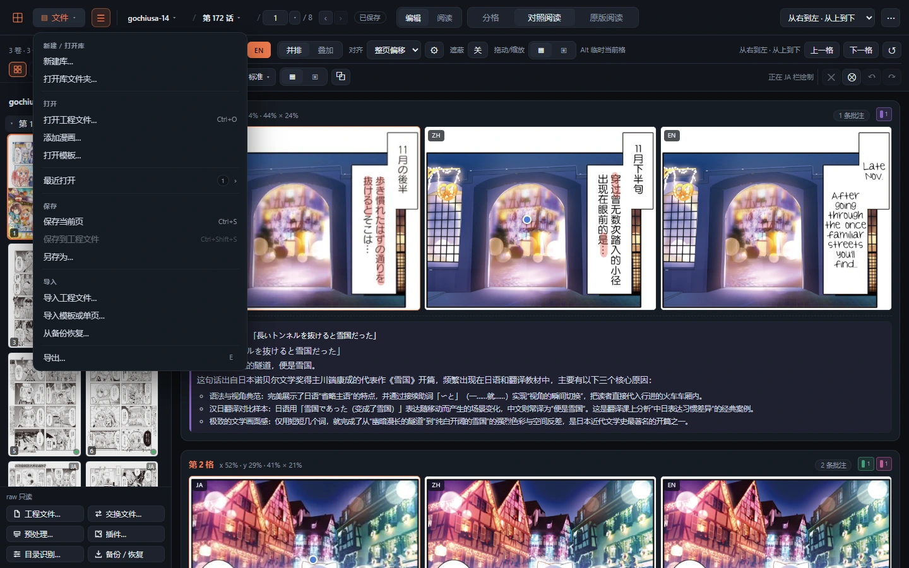

# プロジェクトファイルと形式

KomaYomi が保存するものはすべてプレーンファイルです。画像は `raw/`、注釈は `data/`、生成物は `exports/` にあります。`.mnproj` は作業用のコンテナで、開くとライブラリがリンクされ、保存は同じファイルへ書き戻されます。このページではそのリンク、作業を別の場所へ移す方法、古いファイルを考古学にしないためのバージョン規則を説明します。

## 解決する課題

注釈はもっとも高価な部分です。コマの修正、位置合わせ、ノートに何時間もかかります。マシンの変更、ディスク障害、学習パートナーとの共有、将来のアプリバージョンを越えて残る必要があります。データベースのバックアップは不透明ですが、これらの形式はプレーンな ZIP と JSON で、普通のツールで検査できます。

## 3つの可搬レイヤー

| レイヤー | ファイル | 内容 | 使う場面 |
| --- | --- | --- | --- |
| **プロジェクトパッケージ** | `.mnproj` | 画像（パッケージモード）、ページ JSON、テンプレート、プリセット、言語マッピング | 別のマシンへ移す、または完成した巻をアーカイブするとき。 |
| **交換ファイル** | `.mntpl`、`.mnexp`、`.mnpage.json` | 1つのレイアウト、1つのエクスポートスタイル、1つのページ | 再利用できるレイアウトや、注釈済みの1ページを共有するとき。 |
| **バックアップ ZIP** | `.zip` | `data/` フォルダ全体 | 操作ミスの後に復元する、または定期的な安全コピーを保つとき。 |

<figure class="shot">
  
  <figcaption>ファイルメニューは、開く、リンク済みプロジェクトへの書き戻し、コピーとして保存、読み込み、バックアップからの復元をまとめています。隣の保存インジケーターから書き戻しパネルを開けます。</figcaption>
</figure>

## プロジェクトパッケージ（`.mnproj`）

`.mnproj` はテキストのマニフェストを含む ZIP です。

```text
manifest.json
pages/<volume>/<chapter>/<index>.json
history/<volume>/<chapter>/<index>.json
templates/...
presets/...
config/library.json          (optional)
assets/<sha1>.<ext>          (packaged mode only)
```

ページ版履歴もプロジェクトに含まれるため、開き直したあとも[コマ分割ワークベンチ](/ja/guide/panels#ページ版履歴)で説明した記録を確認できます。

### 参照モードとパッケージモード

| モード | 画像 | サイズ | 可搬性 |
| --- | --- | --- | --- |
| **参照** | マニフェストにはパスと SHA-1 ハッシュのみ。 | 小さい。 | 元の画像フォルダが必要。ハッシュまたはファイル名による再リンクに対応。 |
| **パッケージ** | `assets/<sha1>.<ext>` に重複排除して格納。 | 大きい。 | 自己完結。インポートすると画像が `raw/` に書き込まれます。 |

### 開いたファイルへの書き戻し

プロジェクトを開いてもコピーは作りません。ライブラリはその `.mnproj` にリンクされ、以降の保存はすべて同じファイルへ書き戻されます——画像、ページ JSON、ノート、注釈、テンプレートまで含めて。「もう一度プロジェクトを書き出す」手順はなく、古いコピーを編集してしまう心配もありません。

- **ファイル → プロジェクトファイルへ保存** は保存のデバウンスを待たずに即座に書き戻します。リンクされたプロジェクトがない場合（メニューにその旨が出ます）と読み取り専用モードでは使えません。
- 上部バーの保存状態が書き戻しパネルです。クリックするとリンク先のパス、最終書き戻し時刻、保存待ちの編集があるか、現在の状態（保存済み / 書き込み中 / 失敗）と失敗理由が表示され、**今すぐ書き戻す**、**再試行** が使えます。リンクがない場合は **名前を付けて保存…** へ案内し、読み取り専用モードではディスクに書かないことを説明します。
- 書き戻しに失敗したときは作業を妨げない通知を出し、パネルには理由と再試行ボタンが残ります。一時的なロックやフォルダの移動で変更が黙って消えることはありません。

### コピーとして保存

**ファイル → 名前を付けて保存…** は現在のライブラリを新しい `.mnproj` として任意の場所に書き出します。リンク済みの元ファイルは上書きしません。`vol-01.mnproj` を編集中なら、コピーは別のファイルになります。

デスクトップ版では OS の保存ダイアログが開きます。ブラウザーにはファイルダイアログがないため、同じコマンドがライブラリをまとめてダウンロードに渡します（ダウンロード時に名前を変えられます）。ダイアログには、デスクトップ保存かブラウザーのフォールバックかが事前に表示されます。

マニフェストにはアプリのバージョン、作成日時、言語マッピング、巻 / 話 / ページと画像ハッシュの一覧、ノートと注釈の件数が記録されます。

### インポート

1. **プロジェクトファイルを選択…** をクリックします。書き込む前に、巻、話、ページ、ノート、注釈、画像、テンプレートの概要が表示されます。
2. 競合ポリシーを選びます。**上書き**、**結合**、**スキップ** です。
   - **結合** は、取り込むページにコマや注釈がない場合に既存のものを保持し、ノートは id で統合して既存のノートを削除しません。
3. 参照モードのプロジェクトで画像が不足している場合は、任意で元画像のある **再リンク先フォルダ** を選べます。
4. **インポートする** をクリックします。

安全のための動作:

- インポートの前に、現在の `data/` が `exports/` にスナップショットされます。
- 元のプロジェクトファイルは `data/backups/projects/` にバックアップされます。
- 不足している画像はインポート後に報告されます。再リンク先フォルダに置き、**結合** でもう一度インポートすれば復元できます。

## 交換ファイル

**交換ファイル…** は、ライブラリ全体に触れずに3つの小さな形式を扱います。

### `.mntpl` — レイアウトテンプレート

エクスポート時には巻 / 話 / ページの紐付けが外れるため、テンプレートは別の漫画にインポートし、現在の巻、話、ページに紐付け直せます。インポートダイアログでは紐付けを指定でき、その場で適用することもできます。既存のページは先に保存されます。

### `.mnexp` — エクスポートテンプレート

HTML、Word、印刷ドキュメントのレイアウトとスタイル設定を保存します。今エクスポートして、後でインポートできます。テンプレートの保存先は `data/templates/export.json` です。

### `.mnpage.json` — 1ページ

コマ、ノート、タグ、グループ、注釈、位置合わせオフセットを含む、読めるページドキュメントです。スキーマのエンベロープがない古いページ JSON もインポートでき、移行されます。

- **現在のページを書き出す** は現在のページを書き出します。
- **ページ JSON を選択…** の後に **現在のページを上書き** で、選択中のページのコマ、ノート、注釈を置き換えます。
- 検証に失敗すると正確なフィールドパスが報告され、中途半端なデータは書き込まれません。
- 元のファイルは `data/backups/exchange/` にバックアップされます。

::: warning 未保存の変更
ページに未保存の編集がある場合、交換ファイルのエクスポートには含まれず、ページのインポートで上書きされる可能性があります。先に保存してください。ダイアログは警告しますが、うっかり通り過ぎやすいです。
:::

## 形式のバージョン

すべての交換形式はスキーマのエンベロープを持ちます。

```json
{
  "$schema": "https://manga-memo.dev/schemas/page.schema.json",
  "schemaVersion": 4,
  "appVersion": "1.2.0",
  "kind": "page"
}
```

| 種類 | ファイル | 現在のバージョン |
| --- | --- | --- |
| `mnproj` | `.mnproj` マニフェスト | **2** |
| `mntpl` | レイアウトテンプレート | **1** |
| `mnexp` | エクスポートテンプレート | **1** |
| `page` | ページドキュメント | **4** |
| `mntp` | コマテンプレート（保存用） | **1** |
| `mnalign` | 位置合わせプリセット（保存用） | **1** |
| `mnlayout` | 宣言的レイアウト（保存用） | **1** |
| `mnconfig` | ライブラリ設定（保存用） | **1** |
| `mnstorage` | ストレージ設定（保存用） | **1** |

バージョンの規則:

- アプリが対応するより**高い**バージョンを宣言するファイルは、明確なメッセージとともに拒否されます。先にアプリをアップグレードしてください。アプリが将来の形式を推測することはありません。
- バージョンがない場合は **v0** として扱われ、インポート時に移行されます。初期の実験的なマニフェスト（トップレベルの `images`、フラットな `langDirs` マップ）は現在の形に変換されます。
- 省略された任意フィールドは既定値で補われ、無効な画像はインポート全体を中断せずに破棄されます。
- 読み込み時にページ JSON は**正規化**されます。矩形は範囲内に丸められ、ぶら下がったグループ参照は削除され、欠けた id は生成されます。アプリが知らないフィールドは破棄せずにそのまま保持します。
- 解析できないページ JSON は存在しないものとして扱われ、アプリが再検出して作り直します。

## バックアップ ZIP

バックアップは、各エントリの先頭に `data/` が付く ZIP です。

```text
data/pages/...
data/templates/...
data/presets/...
data/layouts/...
data/library.json
data/.backup-meta.json
```

除外されるもの：`data/cache/`（サムネイルとリモートキャッシュ）、`.tmp` ファイル、ログ。復元は同名ファイルを上書きし、バックアップにないページは残し、最初にスナップショットを書き出します。

## 定期バックアップ

サイドバー下部の **バックアップ / 復元**（またはファイルメニューの **バックアップから復元…**）を開くと、**定期バックアップ** のセクションがあります。

- **定期バックアップを有効にする** — 既定はオフ。
- **間隔（時間）** — 1〜168、既定は 24。
- **保持数** — 1〜50、既定は 7。
- **保存** で設定を `data/library.json` に書き込み、**今すぐ実行** でその場で1つ生成します。

サーバーは1分ごと（起動5秒後にも）前回の実行から間隔が過ぎたかを確認します。実行すると `exports/auto-backup-<タイムスタンプ>_000.zip` を書き出し（手動バックアップと同じ内容）、**保持数** を超えた古い自動バックアップを削除します。手動の `backup-*.zip` は削除しません。ダイアログには前回の実行時刻・ファイル名・サイズ・失敗理由が表示され、失敗時は `ERR_AUTO_BACKUP_FAILED` と原因が返ります。実行状態は `data/cache/backup-schedule.json` に保存されるため、次のアーカイブには含まれません。定期実行はローカルの `exports/` にだけ書き込み、リモートのバックアップ先へのアップロードは手動のままです。

## 未実装の機能

- **語彙リストのエクスポート。** PDF と Word は、エクスポートダイアログの **PDF（印刷）** と **Word 文書** で対応します。
- **アプリ内の画像形式変換。** 名前変更と分割は[前処理](/ja/guide/preprocess)に含まれます。形式変換はアプリの外で行ってください。

## よくある落とし穴

- **参照モードのプロジェクトで画像が不足する。** マニフェストにはハッシュとパスのみが保存されます。再リンク先フォルダを使うか、次回はパッケージモードでエクスポートしてください。
- **「スキーマのバージョンが新しすぎます。」** ファイルはより新しいビルドのものです。アプリを更新してください。`schemaVersion` を手で編集しないでください。
- **インポートで新しいノートが上書きされた。** **上書き** は仕様上破壊的です。迷ったら **結合** を使ってください。スナップショットは書き出されていますが、復元すると現在のデータが置き換わります。
- **レイアウトテンプレートが表示されない。** 現在の話 / 巻のフィルターに紐付いています。インポートダイアログで紐付けを確認してください。
- **`.mnpage.json` をインポートしても画像がない。** ページデータに画像は含まれません。画像は `raw/` またはパッケージ化したプロジェクトから来ます。

<figure class="shot">
  
  <figcaption>プロジェクトのインポート概要。保存形式、件数、競合ポリシー、再リンク先、読み込みボタン。</figcaption>
</figure>

## スクリーンショット未掲載

| 図 | 必要な箇所 |
| --- | --- |
| プロジェクトのエクスポートフォーム | モード、名前、メモ |
| 交換ファイルのダイアログ | 3つのファイル形式 |

## 関連項目

- [データ形式](/ja/data-format) — JSON フィールドの完全なリファレンス。
- [エクスポート](/ja/guide/export) — HTML、Word、PDF、PNG の出力。
- [リモート保存とバックアップ](/ja/guide/remote) — バックアップ先。
