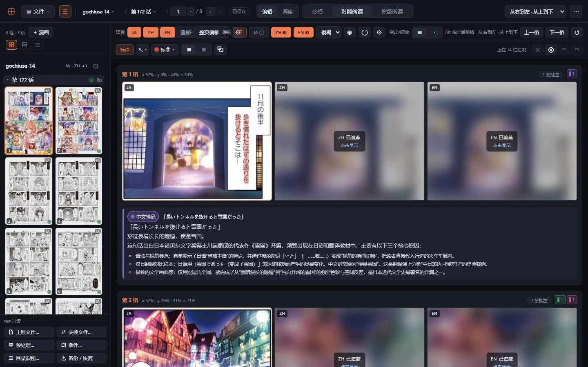
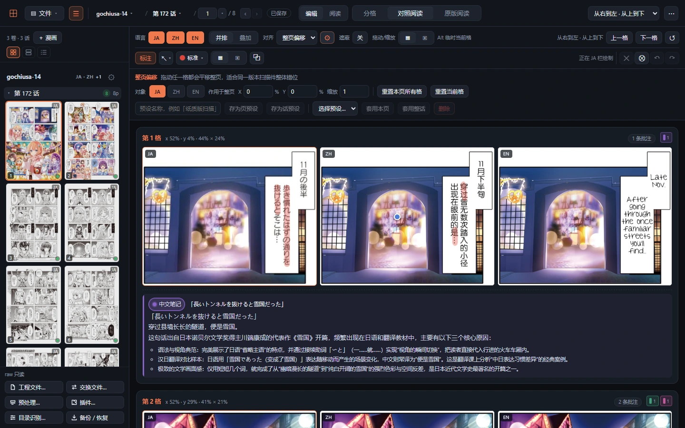

# 对照阅读

对照阅读把两种或更多语言中的同一个分格并排放在一起——或叠放在一起——并让你把画面对齐，让对照真正可信。

<figure class="shot">
  
  <figcaption>三语并排模式。每种语言各占一栏；对齐按页面保存，并会应用在导出中。</figcaption>
</figure>

## 它解决什么问题

同一本书的两个版本，画面很少能严丝合缝：生肉和熟肉之间总有偏移、裁切或缩放差异。整页对看会掩盖细微差别。**逐格对照**，并让每种语言独立对齐，才能看清措辞、语气和省略。

## 布局

| 控件 | 行为 |
| --- | --- |
| **语言标签**（`JA`、`ZH`、`EN`……） | 开启或关闭某种语言。本页缺失的语言会被禁用并显示提示。 |
| 拖动标签 | 调整各栏顺序。顺序会被记住。 |
| `↺` | 恢复图库的语言顺序。 |
| **并排** | 每种选中语言一列。窄窗口中各栏纵向堆叠。 |
| **叠加** | 所有选中语言画在同一个框内。 |
| **正片叠底**（仅叠加） | 图层相乘，让线稿透出来。 |
| **对齐对象** 标签（仅叠加） | 选择你正在拖动的语言，避免两栏同时移动。 |

## 遮蔽

遮蔽会盖住某种语言的画面，方便你检验自己的理解——相当于把答案盖住的自我测验。

| 控件 | 行为 |
| --- | --- |
| **遮蔽：开 / 关** | 总开关。`H` 切换；`Shift+H` 全部显示。 |
| 各语言的 `◐` / `◯` 标签 | 选择遮蔽哪些语言。 |
| **遮蔽样式** | **模糊** 或 **色块**。 |
| **全遮** | 重新遮蔽当前所有可见栏。 |
| **全显** | 关闭总开关。 |
| **默认…** | 记住哪些语言默认遮蔽，跨会话生效。 |
| 点击已遮蔽的栏 | 临时显示；再次点击画面可重新遮蔽。 |

遮蔽只是**阅读偏好**。HTML 和 PNG 导出永远不会包含遮蔽。遮蔽默认值保存在浏览器中，不在页面 JSON 里。

<figure class="shot">
  
  <figcaption>遮蔽中文和英文后的对照阅读。默认遮蔽会记住哪些语言一进来就遮住；点击被遮住的栏可以临时显示。</figcaption>
</figure>

## 缩放、平移与作用域

- 在某一栏上**滚轮**会缩放该语言。滚轮只在指针停在栏内时生效，所以页面其他地方的滚动照常。
- **拖动**某一栏可平移。
- **拖动/缩放**作用域有两种模式：**整页** 和 **当前格**。
- 按住 `Alt` 拖动或滚轮，只调整当前格，无论默认作用域是什么。
- **上一格 / 下一格** 按阅读顺序移动焦点分格。走到本页第一格再往前、或最后一格再往后，会翻到相邻页并选中该页的最后一格 / 第一格；被预处理排除的页会跳过，话的边界也会继续。到了整卷开头或结尾则不再移动，有未保存改动时仍会先按保存模式确认。
- **全部复位** 清除当前作用域内的偏移。

每种语言有 `{ x, y, scale }`。`x` 和 `y` 是分格宽高的比例；`scale` 在 0.5× 到 3× 之间缩放裁切区域。

### 自动居中

选中的分格变化时——上一格 / 下一格、键盘快捷键、从侧栏或笔记总览跳转、跨页翻格——对照阅读会把目标分格滚进视野。

- 分格放得下就居中；比视口还高时，把它的上边缘带进来并留一点间距，第一行画面不会被切掉。
- 已经完整可见的分格不动。每次切换选中都强行拉扯页面会很烦，所以一旦你手动滚动，它就不再抢。
- 跨页跳转时，等新页渲染完成再对齐。
- 滚动尊重系统的「减少动态效果」设置；开启时改为瞬间跳转。

## 对齐模式

对齐保存在页面 JSON 中，永远不会烘焙进图片。

| 模式 | 行为 | 适用 |
| --- | --- | --- |
| **整页偏移** | 拖动任意分格都会平移该语言的整页。 | 整份扫描件存在相同偏移。 |
| **逐格偏移** | 每个分格有自己的偏移。 | 电子版与纸质版的分格位置不同。 |
| **锚点对齐** | 先在参考语言上点一个特征点，再在另一种语言上点同一点；偏移自动算出。 | 精确、可重复地对齐某个细节。 |
| **网格吸附** | 拖动时吸附到 0.5%、1%、2% 或 5% 的步长。 | 需要整齐、可复现的数值偏移。 |

锚点模式会显示一条提示，说明参考语言。先在任意一格点一个特征点，再在另一格点同一位置。**取消取点** 清除待定锚点。待定的锚点不会保存。

<figure class="shot">
  
  <figcaption>第一步：选 **锚点对齐** 后，在参考语言上点一个特征点；提示会显示待定锚点，**取消取点** 可随时清除。</figcaption>
</figure>

<figure class="shot">
  
  <figcaption>第二步：在目标语言点同一位置，X / Y 立即算出（图中为 -1.62% / -1.69%），可以继续微调或直接存成预设。</figcaption>
</figure>

### 对齐设置

**对齐设置** 会打开一个面板，包含：

- **目标**语言标签。
- 所选目标的确切 **X**、**Y** 和 **缩放** 输入框。
- **重置本页所有格** —— 清除逐格偏移；整页偏移不受影响。
- **重置当前格** —— 只清除所选分格的逐格偏移。
- **存为页预设** / **存为话预设** —— 把当前对齐保存到 `data/presets/align.json`。
- 选择预设，然后 **套用本页** 或 **套用整话**；**删除** 移除预设。

预设记录对齐模式、偏移、逐格偏移和网格步长。整话共享同一偏移时，套用话预设是修复整话的最快方式。

<figure class="shot">
  
  <figcaption>对齐设置：选目标语言、直接输入精确数值，或把当前对齐存成页预设 / 话预设。</figcaption>
</figure>

## 对照阅读里的标注

标注工具栏在这里同样可用，而且比对生肉与熟肉的措辞差异，这里也是最快的地方。

- 新标注沿用与工作台相同的作用范围：选中分格后，下一条标注会落在该格内。
- 对照视图默认显示标注层，方便边对照边标记；用**标注**开关可以隐藏。
- 标注在各视图之间共享：在对照阅读里画的标记，会出现在切格工作台和导出结果中。
- `Esc` 退出当前工具，`Delete` 删除选中的标注。
- 选中一条标注后，工具栏的**锚点**会进入定位模式：单击画面放一个锚点，或拖出一个小框圈住区域；**清除锚点** 去掉定位。
- **引线** 默认开启，从标注连到锚点；文字和徽标在没有锚点时也会默认连到所属分格，旧数据同样有效。关掉开关就只保留标注本身。
- 锚点存在页面坐标里，平移、缩放、切换语言都跟着画面走；PNG、HTML 和 Word（烘焙标注）三条导出路径都会画出锚点标记和引线，和编辑器里看到的一致。

### 标注属于某一种语言

每条标注都带着「画在哪一栏」的语言标记。在日文栏画的箭头不会跑到中文或英文版本上，同一格可以分别为每种版本留下不同的标记。如果这个点针对的是整段内容，一个开关可以把它共享给所有语言。

这个区分是有意的：关于译者用词的笔记通常只对某一栏有意义，而圈住拟声词的框则应该到处都在。

### 右键菜单

在标注上右键会打开它自己的菜单：

- **删除** 这条标注。
- **颜色** —— 不重画也能换色。
- **复制到语言** —— 把标注按原坐标复制到另一栏。

<figure class="shot">
  
  <figcaption>标注的右键菜单：删除、改色，或把这条标注按原坐标复制到另一种语言。复制后两栏各有一条独立标注。</figcaption>
</figure>

在空白画面上右键则是窗格菜单：**放大看图**、隐藏该语言、遮蔽该语言、只看该语言、显示全部语言、复位该栏缩放、把这一格导出为 PNG、复制分格坐标、设置分格编号、显示 / 隐藏编号、插入链接。只读模式下同样可用，因为这些操作都不写盘。

## 实用的对照流程

1. 在 **对照阅读**（`C`）中打开页面。
2. 启用 `JA` + `ZH`（如有 `EN` 也启用），按你想要的阅读顺序排列。
3. 如果各版本的分格差异不同，选 **逐格偏移**；否则先用 **整页偏移**。
4. 拖动每种语言的栏，直到分格内容对齐。
5. 如果本话其余页面共享同一偏移，保存一个对齐预设。
6. 切到 **叠加** 并开启正片叠底，找出线稿或文字的差异。
7. 打开遮蔽自测，然后逐栏显示。

## 行为细节

- 导出时也会应用对齐偏移，因此导出的裁切结果与你看到的画面一致。
- 阅读器需要先有分格。页面没有分格时，会提示前往切格工作台。
- 切换页面会保留遮蔽偏好，但清除临时显示。
- 每一栏带有笔记数；在这里选中分格后，新建笔记会限定到共享笔记栏中的该分格。
- 缺失的语言显示占位，而不是空白栏。

<figure class="shot">
  
  <figcaption>对照工具栏：语言开关、遮蔽模式、并排 / 叠放、对齐范围，以及只拖动当前格的切换。</figcaption>
</figure>

## 格子详情

双击任意一行分格即可整幅打开。整行都是目标：语言列、带格号的行头，以及裁切框外的空白边距，都会打开同一个分格。编辑器、拖拽手柄、按钮和链接内部的点击会被排除；触屏布局上双击这一行效果相同。

- **页面布局** —— **自动**、**并排**（左画面、右笔记）或 **堆叠**（上画面、下笔记）。自动跟随窗口宽度；窗口太窄放不下两栏时，界面会说明并改为堆叠，而不是硬挤。
- **可拖分隔条** —— 两栏布局中间的分隔条可以拖动，聚焦后也能用方向键移动。选择的比例会跨分格、跨页、刷新后记住。
- **语言栏方向** —— **横向**把各语言并排，**纵向**让它们各占一整行，窄窗口或竖屏时更好用。选择会被记住，窗口过窄时自动回落到纵向。
- **拖动画面对齐** —— 直接拖动画面就能微调该语言的偏移。**同步移动**关闭时只动你碰到的那一栏；打开时，拖一种语言，所有语言一起动。缩放跟随同一个开关，所以「全部放大 10%」只需一次拖动或一次点击。
- **精确数值** —— 对齐抽屉仍提供每种语言的 `Δx` / `Δy`、1% 方向微调、缩放 − / + 和逐栏复位，以及 **全部复位**。
- 这些详情页调整只在当前会话有效，不会写回页面或已保存的对齐。
- **缩放** —— 在画面上滚轮或双指缩放会缩放指针所在的语言；标题栏有缩放按钮和 **适合宽度**，**复位** 一次清空缩放和所有 Δ。
- 下方窗格中的笔记栏与侧栏使用同一个编辑器，直接写入这一格；切格、翻页或返回前会先落盘草稿。
- **导航条** —— 详情页底部工具条在滚动区之外，不会盖住画面或笔记：左侧是上一页、上一格，右侧是下一格、下一页。桌面端显示文字，窄屏收为图标并带提示。到本页边界时，上一格会跳到上一页最后一格，下一格会进入下一页第一格；详情页保持打开，URL 同步为新页 + 新格。
- **退出** —— `Esc`、**返回** 按钮和浏览器后退都会回到原来的页面与分格。URL 是深链（`…/compare/panel/<id>`），刷新或分享后仍打开同一格；按住 `Alt` / `Cmd` 点击行会在新标签页打开。

<figure class="shot">
  
  <figcaption>格子详情页：画面与这一格的笔记同屏。顶部可切换布局、打开对齐抽屉或复位视图；底部导航条在滚动区之外，不会盖住画面。</figcaption>
</figure>

<figure class="shot">
  
  <figcaption>专注模式（`R`）下的对照阅读：界面全部收起，只留画布与分格。进入时会短暂提示退出方式，按 `Esc` 或再按 `R` 返回。</figcaption>
</figure>

## 放大看图

在窗格上右键选择 **放大看图**（详情页的窗格菜单里也有同一条命令），就能不离开阅读器地检查画面。

- 按原始分辨率显示，滚轮缩放、拖动平移，适合核对一个字、一处网点或修图接缝。
- 在查看器里可以 **切换语言**，对照同一时刻的不同版本，不必关掉重开。
- **上一格 / 下一格** 按阅读顺序移动，可以快速检查一整页的小字。
- 按 `Esc` 或点击遮罩关闭。页面保持原来的缩放、滚动位置和正在编辑的笔记草稿；「看」这个动作本身不保存也不修改任何内容。
- 只读模式下同样可用，因为它从不写盘。

<figure class="shot">
  
  <figcaption>放大看图：按原始分辨率检查一个字、网点或修图接缝；可切换语言、翻到上一格 / 下一格。只读模式下也能用。</figcaption>
</figure>

## 原版阅读

**原版阅读**（`O`）把每种可用语言未裁切的整页并排显示，滚轮缩放范围 0.5×–6×，可拖动平移，并沿用同样的按语言遮蔽。要检查分格框之外的内容时用它。

- **联动 / 独立** —— 原版视图工具栏上的开关决定平移和缩放是否共享。**联动**时，拖动或缩放任意一栏，会把相同的相对位置和缩放应用到所有语言栏；每一栏再按自己的显示尺寸换算这些比例，所以页面尺寸不同也能对齐。**独立**时每一栏各看各的。
- 打开联动会采用第一栏当前的视图，并套用到其余各栏。
- 这个状态按浏览器记在 `localStorage`（`manga-memo.original-linked`）里，默认开启；只有显示两种及以上语言时才有意义。

<figure class="shot">
  
  <figcaption>原版阅读（`O`）：未裁切的整页并排；工具栏的 **联动 / 独立** 决定平移和缩放是否共享给所有语言栏。</figcaption>
</figure>

## 常见坑

- **“这一页还没有分格。”** 到 **分格**（`P`）运行 **自动切格**，然后返回。
- **我拖动时其他语言也跟着动。** 叠加模式下检查 **对齐对象** 标签；只有选中的语言会被拖动。
- **缩放漂移了。** 逐格缩放和逐格偏移与整页值分开存储。如果测试用的缩放没复位，重置当前格。
- **滚动时画面乱跳。** 滚轮只在指针停在栏内时生效；把指针移到页面边缘就能正常滚动。
- **截图里出现了遮蔽。** 遮蔽是界面偏好，不属于导出内容，但普通屏幕截图会带上它。
- **某个标签是灰的。** 该语言在本页没有图片。检查图库警告或卷的语言映射。

## 相关

- [切格工作台](/zh/guide/panels) —— 必须先有分格。
- [笔记](/zh/guide/notes) —— 把观察记下来。
- [远端存储与备份](/zh/guide/remote) —— 图片未缓存在本地时的行为。
