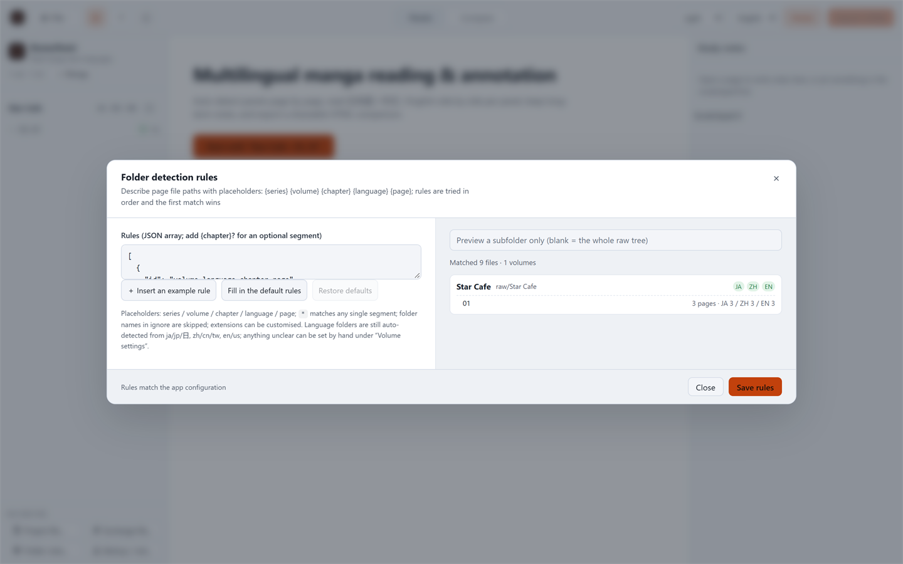

# 目录识别规则

目录识别规则用来描述卷、语言、话和页面分别位于路径的哪一层。它专门伺候那些不肯乖乖排成默认 `raw/<卷>/<语言>/<话>/<页面>`（或并列多部作品的 `raw/<作品>/<卷>/<语言>/<话>/<页面>`）的图库。

## 这一步解决什么问题

真实的收藏很少整齐划一：有的系列多一层作者目录，有的出版社把语言放在最后，只有一种语言的合集干脆没有语言文件夹。为此重命名上千个文件是下策。规则让你直接描述现有的目录形状，而不必迁就默认结构。

<figure class="shot">
  
  <figcaption>规则对话框：左边编辑规则数组，右边预览某个子树，最后保存。底部会说明当前规则是否与正在运行的配置一致。</figcaption>
</figure>

## 使用对话框

1. 在图库侧栏底部打开**目录识别规则…**。
2. 编辑 JSON 规则数组。**＋ 插入示例规则**会给一个起点；**填入默认规则**可以恢复内置结构。
3. 在**只预览子目录**里填一个子文件夹，只测试一个分支；留空则扫描整个 `raw/`。
4. 检查**匹配 n 个文件 · m 卷**、未识别文件列表，以及每话下列出的页面。
5. 点击**保存规则**，图库会按新规则重新扫描。

预览会随输入实时更新。**恢复默认**会丢弃你的修改；只有**保存规则**才会真正改变图库。

## 占位符

| 占位符 | 别名 | 含义 |
| --- | --- | --- |
| `{series}` | `{seriesName}`、`{work}` | 卷之上的系列层；只有确实存在这一层时才写。 |
| `{volume}` | `{vol}`、`{book}` | 侧栏里显示的卷。 |
| `{chapter}` | `{chap}`、`{ch}`、`{episode}` | 话文件夹。 |
| `{language}` | `{lang}`、`{locale}` | 能识别为语言的文件夹：内置别名（如 `ja`、`zh-cn`），或在卷设置里映射过的目录。 |
| `{page}` | `{file}`、`{image}`、`{img}` | 图片文件。每条规则都必须有。 |

所有平台上的匹配都不区分大小写，所以从 Windows 上抄来的规则换到别的系统仍然能用。

### 可选段与通配符

| 写法 | 行为 |
| --- | --- |
| `{chapter}?` | 这一段可以不存在。`{volume}/{language}/{chapter}?/{page}` 同时匹配有话目录和没有话目录的情况。 |
| `*` 或 `**` | 只匹配一个你不关心的路径段。两种写法行为相同。 |
| 普通文字 | 必须与文件夹名完全一致，例如 `manga/{volume}/…` 里的 `manga`。 |

规则必须包含 `{page}`。除非规则里写了回退的 `language`，否则也必须包含 `{language}`。

## 一条规则的结构

```json
[
  {
    "id": "series-volume-language-chapter-page",
    "name": "系列 / 卷 / 语言 / 话 / 页面",
    "pattern": "{series}/{volume}/{language}/{chapter}?/{page}",
    "ignore": ["_extras", "covers"],
    "extensions": [".jpg", ".jpeg", ".png"]
  },
  {
    "id": "flat-japanese",
    "name": "扁平目录，仅日文",
    "pattern": "{volume}/{chapter}/{page}",
    "language": "ja"
  }
]
```

| 字段 | 必填 | 含义 |
| --- | --- | --- |
| `id` | 否 | 稳定标识，省略时自动生成；重复的 id 会被拒绝。 |
| `name` | 否 | 对话框里显示的名称。 |
| `pattern` | 是 | 用斜杠分隔、含占位符的路径。 |
| `ignore` | 否 | 永不进入的文件夹名。 |
| `extensions` | 否 | 接受的文件扩展名，可带或不带前导点；默认 `.jpg`、`.jpeg`、`.png`、`.webp`、`.gif`、`.avif`、`.bmp`。 |
| `language` | 否 | 没有 `{language}` 时的回退语言；写语言 id，例如 `ja`、`zh`、`en`。 |
| `enabled` | 否 | 设为 `false` 可保留规则但不启用。 |

## 顺序、语言与冲突

- 规则**按顺序尝试**，第一条匹配的生效。最具体的规则要放在前面。
- `{language}` 段里的文件夹名仍会按别名识别，例如 `ja`、`jp`、`日本語`、`zh-cn`、`cn`、`english`，或在卷设置里映射过的目录。见[图库与导入](/zh/guide/gallery#语言目录名)。
- 没有 `{language}` 段时，该规则匹配到的页面都使用规则里的 `language`。
- 不匹配任何已启用规则的文件会出现在**未识别**列表里，不会进入图库。
- 规则只影响识别，绝不会重命名、移动、复制或转换文件。

## 多个作品并列的根目录

默认规则同时覆盖两种布局，按顺序尝试：

1. `{volume}/{language}/{chapter}/{page}` —— 卷直接在 `raw/` 下；
2. `{series}/{volume}/{language}/{chapter}/{page}` —— 卷上面还有一部作品。

所以下面这种根目录不需要额外配置就能扫出来：

```text
raw/
  vol-01/ja/172/001.jpg          # 单层卷，走第一条规则
  alpha/vol-01/ja/172/001.jpg    # 作品 alpha 的 vol-01
  beta/vol-01/ja/172/001.jpg     # 另一部作品里的同名卷
```

- 作品名可以比一层更深：`raw/collection/alpha/vol-01/ja/172/001.jpg` 里 `collection/alpha` 会一起算作系列名，`{series}` 会吸收连续目录，直到剩下的段刚好凑齐卷、语言、话和页面。
- 侧栏把系列和卷拼成「系列 · 卷」显示。卷 ID 仍是一个目录名，页面数据写在 `data/pages/<卷 ID>/<话>/...`。两部作品都有 `vol-01` 时，会分别变成 `alpha-vol-01` 和 `beta-vol-01`；如果 `raw/` 下另有一个平铺的 `vol-01`，平铺的那个保留原名，只给带系列的同名卷加前缀。
- 卷设置与预处理按 `raw/<卷 ID>` 定位目录。直接嵌套在 `raw` 里的系列卷没有这个顶层目录，所以这两项对它们不生效。需要修语言映射或批量预处理时，用**添加漫画**选择作品或系列文件夹：工具会为每个卷在 `raw/` 根建立链接，并把系列名记进 `data/library.json`，链接出来的卷可以使用全部卷级功能。

**没有话目录的多作品结构。** 默认两条规则都要求 `{chapter}` 层。`raw/alpha/vol-01/ja/001.jpg` 这种「作品 / 卷 / 语言 / 图片」四层目录会落进未识别列表，因为少了一层话，两条规则都对不上。加一条规则即可：

```json
{ "id": "series-volume-language-page", "pattern": "{series}/{volume}/{language}/{page}" }
```

或者把话层标成可选：`{series}/{volume}/{language}/{chapter}?/{page}`。

## 什么时候会破坏已有工作

页面数据保存在 `data/pages/<卷>/<话>/<序号>.json`。修改规则可能改变识别出的卷 ID 或话 ID，已有的分格和笔记不会自动跟过去。新收藏请在标注**之前**应用规则；如果之后必须改，先做一份备份，再抽查几页。

## 常见坑

- **预览是空的。** 规则从扫描根目录开始整段匹配。把每一层都写进去，包括 `manga/` 这种固定目录。
- **有些话缺少必需的路径段。** 用 `?` 把它标成可选，或者为更扁平的结构再加一条规则。
- **所有页面都进了同一话。** 少了 `{chapter}` 占位符，或者它被通配符顶掉了。
- **某种语言没被识别。** 文件夹别名不认识；在[卷设置](/zh/guide/gallery#卷设置)里映射，或者给规则加 `language` 回退。
- **保存后卷列表变了。** 这是重新扫描的预期结果。写笔记前先看未识别列表。
- **两条规则同时匹配。** 第一条生效。把更具体的规则拖到前面。

## 相关

- [图库与导入](/zh/guide/gallery) —— 默认目录结构与卷设置。
- [预处理与重命名](/zh/guide/preprocess) —— 扫描前该整理什么。
- [数据格式](/zh/data-format) —— 卷和话的 ID 在页面数据里长什么样。
- [术语表](/zh/terminology) —— 分格、页面与标注的通用用词。
