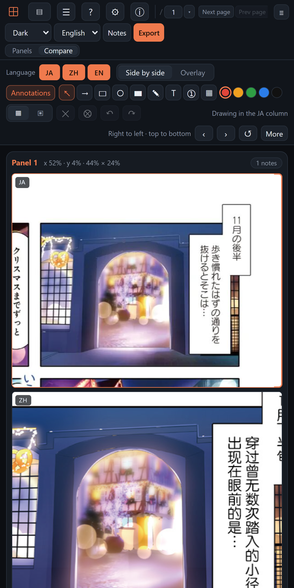
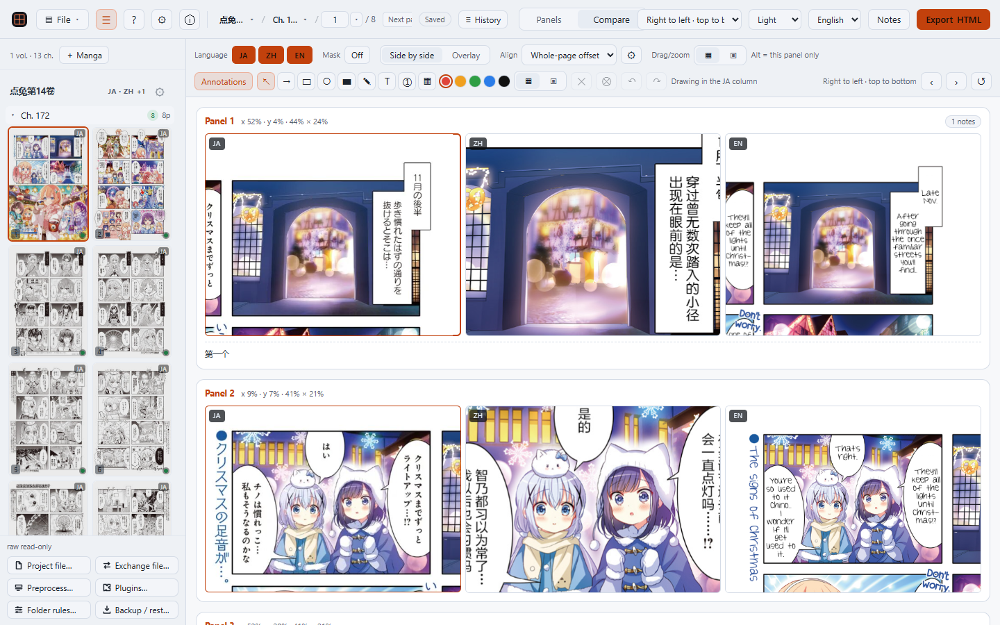

# 简介

KomaYomi（**Manga Learner**）是一个本地优先的网页应用，专门用来「一页漫画，几种语言一起看」。学日语时顺手对照熟肉、做汉化校对时拿生肉核原文、或者单纯想知道这句台词在各版里分别怎么翻——都用得上。它把页面切成一个个分格，把同一格在日/中/英三个版本里对齐，再让你把 Markdown 笔记钉在对应分格上：翻译吐槽、用词考据、生词、校对疑问，都行。

它不是随手翻漫画的阅读器，也不是分发平台。所有东西都跑在你自己机器上，只读你自己的图片文件夹。

## 它解决什么问题

学翻译，按分格逐格看比按整页啃有效得多。可同一本书的三份扫描件很少乖乖对齐：整页偏移、分格裁切不同、文字位置各有各的想法。普通看图软件只有一个缩放级别，没有笔记，也没法表达「这个对话框，在这三个版本里分别长啥样」。

KomaYomi 补的就是中间缺的那一层：

1. **结构** —— 分格检测后以归一化矩形保存，缩放、改窗口、换导出尺寸都不会把框弄丢。
2. **对齐** —— 每种语言都能单独微调，直到同一格真正重叠。对，终于能重叠。
3. **笔记** —— 每条记录都挂在某一页或某一格上，Markdown 写，带标签和来源。「先记在心里」从此不算计划。

## 五步工作流

| 步骤 | 你要做什么 | 页面 |
| --- | --- | --- |
| 1 | 把生肉、熟肉整理成 `raw/<volume>/<language>/<chapter>/01.jpg`，或者直接指向已有的文件夹。 | [预处理与重命名](/zh/guide/preprocess)、[图库与导入](/zh/guide/gallery) |
| 2 | 打开页面，让它自动切格，再手动修框。自动检测只是草稿，不是结论。 | [切格工作台](/zh/guide/panels) |
| 3 | 并排或叠加阅读 2–3 种语言，对齐画面，遮住正在自测的那一版。 | [对照阅读](/zh/guide/compare) |
| 4 | 写下整页笔记与格级笔记，带标签、来源和截图。翻译吐槽尤其欢迎。 | [笔记](/zh/guide/notes) |
| 5 | 导出学习用 HTML、用于幻灯片的 PNG，或带到另一台机器的工程包。 | [导出](/zh/guide/export) |

## 界面一览

<figure class="shot">
  
  <figcaption>切格工作台。顶栏：页面导航、分格 / 对照阅读、阅读顺序、主题、界面语言、笔记与导出。左侧：图库。右侧：笔记。中间：带分格框的页面——你大部分时间都会待在这儿。</figcaption>
</figure>

窗口有五个始终不变的区域，用熟了基本可以闭眼操作：

- **顶栏** —— 品牌（返回图库）、卷 / 话 / 页、`‹` `›` 翻页箭头、保存指示器、**分格 / 对照阅读** 切换、阅读方向选择器、界面主题、界面语言、**笔记** 与 **导出**。
- **图库侧栏**（`S`）—— 卷 → 话 → 页，带逐页警告，以及添加漫画、目录规则、工程文件、交换文件和备份的入口。
- **舞台** —— 切格工作台或对照阅读，取决于视图切换。
- **笔记栏**（`N`）—— 整页笔记、格级笔记、总览搜索和随手记暂存。
- **分隔条** —— 拖动图库与舞台之间、或舞台与笔记之间的竖向手柄调整宽度；双击恢复默认。

一页可以有一种、两种或三种语言。对照阅读里的语言标签只对当前页实际存在的语言亮起。

## 最初的十分钟

1. 启动应用（`npm run dev` 或桌面版），打开 `http://127.0.0.1:5173`。
2. 在 `raw/` 下放一卷，或点击侧栏的 **＋ 添加漫画**，指向已有文件夹。
3. 点击侧栏中的某一页。首次打开会自动检测分格，并把结果保存到 `data/pages/`。
4. 切换到 **对照阅读**（`C`），勾选 `JA` 和 `ZH`，拖动某一栏直到分格对齐。一次对一格，比跟整页较劲省力。
5. 打开 **笔记**（`N`），选中一个分格，写下第一条笔记。按 `Ctrl+Enter` 保存。
6. 按 `E` 导出 HTML 文件，在浏览器里打开看看。

## 已实现的功能

  
<strong>图库</strong> —— 扫描卷目录，识别语言目录别名，按排序位置配对页面，并对缺页和命名不一致给出警告。

  
<strong>分格</strong> —— 自动 XY-cut 检测，新增 / 移动 / 八向缩放 / 合并 / 分组 / 删除，编号，百分比输入，网格生成器，分格模板，声明式布局，插件，跨会话页面历史。

  
<strong>标注</strong> —— 箭头、矩形、椭圆、荧光笔、自由笔迹、文字、编号圆标和马赛克，页面级显示开关，支持 PNG 导出。

  
<strong>对照</strong> —— 2–3 种语言，并排或叠加，按语言模糊 / 色块遮蔽，滚轮缩放，平移，整页 / 逐格 / 锚点 / 网格对齐，已保存的预设，自定义语言顺序。

  
<strong>笔记</strong> —— 整页 / 格级笔记，带工具栏和实时预览的 Markdown，标签，来源，附图，总览搜索，复制给大模型，随手记暂存。

  
<strong>导出</strong> —— HTML（图片目录或单文件）、PNG（整页、当前格、三语拼图）、经浏览器打印对话框的 PDF、含页图与笔记的 Word（`.docx`）、分格边框叠加、打印样式、导出模板。

  
<strong>存储</strong> —— 本地文件夹、挂载的网络共享和 WebDAV，按需拉取图片并使用有上限的 LRU 缓存。

  
<strong>可移植性</strong> —— `.mnproj` 工程包，`.mntpl` / `.mnexp` / `.mnpage.json` 交换文件，备份与恢复 ZIP，带版本的 schema。

## 尚未实现的功能

以下内容在出现的位置都标记为 <Badge type="warning" text="计划中" />：

- 词表导出。PDF 与 Word 分别用导出对话框里的 **PDF（打印）** 和 **Word 文档**。
- 定时自动备份。
- 应用内的图片转换或批量重命名。请在导入前整理文件（见[预处理与重命名](/zh/guide/preprocess)）。
- 原生移动端应用。Web 界面在窄浏览器窗口里确实可用（见下文）。

<figure class="shot">
  
  <figcaption>窄窗口：各栏纵向堆叠，图库收起为抽屉。这是响应式 Web 布局，不是原生应用——但手机大小的屏幕也照样能用。</figcaption>
</figure>

## 亮色与暗色

界面主题默认跟随系统，也可以在顶栏固定为亮色或暗色。导出的 HTML 只有亮色，以保证截图和打印结果一致。

<figure class="shot">
  
  <figcaption>亮色主题。</figcaption>
</figure>

<figure class="shot">
  
  <figcaption>暗色主题。</figcaption>
</figure>

## 常见坑

- **图库里什么都没有。** 侧边栏只扫描 `raw/`；先添加文件夹或挂载远端目录。参见[图库与导入](/zh/guide/gallery)。
- **第一页分格是错的。** 自动检测只是草稿，不是结论。先修框再写格级笔记；之后重新检测会丢弃手动修改。
- **某个语言标签是灰的。** 这一页在该语言下没有图片。检查页数是否一致、卷的语言映射是否正确。
- **换机器后笔记好像没了。** 笔记在 `data/`，图片在 `raw/`；两者都要带走，或者导出 `.mnproj`。参见[工程文件与格式](/zh/guide/project-files)。
- **离线时图片请求失败。** 只有离线前打开过的页面在缓存里。参见[备份与远端](/zh/guide/remote)。

## 下一步

- 全新安装：[安装与运行](/zh/guide/installation)。
- 图片还没整理好：[预处理与重命名](/zh/guide/preprocess)。
- 准备添加图片：[图库与导入](/zh/guide/gallery)。
- 目录形状不常规：[目录识别规则](/zh/guide/folder-rules)。
- 想找某个按键：[快捷键总表](/zh/guide/shortcuts)。
- 遇到问题：[FAQ 与故障排查](/zh/faq)。
