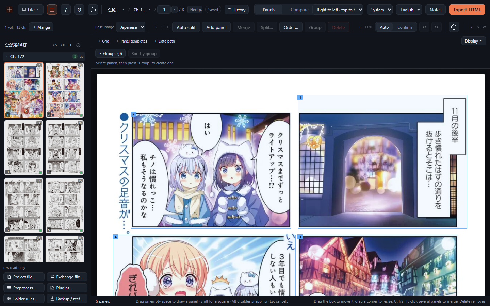
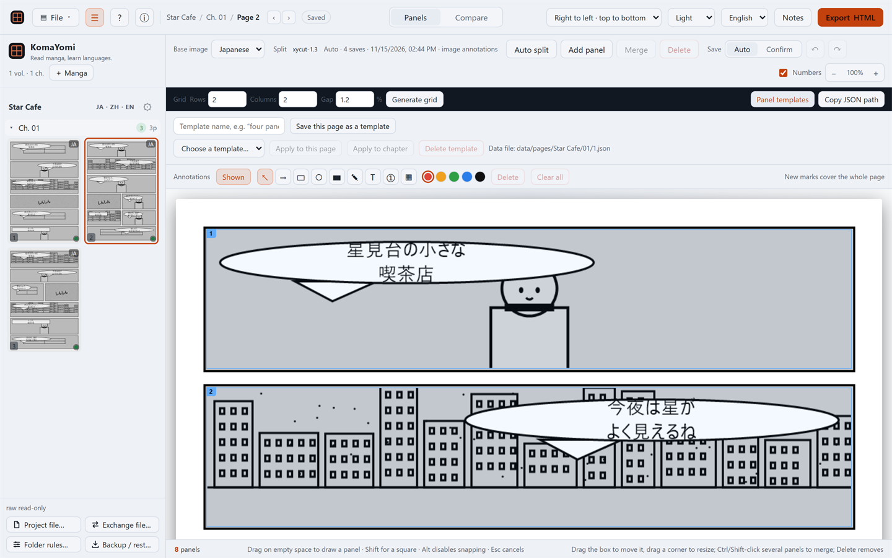
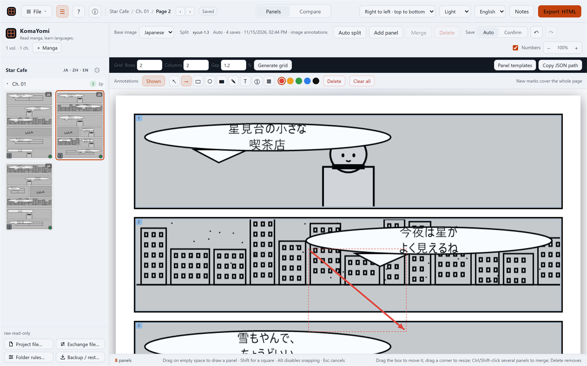
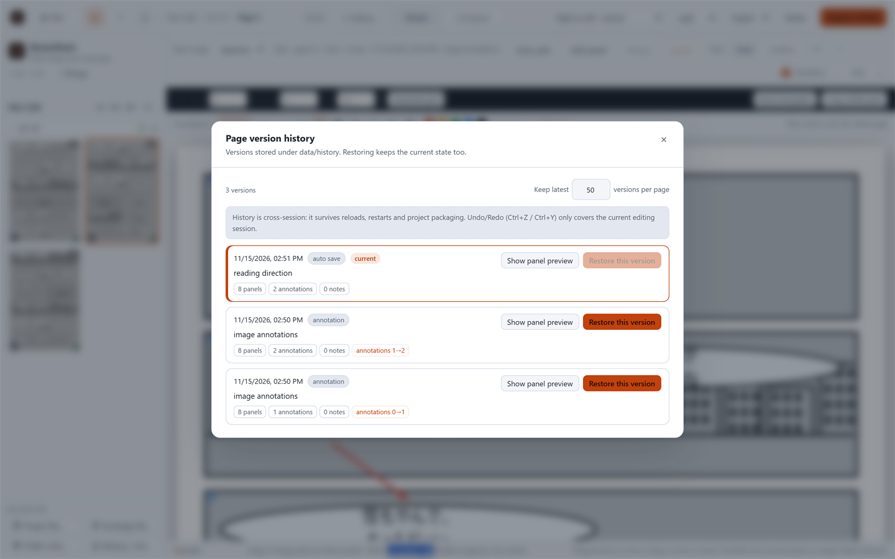

# 切格工作台

切格工作台是把一页变成结构化数据的地方。自动检测只是第一遍；工作台存在的意义，是让你能跟它讨价还价——而且要快，还不能把东西弄坏。

<figure class="shot">
  
  <figcaption>检测出的分格以带编号的方框画在底图上。选中的方框显示八个缩放手柄。标注工具栏位于分格工具下方。</figcaption>
</figure>

## 它解决什么问题

后面每项功能都站在分格上：对照阅读、格级笔记、PNG 单格导出、HTML 导出。框错了，后面全跟着错。自动检测大多数页面都够用，但扉页、跨页、边缘窄条，以及杂志那个月突然想玩的花样，总得人工搭把手。

## 工具栏逐项说明

<figure class="shot">
  
  <figcaption>两行工具栏：上面是检测与保存，下面是矩形数值、网格生成器和分格模板。标注工具栏再往下一行。</figcaption>
</figure>

### 第一行 —— 底图与切分

| 控件 | 作用 | 说明 |
| --- | --- | --- |
| **底图**选择器 | 选择显示哪种语言的画面，并用它做检测。 | 分格矩形由本页所有语言共用，所以这里只改变你画框所依据的图。 |
| 检测器标签 | 显示生成当前分格的算法版本，例如 `xycut-1.3`、`layout:<id>`、`plugin:<name>`。 | `旧数据` 表示该页 JSON 早于版本记录功能。 |
| 状态文本 | 显示分格是*自动*、*按模板*、*按插件*还是*手动改过*，以及保存次数和最后一次编辑摘要。 | 这是编辑计数器，不是审计日志。 |
| **自动切格** | 在底图上运行检测，并替换当前分格。 | 检测进行中或本页没有图片时不可用。重新检测会丢弃手动修改。 |
| **添加格子** | 在页面中部附近添加一个默认分格。 | 更快的替代方式：双击空白处。 |
| **合并 (n)** | 把选中的分格合并为一个框，`source: "merged"`。 | 选中两个及以上分格时可用。 |
| **分组 (n)** | 用选中的分格创建一个分组。 | 至少选中一个分格时可用。见[分组](#分组)。 |
| **删除** | 删除选中的分格以及它们的格级笔记。 | 等同于 `Delete` / `Backspace`。 |

### 第一行 —— 保存

| 控件 | 作用 |
| --- | --- |
| **自动** | 改动后约 0.7 秒自动保存。 |
| **确认** | 改动保持未保存，直到你点击 **✓** 或按 `Enter`。**×** 或 `Esc` 放弃并回到上次保存。 |
| `↶` / `↷` | 撤销 / 重做（`Ctrl+Z`、`Ctrl+Shift+Z`、`Ctrl+Y`）。 |
| **✓** | 保存当前页的改动（仅确认模式）。 |
| **×** | 放弃未保存的改动（仅确认模式）。 |
| **未保存**标记 | 确认模式下，页面有未保存改动时出现。 |
| **编号** | 显示或隐藏分格序号标记。 |

保存模式会记在浏览器中。顶栏始终显示当前状态：*已保存*、*保存中…*、*待保存* 或 *未保存改动*。

### 第一行 —— 缩放

`−` / 百分比 / `＋` 控件把舞台缩放从 50% 调到 300%，步进 15%。缩放只影响显示；分格坐标归一化到 `0..1`，不会改变。

### 第二行 —— 数值矩形

只选中一个分格时，第二行显示 **格子坐标**，含四个百分比输入框：

| 字段 | 含义 |
| --- | --- |
| `X` | 左边缘，占页宽的百分比。 |
| `Y` | 上边缘，占页高的百分比。 |
| `W` | 宽度，占页宽的百分比。 |
| `H` | 高度，占页高的百分比。 |

输入数值会立即更新分格。保存时，超出页面的数值会被限制回页面内。

### 第二行 —— 网格生成器

| 字段 | 范围 | 含义 |
| --- | --- | --- |
| **行** | 1–8 | 行数。 |
| **列** | 1–6 | 列数。 |
| **间距** | 0–8 % | 单元格之间的间隙，占页面的百分比。 |
| **生成网格** | — | 用均匀划分的网格替换当前分格。 |

固定杂志版式的一话可以用网格；版式完全重复时，用**分格模板**。

### 第二行 —— 模板与 JSON

**分格模板** 会记录当前页的矩形：

1. 打开 **分格模板**，输入名称，点击 **把当前页存为模板**。
2. 选择模板，然后 **套用本页** 或 **套用整话**。
3. 套用到整话时会要求确认，因为已有分格会被覆盖。

新页面的分格数与模板相同时，格级笔记会按阅读顺序重新映射。数量不同时，格级笔记会被丢弃，而不是悄悄挂到错误的分格上；整页笔记始终保留。模板保存在 `data/templates/panel.json`。

**复制 JSON 路径** 复制 `data/pages/<volume>/<chapter>/<index>.json`。支持手工编辑该文件；服务器在读取时会规范化矩形、修复缺失的 id，并丢弃悬空引用。

## 画布上的鼠标与键盘

| 操作 | 手势 |
| --- | --- |
| 移动分格 | 拖动框体。 |
| 缩放 | 拖动八个手柄之一。 |
| 快速添加分格 | 双击空白处。 |
| 精确框选分格 | 在空白处拖拽。 |
| 约束为正方形 | 拖拽时按住 `Shift`。 |
| 关闭吸附 | 拖拽或绘制时按住 `Alt`。 |
| 取消当前框 | `Esc`。 |
| 多选 | `Ctrl` 点击或 `Shift` 点击方框。 |
| 微调 | 方向键移动选中项 0.2%；`Shift` + 方向键移动 1%。 |
| 删除 | `Delete` 或 `Backspace`。 |
| 保存 / 放弃（确认模式） | `Enter` / `Esc`。 |

所有坐标都以页面为基准归一化，因此分格在任何缩放级别或导出分辨率下位置都不变。

## 编号与阅读方向

- **编号** 切换序号标记。
- 阅读方向按页面存储，共有七种取值：`rtl`、`ltr`、`ttb`、`horizontal-rl`、`horizontal-lr`、`vertical-rl`、`vertical-lr`。前三个是横排与竖排形式的旧名。在顶栏修改。
- 分格可以带显式的 `number`，覆盖自动阅读顺序；否则编号由矩形和阅读方向推导。
- 同一顺序也驱动对照阅读、笔记总览和 HTML 导出。

::: tip 先定阅读顺序
还没动手就觉得编号不对？先改阅读方向选择器。在 JSON 里手工重新编号也行，但改方向能一次修好整话的所有页面。
:::

## 标注工具

标注图层画在画面之上，与分格分开存储——把它当成你的红笔，不属于页面几何。

<figure class="shot">
  
  <figcaption>标注工具栏。右侧提示当前作用范围——这里是“新标注覆盖整页”。对照阅读里也会出现同一套工具。</figcaption>
</figure>

| 控件 | 作用 |
| --- | --- |
| **标注：显示中 / 已隐藏** | 全局可见性。隐藏会保留数据，并在导出中隐藏。 |
| **选择与移动** | 选中已有标注；拖动可移动。 |
| **箭头** | 从尾部拖到头部。 |
| **矩形** / **椭圆** | 拖出方框或椭圆。 |
| **荧光笔** | 半透明自由笔迹。 |
| **自由笔迹** | 不透明笔迹；保留完整折线。 |
| **文字** | 点击后输入文字。 |
| **编号圆标** | 点击后输入编号。 |
| **马赛克** | 拖出矩形；该区域被像素化。 |
| **颜色样块** | 设置新标注的颜色；选中标注时点击样块可为它改色。 |
| **删除** | 删除选中的标注。 |
| **清空** | 确认后删除本页所有标注。 |

作用范围跟随选择：选中一个分格时，提示为*新标注画在格 N 内*；没有选中时，*新标注作用于整页*。`Esc` 退出当前工具或取消选中标注。

只有标注图层显示时，导出的 HTML 和 PNG 才包含标注。HTML 导出还有一个 **在原图上标出格子边框** 选项，它与标注无关。

## 分组

分组是一组应当作为一个整体来读的分格：拆成两个框的跨页、反复出现的全景镜头，或者你想放在一起讨论的一段连续画面。分组只是版式信息，不会合并画面、搬动笔记或改变标注。

### 创建分组

1. 选中一个或多个分格：`Ctrl` 点击、`Shift` 点击，或在空白处拖出选框。
2. 点击第一行的**成组**。
3. 新分组会出现在**分组（n）**面板里。给它起名并选一个颜色。

创建分组会把分格从之前的分组里移走，因此分组之间不会重叠。

### 编辑分组

| 控件 | 作用 |
| --- | --- |
| 颜色样块 | 给该分组的分格边框和标签上色。 |
| 名称输入框 | 自由文本；默认是*组 n*。 |
| 编号标签 | 组内的分格。拖动标签可调整组内顺序。 |
| 标签上的 `×` | 把该分格移出分组；分格本身仍留在页面上。 |
| **并入上一组** | 把本组的分格追加到上一组。第一组不可用。 |
| **拆分** | 把多格分组拆成每格一组。 |
| **删除** | 只删除分组；分格、笔记和标注都保留。 |

分组标题栏的**按组排序**会按每组第一个分格的阅读位置重新编号整页。这会改变分格编号，请有意识地使用；导出和对照阅读都遵循同一顺序。

分组以 `groups: [{ id, name, panelIds, number, color }]` 保存在页面 JSON 中，并随交换文件、工程包和备份一起迁移。

## 页面历史

每次保存还会向 `data/history/<卷>/<话>/<页>.json` 追加一个版本。与当前会话内的撤销栈不同，页面历史在刷新、重启和打包工程之后仍然存在——模板把分格吃掉时，它就是你的安全网。

1. 打开一页。
2. 点击顶栏的 **≡ 历史**。
3. 选中一个版本查看，确认无误后点击**恢复到此版本**。

<figure class="shot">
  
  <figcaption>页面版本历史。每一行记录版本产生的原因和结构变化；当前版本会被标出，且不能覆盖自身恢复。</figcaption>
</figure>

| 控件 | 作用 |
| --- | --- |
| 版本行 | 时间、来源标签，以及与上一版的结构差异。 |
| 来源标签 | *自动保存*、*手动保存*、*批量*、*模板套用*、*对齐*、*标注*、*导入*、*恢复*、*自动切格*。 |
| 数量 | 该版本的分格、标注和笔记数量。 |
| **展开框图预览** | 把此版本的分格矩形与上一版对比。 |
| **每页保留最近 n 个版本** | 历史上限，默认 50。更旧的版本会在下次保存时清理。 |
| **恢复到此版本** | 先把当前状态保存为新版本，再恢复选中的版本。 |
| **撤销恢复** | 回到上一次恢复之前的状态。 |

恢复不等于撤销：它会写入一个新版本，所以被你恢复掉的那个状态仍然留在列表里。历史文件会进入备份和工程包，清理缩略图缓存不会删除它们。

## 安全的修正流程

1. 打开页面，让自动检测运行。
2. 修正明显的框：移动、缩放、添加、删除。
3. 合并跨页大图的分格。
4. 保存（确认模式下按 `✓`）。
5. 切换到 **对照阅读**（`C`），确认同一个分格确实包含同一块画面。

手动改过之后，除非愿意丢失修改，否则不要再运行 **自动切格**。

## 常见坑

- **自动切格替换了我的框。** 检测会覆盖。第一次切分成功后，改用分格模板或手工编辑。
- **页面没有图片。** 检测被禁用，舞台显示空状态。补上缺失的语言文件夹，或在卷设置里映射。
- **WebP 页面检测不了。** WebP 可以显示，但不会解码用于检测；请转成 JPEG 或 PNG。
- **套用模板后格级笔记不见了。** 模板的分格数不同，格级笔记被丢弃；整页笔记保留。需要时从备份恢复。
- **“未保存改动”一直不消失。** 你处于确认模式。按 `✓` 或 `Enter`；`×` 放弃。
- **标注看不见。** 标注图层被隐藏，或分格筛选处于激活状态。检查 **标注：显示中**。
- **分组之后编号变了。** **按组排序**会重写阅读顺序。可以撤销，或者先建分组再写格级笔记。
- **恢复版本后较新的笔记没了。** 恢复会替换整页。被替换掉的状态仍保留为一个版本，可以用**撤销恢复**，或再恢复那个版本。

## 缺失的截图

| 图 | 用于 |
| --- | --- |
| 分组面板特写 | 颜色、组名、编号标签与分组操作 |
| 分格模板面板 | 模板保存 / 套用控件 |

## 相关

- [对照阅读](/zh/guide/compare) —— 分格是用来做什么的。
- [工程文件与格式](/zh/guide/project-files) —— 历史和分组怎样打包。
- [数据格式](/zh/data-format) —— 页面 JSON 的约定。
- [键盘快捷键](/zh/guide/shortcuts) —— 所有按键集中在一张表里。
