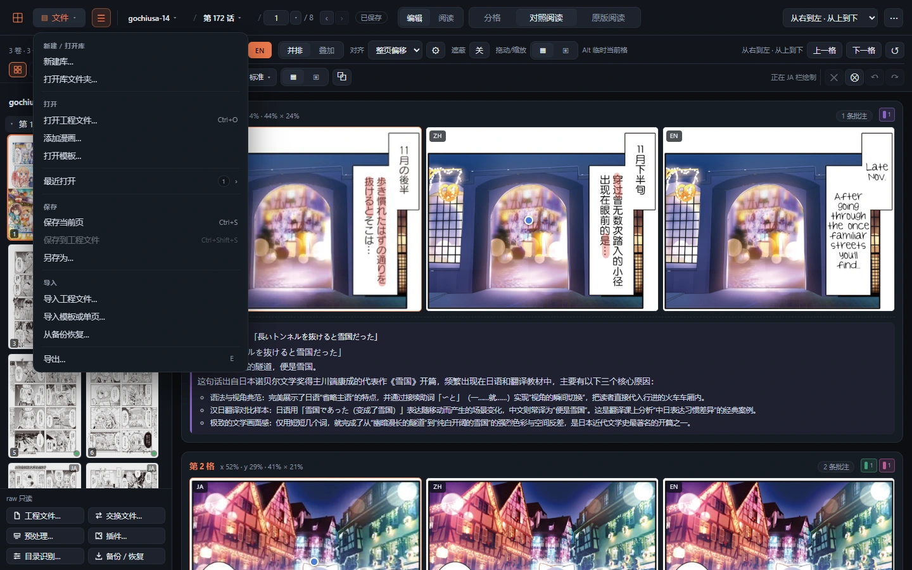

# 工程文件与格式

KomaYomi 存储的一切都是普通文件：图片在 `raw/`，标注在 `data/`，生成结果在 `exports/`。`.mnproj` 是工作容器：打开它就与图库链接，之后保存写回同一个文件。本页介绍这条链接、把工作搬到别处的方式，以及让旧文件保持可读、而不是变成考古现场的版本规则。

## 它解决什么问题

标注是最昂贵的部分——数小时的分格修正、对齐和笔记。它们得扛住换机器、磁盘损坏、与学习伙伴共享，以及一次次版本升级。数据库备份是个黑盒；这里的格式就是普通 ZIP 和 JSON，拿常用工具就能打开检查。

## 三个可移植层

| 层 | 文件 | 内容 | 何时使用 |
| --- | --- | --- | --- |
| **工程包** | `.mnproj` | 图片（打包模式）、页面 JSON、模板、预设、语言映射 | 换到另一台机器，或归档已完成的卷。 |
| **交换文件** | `.mntpl`、`.mnexp`、`.mnpage.json` | 一个版式、一种导出样式，或一页 | 分享可复用的版式或单个已标注页面。 |
| **备份 ZIP** | `.zip` | 整个 `data/` 文件夹 | 误操作后恢复，或保留定期安全副本。 |

<figure class="shot">
  
  <figcaption>文件菜单把打开、保存写回已链接工程、另存副本、导入与从备份恢复集中在一起；旁边的保存状态可打开写回面板。</figcaption>
</figure>

## 工程包（`.mnproj`）

`.mnproj` 是一个带文本清单的 ZIP：

```text
manifest.json
pages/<volume>/<chapter>/<index>.json
history/<volume>/<chapter>/<index>.json
templates/...
presets/...
config/library.json          (optional)
assets/<sha1>.<ext>          (packaged mode only)
```

页面版本历史会随工程一起迁移，重新打开后仍能看到[切格工作台](/zh/guide/panels#页面历史)里描述的记录。

### 引用模式与打包模式

| 模式 | 图片 | 体积 | 可移植性 |
| --- | --- | --- | --- |
| **引用** | 清单中只记录路径与 SHA-1 哈希。 | 小。 | 需要原始图片文件夹。支持按哈希或文件名补链。 |
| **打包** | 去重后存入 `assets/<sha1>.<ext>`。 | 大。 | 自包含；导入时把图片写入 `raw/`。 |

### 保存写回已打开的文件

打开工程不是复制一份。图库会与那个 `.mnproj` 建立链接，之后每次保存都写回同一个文件——图片、页面 JSON、笔记、标注和模板都在里面。不需要再“重新导出工程”，也不会出现改到旧副本的情况。

- **文件 → 保存到工程文件** 会立即写回并跳过保存防抖。没有链接工程时该菜单项不可用（会写明原因），只读模式下同样不可用。
- 顶栏的保存状态就是写回面板。点开可以看到链接路径、上次写回时间、是否有编辑在排队、当前状态（已保存 / 写入中 / 失败）和失败原因，并提供 **立即写回**、**重试**；没有链接时引导使用 **另存为…**。只读模式下会说明不会写入磁盘。
- 写回失败会以不打断操作的方式提示；面板保留原因和重试按钮，临时占用或文件夹被移走都不会静默丢改动。

### 另存为副本

**文件 → 另存为…** 会把当前图库打包成一个新的 `.mnproj`，存到你选的位置。它绝不覆盖已链接的原文件：正在编辑 `vol-01.mnproj` 时，副本是另一个文件。

桌面端会打开系统保存对话框。浏览器里没有文件对话框，同一条命令会把图库打包后交给下载管理器——下载时可以顺便改名。对话框会先说明当前走的是桌面保存还是浏览器的下载兜底。

清单记录应用版本、创建时间、语言映射、卷 / 话 / 页清单与图片哈希，以及笔记和标注数量。

### 导入

1. **选择工程文件…**。写入任何内容之前，对话框会先汇总卷、话、页、笔记、标注、图片和模板。
2. 选择冲突策略：**覆盖**、**合并** 或 **跳过**。
   - **合并** 在传入页面缺少分格和标注时保留现有内容，并按 id 合并笔记，不删除已有笔记。
3. 引用模式工程缺少图片时，可选一个存放原图的 **补链目录**。
4. 点击 **导入**。

安全行为：

- 导入前会把当前 `data/` 快照到 `exports/`。
- 原工程文件备份到 `data/backups/projects/`。
- 导入后会列出缺失的图片；把它们放进补链目录，再用 **合并** 导入一次即可找回。

## 交换文件

**交换文件…** 负责三种小格式，不触碰整个图库。

### `.mntpl` —— 版式模板

导出时会剥离卷 / 话 / 页绑定，因此模板可以导入另一部漫画，再重新绑定到当前卷、话或页。导入对话框可以绑定，并可选立即套用；已有页面会先保存。

### `.mnexp` —— 导出模板

保存 HTML、Word 与打印文档的版式与样式设置。可以现在导出、以后导入。模板存储在 `data/templates/export.json`。

### `.mnpage.json` —— 单页

可读的页面文档，包含分格、笔记、标签、分组、标注和对齐偏移。没有 schema 外壳的旧页面 JSON 也能导入，并会自动迁移。

- **导出当前页** 写出当前页。
- **选择页面 JSON…** 然后 **覆盖当前页** 会替换所选页的分格、笔记和标注。
- 校验失败会报告确切的字段路径，绝不写入半成品数据。
- 原文件备份到 `data/backups/exchange/`。

::: warning 未保存的改动
如果页面有未保存的编辑，交换导出不会包含它们，页面导入也可能覆盖它们。请先保存——对话框会警告，但很容易点过去。
:::

## 格式版本

每种交换格式都带一个 schema 外壳：

```json
{
  "$schema": "https://manga-memo.dev/schemas/page.schema.json",
  "schemaVersion": 4,
  "appVersion": "1.1.0",
  "kind": "page"
}
```

| 类型 | 文件 | 当前版本 |
| --- | --- | --- |
| `mnproj` | `.mnproj` 清单 | **2** |
| `mntpl` | 版式模板 | **1** |
| `mnexp` | 导出模板 | **1** |
| `page` | 页面文档 | **4** |
| `mntp` | 分格模板（存储） | **1** |
| `mnalign` | 对齐预设（存储） | **1** |
| `mnlayout` | 声明式布局（存储） | **1** |
| `mnconfig` | 图库配置（存储） | **1** |
| `mnstorage` | 存储配置（存储） | **1** |

版本规则：

- 声明版本**高于**应用支持的文件会被拒绝，并给出明确提示：先升级应用。应用绝不猜测未来的格式。
- 缺失版本按 **v0** 处理，并在导入时迁移。早期的实验性清单（顶层 `images`、扁平的 `langDirs` 映射）会转换为当前结构。
- 缺失的可选字段用默认值填充；无效图片会被丢弃，而不是让整个导入失败。
- 读取页面 JSON 时会**规范化**：限制矩形范围、移除悬空的分组引用、生成缺失的 id；应用不认识的字段会原样保留，不会丢弃。
- 无法解析的页面 JSON 视为不存在；应用会重新检测并重建。

## 备份 ZIP

备份是一个 ZIP，条目以 `data/` 为前缀：

```text
data/pages/...
data/templates/...
data/presets/...
data/layouts/...
data/library.json
data/.backup-meta.json
```

排除：`data/cache/`（缩略图与远端缓存）、`.tmp` 文件和日志。恢复会覆盖同名文件，保留备份中没有的页面，并先写入快照。

## 定时备份

打开侧栏底部的 **备份 / 还原**（或文件菜单里的 **从备份还原…**），里面有**定时备份**一段：

- **启用定时备份** —— 默认关闭。
- **间隔（小时）** —— 1 到 168，默认 24。
- **保留份数** —— 1 到 50，默认 7。
- **保存** 把设置写进 `data/library.json`；**立即备份** 马上生成一份。

服务端每分钟检查一次（启动 5 秒后也会检查），距上次运行超过间隔就执行。每次运行写出 `exports/auto-backup-<时间戳>_000.zip`，内容与手动备份相同，然后删除超出**保留份数**的最旧自动备份；手动生成的 `backup-*.zip` 不会被清理。对话框会显示上次运行的时间、文件名、大小和失败原因；失败时接口返回 `ERR_AUTO_BACKUP_FAILED`，并带上底层原因。运行状态保存在 `data/cache/backup-schedule.json`，因此不会被下一次备份打包进去。定时任务只写本机 `exports/`；上传到远端备份目标仍需手动触发。

## 尚未实现

- **词表导出。** PDF 和 Word 分别用导出对话框里的 **PDF（打印）** 和 **Word 文档**。
- **应用内的图片格式转换。** 重命名与拆分已包含在[预处理](/zh/guide/preprocess)里；格式转换仍需在应用之外完成。

## 常见坑

- **引用模式的工程显示缺图。** 清单只存哈希和路径。使用补链目录，或下次用打包模式导出。
- **“Schema 版本过新。”** 文件来自更新的版本。请更新应用；不要手工修改 `schemaVersion`。
- **导入覆盖了更新的笔记。** **覆盖** 按设计就是破坏性的。拿不准时用 **合并**；虽然写入了快照，但恢复快照会替换当前数据。
- **版式模板没有出现。** 它绑定在当前的话 / 卷筛选上；检查导入对话框中的绑定。
- **`.mnpage.json` 导入后没有图片。** 页面数据从不包含图片；图片来自 `raw/` 或打包工程。

<figure class="shot">
  
  <figcaption>工程导入摘要：存储方式、清单计数、冲突处理、重新关联目录与“导入”按钮。</figcaption>
</figure>

## 缺失的截图

| 图 | 用于 |
| --- | --- |
| 工程导出表单 | 模式、名称与备注 |
| 交换文件对话框 | 三种文件类型 |

## 相关

- [数据格式](/zh/data-format) —— 完整的 JSON 字段参考。
- [导出](/zh/guide/export) —— HTML、Word、PDF 与 PNG 输出。
- [远端存储与备份](/zh/guide/remote) —— 备份目标。
